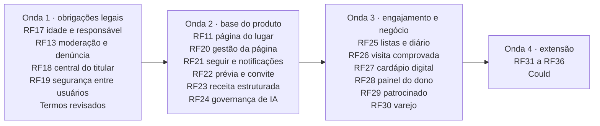

# Pesquisa de requisitos funcionais · Friendly Eats

Consolidação de quatro pesquisas feitas em 25/10/2026, cada uma num eixo. Juntas, elas somam **71 requisitos
candidatos (RC)**, todos com critérios de aceite, base legal, referências de mercado com links, prioridade MoSCoW e
esforço. Os arquivos completos estão em [`pesquisa/requisitos/`](pesquisa/requisitos/):

| Eixo | Arquivo | RCs |
|---|---|---|
| Comunidade, social e descoberta | [req-01-comunidade-descoberta.md](pesquisa/requisitos/req-01-comunidade-descoberta.md) | RC-COM-01 a 18 |
| Estabelecimento, dono e varejo | [req-02-estabelecimento-dono.md](pesquisa/requisitos/req-02-estabelecimento-dono.md) | RC-EST-01 a 17 |
| Confiança, segurança e conformidade legal | [req-03-confianca-legal.md](pesquisa/requisitos/req-03-confianca-legal.md) | RC-SEG-01 a 18 |
| Cozinha de casa, receitas e IA | [req-04-receitas-casa-ia.md](pesquisa/requisitos/req-04-receitas-casa-ia.md) | RC-REC-01 a 18 |

> ⚖️ **Não é parecer jurídico.** Os pontos marcados com ⚖️ nos arquivos e as obrigações abaixo precisam de validação
> com um advogado. O que as pesquisas não conseguiram confirmar na fonte original está marcado como *não verificado*.

> **Numeração provisória.** Os RFs abaixo (RF17 em diante) são propostas: só ganham pasta `docs/RFn/` quando forem
> aceitos e entrarem num PR, como manda o `CLAUDE.md`. Já criado: [RF17](RF17/README.md) (pendências na pasta).

## 1. O mais urgente: obrigações legais que o produto ainda não cumpre

Em ordem de risco (detalhes em [req-03](pesquisa/requisitos/req-03-confianca-legal.md#obrigações-legais-que-o-produto-ainda-não-cumpre-em-ordem-de-risco)):

1. **Verificação de idade para conteúdo de bebida alcoólica.** O ECA Digital (Lei 15.211/2025) está em vigor desde
   17/03/2026. Ele exige verificação **a cada acesso, sem autodeclaração** (art. 9º, §1º), e o Decreto 12.880/2026
   trata bebida alcoólica como conteúdo proibido a menores (art. 15, §1º, II). A rede social precisa ter uma versão
   sem esse conteúdo ou verificar a idade de forma efetiva (art. 19). Hoje o 18+ usa a data de nascimento declarada.
   A multa chega a 10% do faturamento ou R$ 50 milhões por infração (art. 35).
2. **Conta de menor de até 16 anos vinculada a um responsável**, com supervisão parental (ECA Digital, arts. 17, 18 e
   24). Hoje o cadastro só pede o **e-mail** do responsável.
3. **Canal de denúncia com retirada sem ordem judicial e direito de contestação** (ECA Digital, arts. 28 a 30;
   Decreto, arts. 41 a 44). Conteúdo de abuso sexual infantil vai à Polícia Federal.
4. **Registros de acesso por 6 meses, com IP recuperável e sob sigilo** (Marco Civil, art. 15; Decreto 8.771/2016,
   art. 13). Hoje o IP é guardado só como HMAC, e não há tabela de registros de acesso. Os Termos já prometem a
   guarda, então é preciso confirmar se algum log de infraestrutura cumpre isso.
5. **Sistema de notificações, devido processo e canal para não usuários.** Desde o julgamento do STF de 26 e
   27/06/2025 (Temas 987 e 533), o art. 19 do Marco Civil é parcialmente inconstitucional. A regra geral passou a
   ser a do art. 21: o provedor responde se não remover depois de notificado. A exceção são os crimes contra a honra.
   O resultado dos embargos de jun/2026 está *não verificado*.
6. **Política contra uso abusivo de denúncias** (ECA Digital, arts. 32 e 33).
7. **Encarregado (DPO) identificado em público** (LGPD, art. 41). Nos Termos, o campo `{{ENCARREGADO_NOME}}` ainda
   está sem preencher.
8. **Exportar meus dados e prazos de atendimento ao titular** (LGPD, arts. 18 e 19). Os Termos já prometem a
   exportação, mas ela segue pendente no RF5.
9. **Incidentes de segurança:** comunicação à ANPD e aos titulares em 3 dias úteis e registro de cada incidente por
   5 anos (LGPD, art. 48; Resolução CD/ANPD 15/2024).
10. **Avaliação de impacto à segurança da criança, com resumo público** (Decreto 12.880, art. 47). É um documento,
    não uma funcionalidade.
11. **Política contra intimidação sistemática virtual (cyberbullying), com apoio às vítimas** (ECA Digital, art. 6º,
    §2º; Lei 14.811/2024).
12. **Publicidade a menores sem perfilamento.** Falta conferir as travas para quem tem 16 e 17 anos.
13. **Relatório de transparência.** A tese do STF pede um relatório anual. O ECA Digital pede um semestral, mas só
    para quem tem mais de 1 milhão de usuários menores (art. 31).
14. **Acessibilidade digital** (Lei Brasileira de Inclusão, art. 63): o produto cumpre em parte.

O ECA Digital, art. 39, ajusta várias obrigações ao porte do serviço, o que pode aliviar um produto em lançamento ⚖️.

**Correções a fazer nos Termos de Uso** (`docs/legal/TERMOS_DE_USO.md`, o que exige uma nova `terms-version`):

- preencher o encarregado;
- trocar a menção ao "art. 19 do Marco Civil" como regra geral pelo regime fixado pelo STF;
- trocar o "sempre que possível" do recurso (§8) por um direito garantido, como pede o ECA Digital.

## 2. Achados que mudam premissas

| Achado | Efeito |
|---|---|
| A **Lei 14.016/2020 foi revogada** pela **Lei 15.224/2025** (Política Nacional de Combate à Perda e ao Desperdício de Alimentos). Ela permite doar alimento preparado (art. 14), mas a doação direta exige profissional habilitado. | A ponte para doação (RC-REC-09) segue a lei nova |
| A **TBCA (USP) não permite reprodução nem uso comercial**. A TACO (4ª ed., 2011) pode ser usada com citação, mas os dados são antigos. | Informação nutricional fica como Could |
| Pela norma da Anvisa (IN 75/2020, Anexo VII), a **xícara de chá tem 200 ml**, não 240 ml. A colher de sopa tem 10 ml. | A receita precisa dizer qual medida usa (RC-REC-01) |
| A **revisão humana de decisão automatizada não é obrigatória**: o veto ao art. 20, §3º, da LGPD foi mantido. | Revisão humana entra por política da casa (RC-REC-18, RC-SEG-02) |
| O **PL 2338/2023 (marco da IA) ainda não é lei**. A votação na Câmara ficou para depois das eleições de out/2026. | Rotular conteúdo de IA já, por boa prática |
| Preço afixado **na porta** de restaurantes e bares: a regra está no **Decreto 5.903/2006, art. 8º, §2º**, e não na Lei 10.962/2004. | Cobranças e preços declarados (RC-EST-05) |
| A **RDC 727/2022 vale para alimento embalado**. Prato servido no local fica fora; a taxonomia já dizia isso (seção 6.2). | Pesa nos produtos do varejo (RC-EST-16) |
| Rio de Janeiro (Lei 8.224/2023) e Contagem exigem **cardápio impresso** além do QR. Paraíba e Pernambuco exigem **braille**; em Pernambuco, o áudio vale como alternativa. | Cardápio acessível (RC-EST-07) |
| O **Q&A do Google Business Profile** foi desativado em nov/2025 (fonte secundária). | Perguntas e respostas no lugar ficou descartado |
| O Untappd **desligou as mensagens diretas** em 02/03/2026, por pouco uso e muito spam. | Sem DM no Friendly Eats (descartado) |
| O Yummly fechou em dez/2024, e as pessoas tiveram dificuldade para levar as receitas. | Exportar o caderno de receitas (RC-REC-04) |
| A **chave da NFC-e** (44 dígitos) traz o CNPJ do emitente, o ano e mês e o modelo da nota, e dá para validá-la sem chamar a SEFAZ. | Visita comprovada guardando só um hash da chave (RC-SEG-06) |
| **Não há conjunto de dados abertos de recolhimento de alimentos da Anvisa.** | O alerta sanitário depende da conta Oficial e das publicações oficiais (RC-SEG-18) |

## 3. Proposta de RFs

Os 71 RCs viram 20 RFs, entre os planejados (RF11 e RF13) e os novos (RF17 a RF36). A pesquisa de fontes de dados
acrescenta o RF37 (catálogo mundial de lugares). Os que se sobrepõem entre eixos
foram juntados: "Eu fiz" (COM-12) com "Fiz essa receita" (REC-04); visita comprovada (COM-05) com NFC-e (SEG-06);
contestação pelo dono (EST-14) com (SEG-08); e revisão humana (SEG-02) com governança de IA (REC-18).

| RF | Título | RCs | Prioridade | Obrigação legal? | Esforço |
|---|---|---|---|---|---|
| **[RF17](RF17/README.md)** ✅ criado | Verificação de idade e conta do responsável | SEG-13, SEG-14 | **Must** | Sim (ECA Digital) | G |
| **RF13** | Moderação: denúncia, decisão motivada, recurso e integridade das avaliações | SEG-01 a 05, SEG-07, SEG-08, EST-14 | **Must** | Sim (STF, ECA Digital, CDC) | G |
| **RF18** | Central do titular e conformidade (exportar dados, encarregado, registros de acesso, incidentes, transparência) | SEG-12, SEG-15, SEG-16, SEG-17 | **Must** | Sim (LGPD, Marco Civil) | G |
| **RF19** | Segurança entre usuários: bloquear, silenciar, palavras filtradas, desfoque de rosto e placa, direito autoral | SEG-09, SEG-10, SEG-11 | **Must** (menores) / Should | Em parte | M |
| **RF11** | Página do estabelecimento + horários e feriados, cobranças declaradas, botões de reserva, delivery e WhatsApp | EST-04, EST-05, EST-09 | **Must** | Em parte (Decreto 5.903, Lei 13.419) | M |
| **RF20** | Gestão da página: reivindicar e disputar a posse, equipe com papéis, marca e filiais | EST-01, EST-02, EST-03 | **Must** | Não | G |
| **RF21** | Seguir pessoas e lugares, feed "Seguindo" e preferências de notificação | COM-01, COM-09 | **Must** | Não | M |
| **RF22** | Prévia de link (Open Graph) e convite ou indicação sem recompensa financeira | COM-16, COM-17 | **Must** | Não | P |
| **RF23** | Receita estruturada: ingredientes, escala, medidas, modo cozinhar, schema.org, remix com crédito, "Eu fiz", substituições | REC-01 a 05, REC-13, COM-12 | **Must** | Não (direito autoral no remix) | G |
| **RF24** | Governança de IA (rótulo, revisão humana) e usos: classificação e texto alternativo pela foto, alergênicos sugeridos, busca natural, resumo de avaliações | REC-14 a 18 | **Must** (governança antes de qualquer IA) | Boa prática; PL 2338 | G |
| RF25 | Listas colaborativas, ranking pessoal por comparação e diário de visitas | COM-02, COM-03, COM-04 | Should | Não | M |
| RF26 | Visita comprovada sem guardar a localização (inclui a chave da NFC-e) | COM-05, SEG-06 | Should | Não | M |
| RF27 | Cardápio digital: por item com alergênicos, QR de mesa e porta, esgotado, cardápio acessível e impresso | EST-06, EST-07 (+ cardápio por item, pendente do RF9) | Should | Em parte (leis estaduais) | M |
| RF28 | Painel de métricas com privacidade e exportação dos dados do estabelecimento | EST-08, EST-15 | Should | Não | G |
| RF29 | Patrocinado separado do ranking e parceria paga rotulada | EST-17, COM-18 | Should, vira **Must antes do 1º anúncio** | Sim ao vender (CDC, CONAR, STF item 4) | G |
| RF30 | Varejo: catálogo da marca, "onde encontrar" e lista de compras | EST-16, REC-08 | Should | Em parte (RDC 727 nos embalados) | G |
| RF31 | Promoções com regulamento e programa de fidelidade | EST-11, EST-12 | Should / Could | CDC | M |
| RF32 | Recomendações "Para você" com motivo, mapa sem localizar pessoas e decidir em grupo | COM-14, COM-15, COM-06 | Should / Could | LGPD (consentimento) | G |
| RF33 | Eventos com convite e confirmação, grupos e confrarias, ingresso externo | COM-07, COM-08, EST-13 | Should / Could | Não | M |
| RF34 | Reconhecimento: selos e níveis com anti-abuso, desafios culinários e embaixadores locais | COM-10, COM-11, COM-13 | Should / Could | ECA Digital (sem placar nem sequência para menores) | M |
| RF35 | Alerta sanitário: fonte oficial e combate à desinformação | SEG-18 | Should | Não (a RDC 655/2022 obriga a empresa) | M |
| RF36 | Vídeo de receita com legendas e capítulos e, depois, cozinhar junto ao vivo | REC-10, REC-11 | Should / Won't agora | Acessibilidade | G |

**Could, sem RF por enquanto:** nutrição estimada e grau de processamento (REC-06), "tá na época" (REC-07),
aproveitamento integral e doação (REC-09), harmonização com bebida (REC-12) e fila de espera virtual (EST-10).

### RF37 · Catálogo mundial de lugares não reivindicados (listagem clicável com modal explicativo)

Pesquisa completa: [pesquisa/restaurantes-do-mundo/RECOMENDACAO.md](pesquisa/restaurantes-do-mundo/RECOMENDACAO.md).
Os scripts da prova prática estão em `scripts/pesquisa/restaurantes-do-mundo/`.

- **Base: Overture Maps Places**, publicada todo mês em GeoParquet (versão `2026-10-21.0`).
  - Cobertura medida: cerca de **11 milhões** de lugares de comida e bebida no mundo, **709.904 no Brasil**, dos
    quais 288.975 com confiança ≥ 0,77.
  - Licença por registro (CDLA-Permissive-2.0, Apache-2.0 ou CC0) e **custo de licença zero**.
  - Cada lugar tem um ID estável, o que permite comparar uma versão com a seguinte.
- **Complementos:**
  - Wikidata (CC0) para lugares notáveis;
  - depois, o Foursquare Open Source Places (Apache-2.0, exige conta), que informa a data de fechamento.
- **OpenStreetMap fica fora** até um parecer jurídico ⚖️: misturar restaurantes do OSM com os de outra fonte obriga
  a publicar o resultado sob a licença ODbL.
- **APIs pagas não servem de base:** Google, Yelp, Foursquare API, Tripadvisor, HERE, TomTom e Mapbox só deixam
  guardar o ID ou fazer cache curto (de 24 h a 30 dias). Só o Google Places, por exemplo, custaria cerca de
  US$ 12 a 14 mil por mês no cenário estudado.
- **Tabelas separadas:** `catalog_place` + `place_source` (origem, licença, versão e ID externo), sem misturar com
  `establishment`.
  - A tabela do RF6 exige dono, código IBGE e ponto dentro do Brasil.
  - O lugar entra como "não reivindicado" e vira `establishment` quando o dono reivindica a página (RF20).
- **LGPD:**
  - não importar cozinha caseira, MEI em casa nem e-mail;
  - endereço com cara de residência aparece só como bairro;
  - opt-out sem login, com uma lista de supressão que impede reimportar o lugar;
  - nota de terceiros nunca é copiada.
- **Modal** (sobre o `Dialog` que já existe), com:
  - "De onde vem esta informação" e a atribuição da fonte;
  - "Não reivindicado" e "Este lugar é seu?";
  - "Pode estar desatualizado";
  - "Ver página", "Como chegar" (só um link de mapas) e "Sugerir correção".
- **Prova prática:**

  | Região | Lugares | Telefone | Site | Culinária mapeável | Horário |
  |---|---|---|---|---|---|
  | Pinheiros e Vila Madalena (SP) | 2.652 | 88 % | 61 % | 18 % | 0 % |
  | Baixa e Chiado (Lisboa) | 2.589 | 91 % | 58 % | 25 % | 0 % |

  Nenhuma culinária regional brasileira aparece nos dados.
- **Achados que pedem mudança de código** (entram no mesmo PR do RF37, junto com a taxonomia, o RF6, o RF7 e o RF10):
  1. **A regra do chip do RF7 erra fora do Brasil:** os formatos `REFEICOES` e `CARNES_PESCADOS` viram o chip
     "Brasileira", e uma marisqueira de Lisboa sairia como brasileira.
  2. **Classificação incompleta:** de 44 % a 46 % dos lugares importados têm só o tipo, que o RF7 recusa. Falta o
     status "classificação pendente".
  3. **Telefone sozinho não serve para achar duplicatas:** há dezenas de lugares vizinhos com o mesmo telefone e
     nomes diferentes. A deduplicação precisa de nome normalizado + distância + telefone.

Prioridade sugerida: **Should**, na onda 2, depois do RF20, que traz a reivindicação da página. Esforço: G.

## 4. Ordem sugerida

- A **onda 1** vem primeiro porque o ECA Digital já está em vigor e a multa é por infração. O RF17 é o mais caro: a
  verificação de idade efetiva precisa de um fornecedor, e não se pode guardar a imagem do documento (Decreto,
  art. 24, §3º). A alternativa mais barata é uma versão sem conteúdo de bebida até a idade ser verificada ⚖️.
- O **RF24 (governança de IA)** vem antes de qualquer IA, e o **RF29 (patrocinado)** antes de vender o primeiro
  anúncio: pelo STF (item 4), anúncios e impulsionamentos pagos têm presunção de responsabilidade.

## 5. Descartados (resumo)

- **Social:**
  - mensagens diretas;
  - localização ao vivo de amigos;
  - "prefeito" público do lugar;
  - placar entre pessoas;
  - sequências que se perdem;
  - pontos trocáveis por desconto;
  - dinheiro por indicação;
  - selo pago;
  - leitura da agenda de contatos;
  - votação pública de "melhor do ano".
- **Estabelecimento:**
  - selo de acessibilidade e de pet (as facetas da taxonomia, seção 8, já cobrem);
  - alvará como selo público;
  - perguntas e respostas;
  - reserva, pedido e pagamento dentro do app;
  - vale-presente;
  - vagas de emprego;
  - sacola de excedentes;
  - marketplace de insumos;
  - resposta às avaliações gerada por IA;
  - chat com o lugar;
  - nota agregada da marca;
  - sorteios.
- **Receitas e IA:**
  - receita inteira gerada por IA;
  - calorias estimadas pela foto;
  - selo "seguro para alérgicos";
  - importar receitas copiando texto e foto de outros sites;
  - plano alimentar com metas de saúde;
  - raspar preços de mercados;
  - inferir dado sensível pelo comportamento;
  - desafios com álcool;
  - doação de comida caseira entre pessoas físicas.

O motivo de cada descarte está no arquivo do eixo.
