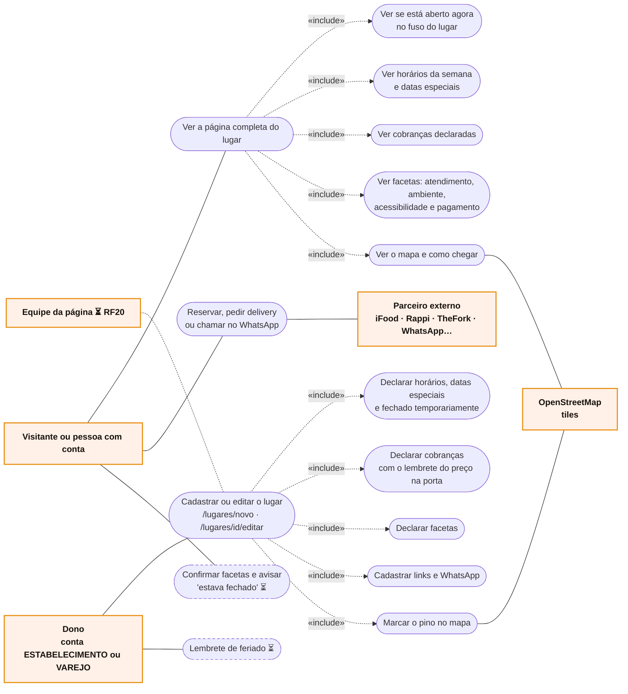

# RF11 · Casos de uso

Atores primários à esquerda, secundários à direita.

O app nunca processa reserva, pedido nem pagamento: o botão só abre o parceiro, em outra aba. Quem pode editar é
decidido pelo `PlaceEditors` (hoje, o dono).
