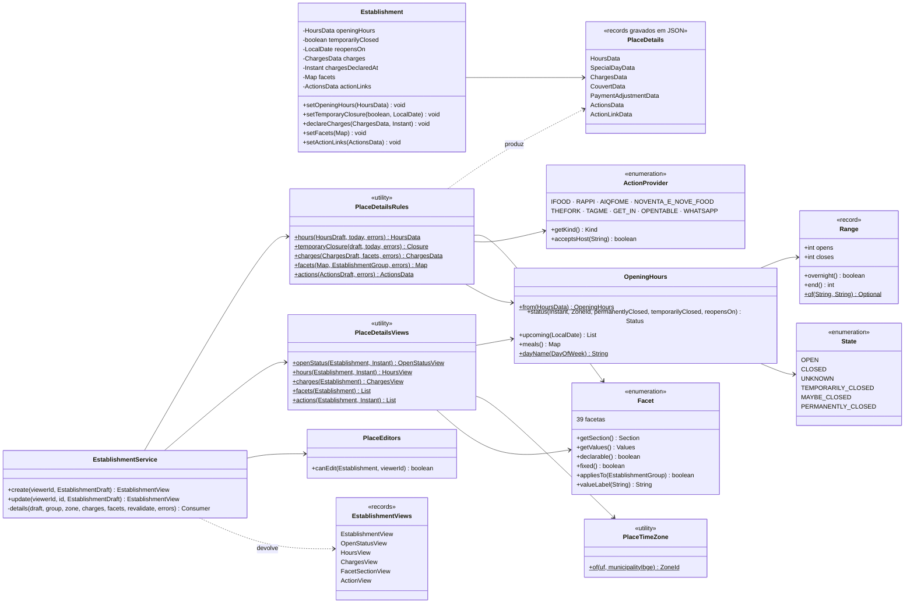

# RF11 · Classes

No app web: `PlaceView` usa `OpenStatusBadge`, `ActionButtons`, `HoursSection`, `ChargesSection`, `FacetsSection` e
`PlaceLocation` (com `PlaceMap`); o `PlaceForm` monta o `EstablishmentDraft` com `lib/place-form`
(`buildPlaceDraft`, `valuesFromPlace`, `mapPlaceErrors`).
