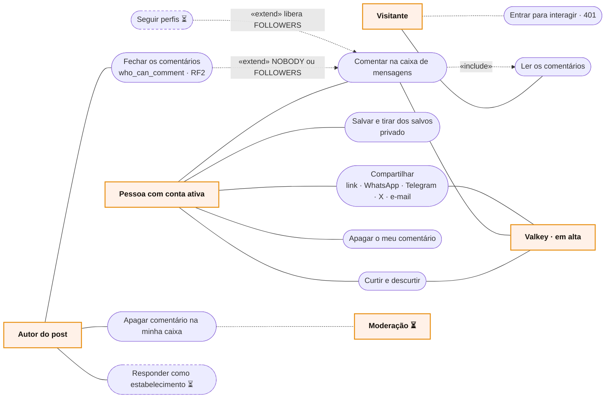

# RF12 · Casos de uso

Atores primários à esquerda, secundários à direita.

No alerta sanitário só há compartilhar e salvar. O post de menor de 16 não aparece para os outros, então ninguém de
fora interage com ele.
