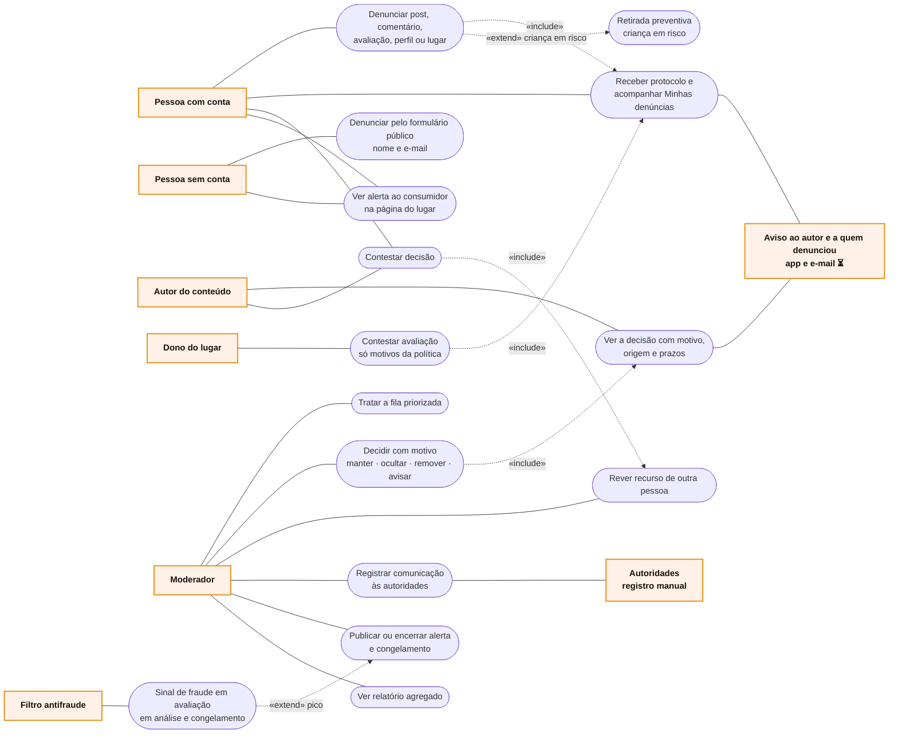

# RF13 · Casos de uso

Atores primários à esquerda, secundários à direita.

Quem publicou nunca sabe quem denunciou. O dono do lugar contesta, mas não vê dados de quem avaliou e não esconde a
avaliação bloqueando a pessoa (RF19).
