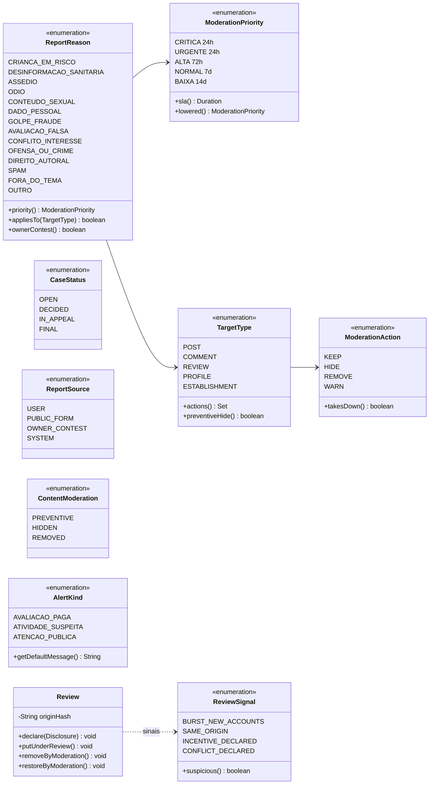
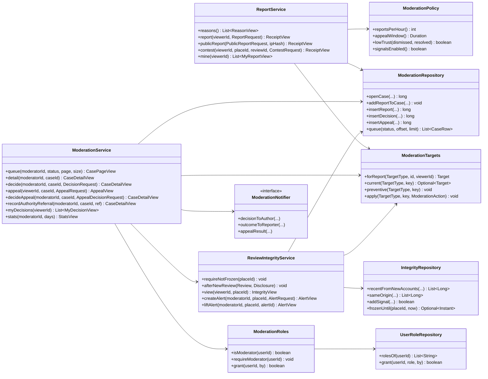

# RF13 · Classes

## Domínio

## Serviços, persistência e views

As views (`ModerationViews`) são records: `ReceiptView`, `ReasonView`, `TargetView`, `CaseSummaryView`,
`CaseDetailView`, `ReportView`, `DecisionView`, `AppealView`, `SignalView`, `MyReportView`, `MyDecisionView`,
`AlertView`, `IntegrityView`, `StatsView` e `RolesView`.
