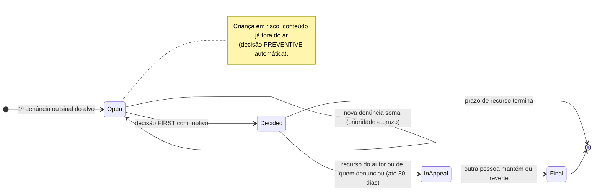
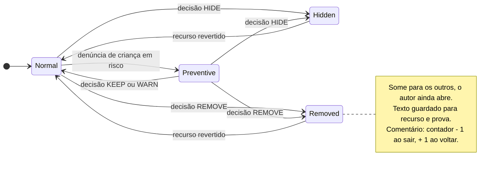
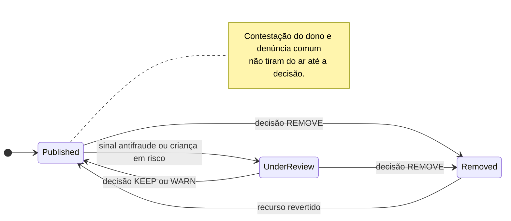
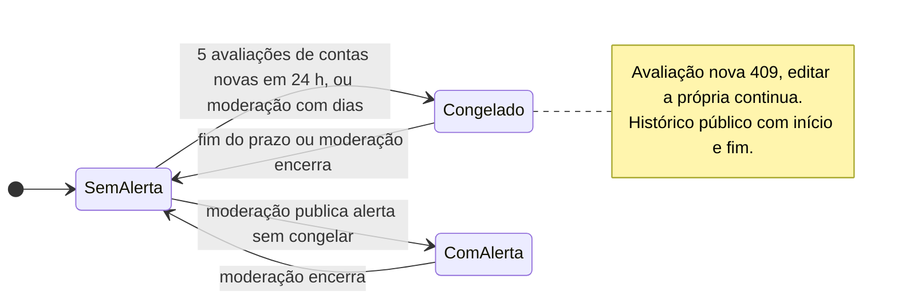
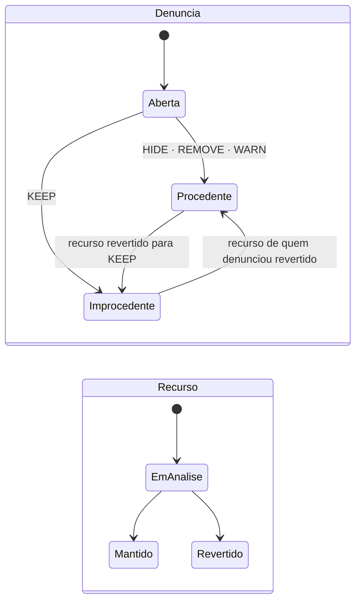

# RF13 · Estados

## Caso da fila (`moderation_case.status`)

## Conteúdo sob moderação (`post` e `post_comment.moderation_state`)

## Avaliação na moderação (`review.status`, RF8)

## Página do lugar (`establishment_alert`)

## Denúncia e recurso

