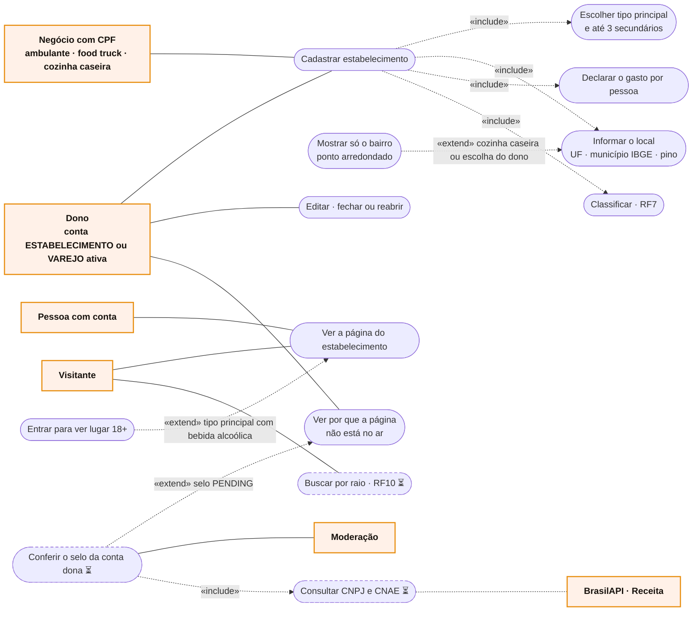

# RF6 · Casos de uso

Atores primários à esquerda, secundários à direita.

O negócio com CPF tem um único ponto e só os tipos do seu `informalFormat`. A pessoa com conta e menos de 18 anos
não vê a página 18+ (`404`).
