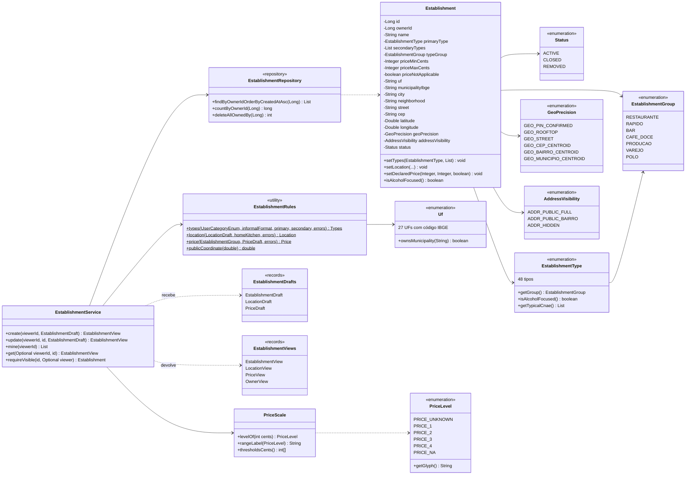

# RF6 · Classes

A classificação do mesmo `Establishment` (culinária, formato, abordagem e estilos) está no [RF7](../RF7/classes.md),
e a nota agregada que a página mostra, no [RF8](../RF8/classes.md).
