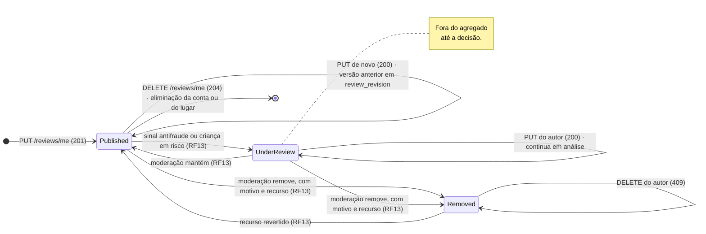
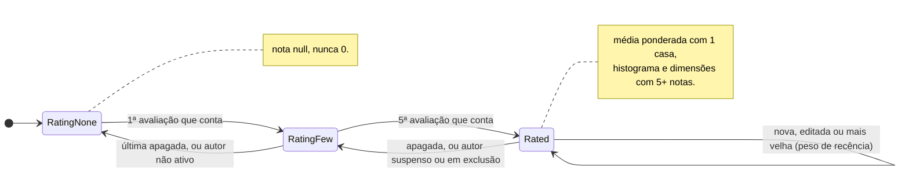

# RF8 · Estados

## Avaliação (`review.status`)

A edição gera uma nova versão e não é um estado. Avaliação `REMOVED` não é reescrita nem apagada pelo autor (`409`),
como manda a taxonomia (seção 10.1).

## Nota agregada do estabelecimento

