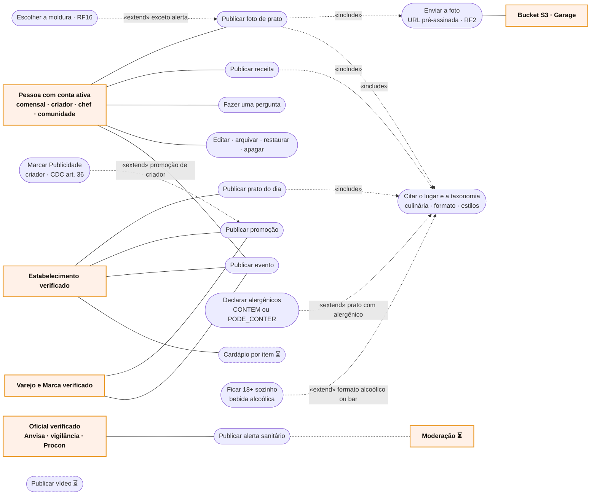

# RF9 · Casos de uso

Atores primários à esquerda, secundários à direita.

O chef e a comunidade publicam evento; o criador publica promoção só com o chip Publicidade; a conta Oficial não faz
pergunta. Organizações com o selo em conferência leem e interagem, mas não publicam (`403`).
