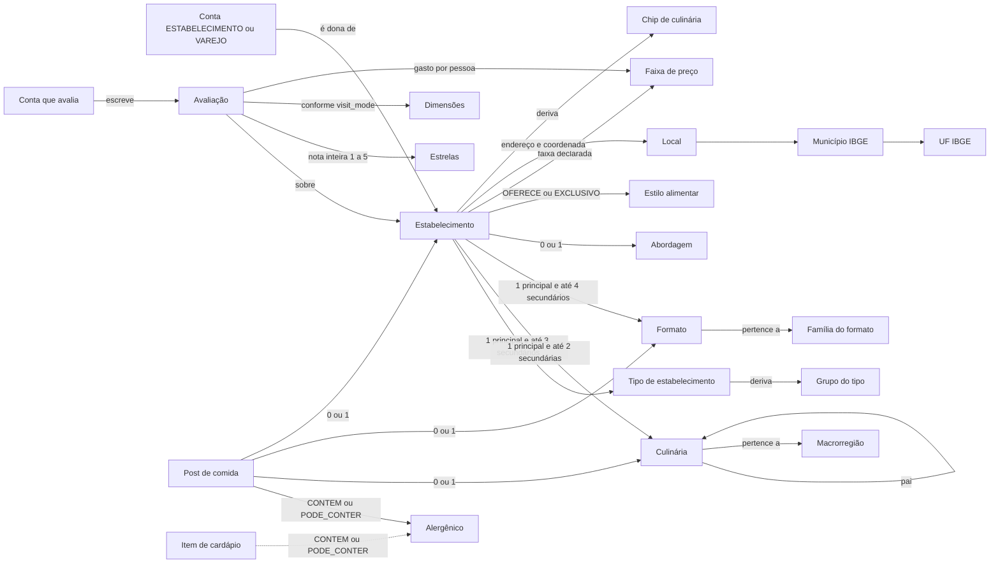

# Taxonomia do Friendly Eats: atores, atributos e categorias

Fonte única dos vocabulários controlados do Friendly Eats: quem usa a plataforma (atores e tipos de conta) e como um
estabelecimento, um prato e uma avaliação são classificados (culinária, formato, abordagem, estilo alimentar,
alergênicos, tipo de estabelecimento, facetas, preço, estrelas e local). Cores, glifos e ícones ficam em
[`DESIGN_SYSTEM.md`](DESIGN_SYSTEM.md); os fluxos de cada requisito, nas pastas `docs/RFn/`.

Base: as quatro pesquisas de 25/10/2026 (culinária e estilos; estabelecimentos e contas; preço, estrelas e local;
conteúdo e sinais visuais), conciliadas com o que o código já faz.

**Legenda.** Sem marcação = regra já no código (RF1 a RF16). ⏳ = planejado, ainda sem código. `≈` = equivalência aproximada,
que exige revisão humana na importação.

## Sumário

1. [Princípios](#1-princípios)
2. [Atores](#2-atores)
3. [Culinária](#3-culinária)
4. [Formato (tipo de comida)](#4-formato-tipo-de-comida)
5. [Abordagem](#5-abordagem)
6. [Estilos alimentares e alergênicos](#6-estilos-alimentares-e-alergênicos)
7. [Tipo de estabelecimento](#7-tipo-de-estabelecimento)
8. [Facetas operacionais](#8-facetas-operacionais)
9. [Preço](#9-preço)
10. [Estrelas](#10-estrelas)
11. [Local](#11-local)
12. [Chip de culinária](#12-chip-de-culinária)
13. [Mapa para os RFs](#13-mapa-para-os-rfs)
14. [Conteúdo: posts, feeds e interações](#14-conteúdo-posts-feeds-e-interações)
15. [Fontes](#15-fontes)

---

## 1. Princípios

1. **Eixos ortogonais.** Cada atributo vive num só eixo. A culinária diz *de qual tradição*; o formato, *o que se come*;
   a abordagem, *o jeito*; o estilo alimentar, *para quem serve*; o tipo de estabelecimento, *o que o lugar é e como
   atende*. "Vegano", "saudável" ou "sem glúten" nunca são culinária nem formato. "Fusion", "contemporânea", "caseira"
   e "variada" também não são culinárias, e sim valores de abordagem. "Pizzaria" e "boteco" são tipos de estabelecimento,
   e o que vendem são formatos.
2. **Códigos estáveis.** Todo valor tem um código em MAIÚSCULAS ASCII, sem acento e com `_` entre as palavras. Um
   código **nunca é renomeado nem reaproveitado**. Quando um valor sai de uso, ele fica descontinuado e aponta para o
   substituto. Os códigos são únicos entre os vocabulários (a culinária usa adjetivo, como `ARABE`, e o formato usa
   substantivo, como `ESFIHA`), para não colidir em busca nem em URL.
3. **O rótulo pt-BR pode mudar** a qualquer momento, sem migração.
4. **Equivalências só para importar e exportar.** OSM, Google Places, Yelp, Foursquare, iFood e schema.org misturam
   os eixos numa lista única de "categoria". As colunas de equivalência servem de tabela de mapeamento: na importação,
   `restaurant` + `cuisine=italian` do OSM vira `RESTAURANTE_A_LA_CARTE` + `ITALIANA`. Na exportação, o JSON-LD
   publica `servesCuisine` com o rótulo pt-BR. Elas não são 1:1 e nunca viram código nosso.
5. **Principal + secundárias.** Cada eixo de lista tem no máximo um valor principal, que aparece no card e no ranking.
   As secundárias valem só como filtro.
6. **A cor nunca é o único sinal.** Toda categoria visível tem cor, glifo ou ícone e rótulo ([`DESIGN_SYSTEM.md`](DESIGN_SYSTEM.md)).



A linha tracejada indica o que ainda está planejado (alergênicos por item de cardápio). Os posts e os seus tipos estão
na [seção 14](#14-conteúdo-posts-feeds-e-interações).

---

## 2. Atores

### 2.1 Tipos de conta

São os 7 valores de `UserCategoryEnum` (coluna `user_account.user_type`), como estão no código. O cadastro, os campos
de `type_details` e o selo estão no [RF1](RF1/README.md).

| Código | Rótulo | Escuro / claro | Glifo | Ícone Lucide | Pode | Não pode | Selo inicial |
|---|---|---|---|---|---|---|---|
| `COMENSAL` | Comensal | `#48A8FF` / `#05558F` | ◇ losango | `user-round` | avaliar, publicar, seguir, comentar; a partir de 13 anos (menor de 16 com proteções travadas) | ser dono de estabelecimento; publicar alerta sanitário | `NOT_REQUIRED` |
| `CRIADOR` | Criador | `#F7C638` / `#876A06` | ✦ estrela | `camera` | o mesmo que o comensal, com perfil de canal (`CRITICO`, `BLOG`, `VIDEO`, `PODCAST`, `GUIA`) | ser dono de estabelecimento; publicar promoção sem o chip Publicidade (CDC art. 36, CONAR) | `NOT_REQUIRED` |
| `CHEF` | Chef | `#D6C5FF` / `#7D5BBA` | ⬠ pentágono | `chef-hat` | o mesmo que o comensal, com função (`CHEF`, `COZINHEIRO`, `CONFEITEIRO`, `PADEIRO`, `BARISTA`, `SOMMELIER`, `BARTENDER`, `NUTRICIONISTA`) e registro profissional privado; ⏳ vínculo "chef do X" confirmado pelo estabelecimento | ser dono de estabelecimento; ⏳ avaliar o lugar com que tem vínculo | `NOT_REQUIRED` |
| `ESTABELECIMENTO` | Estabelecimento | `#E88F12` / `#7F4D06` | ▭ retângulo | `store` | ser dono de estabelecimento dos grupos que não são `VAREJO`; editar tipo, classificação, local e preço declarado; ⏳ responder avaliações em público | **avaliar** (qualquer lugar); publicar como organização antes do selo | **`PENDING`** |
| `VAREJO` | Varejo & Marca | `#EE559F` / `#96075A` | △ triângulo | `shopping-basket` | ser dono de estabelecimento do grupo `VAREJO`; ⏳ catálogo e "onde encontrar" | **avaliar**; publicar como organização antes do selo | **`PENDING`** |
| `COMUNIDADE` | Comunidade | `#08DABD` / `#0B8170` | ⬢ hexágono | `users` | avaliar (em nome do grupo, sem peso extra), publicar; ⏳ membros, eventos e listas coletivas | ser dono de estabelecimento; vender | `NOT_REQUIRED` |
| `OFICIAL` | Oficial | `#0C0A07` + anel `#D6D0C8` / `#0C0A07` | ◎ círculo duplo | `landmark` | publicar alerta sanitário e recall (`canPublishFoodAlerts`, depois do selo; tipo `ALERTA_SANITARIO`, [RF9](RF9/README.md)) | **avaliar**; ser dono de estabelecimento | **`PENDING`** |

- **Selo** (`category_verification`): `NOT_REQUIRED`, ou `PENDING` → `VERIFIED` | `REJECTED` depois da moderação.
  Com `VERIFIED`, o nome ganha o ícone `badge-check`. O selo diz só "é quem diz ser": **nunca é pago e nunca indica
  qualidade**.
- Contas `PENDING` leem e interagem, mas só publicam como organização depois do selo. A página de um estabelecimento
  só fica pública quando a conta dona está ativa e com selo `VERIFIED`. O dono sempre vê a própria página.
- Todo tipo diferente de `COMENSAL` exige 18 anos ou mais.

**Nomes da pesquisa 02.** A pesquisa usou outros nomes para três tipos. Eles **não** são códigos e servem só para ler
a pesquisa:

| Nome na pesquisa 02 | Código implementado |
|---|---|
| `PESSOA` | `COMENSAL` |
| `PROFISSIONAL` | `CHEF` |
| `MARCA` | `VAREJO` |

Os nomes de selo da pesquisa (`CRIADOR_VERIFICADO`, `MARCA_VERIFICADA` etc.) também não foram adotados. O selo é um só,
`category_verification`.

### 2.2 Estabelecimento sem CNPJ (negócio informal)

A conta `ESTABELECIMENTO` pode se cadastrar sem CNPJ com `type_details.informalFormat`:

| `informalFormat` | Quem é | Tipos permitidos, principal e secundários (seção 7) |
|---|---|---|
| `AMBULANTE` | barraca, carrinho, tabuleiro | `AMBULANTE` |
| `FOOD_TRUCK` | food truck, trailer | `FOOD_TRUCK` |
| `COZINHA_CASEIRA` | produção em casa, encomenda, marmita | `COZINHA_ARTESANAL` ou `MARMITARIA` |

- O **CPF do titular** substitui o CNPJ: os dígitos verificadores são conferidos, ele é guardado sem pontuação e é
  **privado** (nunca aparece na API pública). Razão social, CNAE, representante e CNPJ são recusados.
- A moderação confere a identidade do titular e, quando houver, o alvará ou a licença sanitária.
- A cozinha caseira mostra só o bairro: `ADDR_PUBLIC_BAIRRO` é o padrão, e `ADDR_PUBLIC_FULL` é recusado (seção 11).
- ⏳ Feirante com matrícula (`FEIRA_LIVRE`, regra R9 da pesquisa 02) ainda não tem `informalFormat`.

### 2.3 Outros atores

| Ator | Código | O que faz | Situação |
|---|---|---|---|
| Visitante | — (sem conta) | lê o conteúdo público, exceto as páginas 18+ (precisa entrar); precisa de conta para avaliar, publicar ou interagir | ✅ |
| Conta com e-mail não confirmado | `PENDING_VERIFICATION` (estado da conta) | lê, mas não interage, não avalia e não cadastra lugar (`403`) | ✅ |
| Moderador | `MODERADOR` (papel interno, sem perfil público) | confere selos, trata denúncias e revisões de avaliação | ⏳ papel no código; hoje toda sessão é `ROLE_USER` |

### 2.4 Regras de quem é dono e de quem avalia

| Regra | Detalhe |
|---|---|
| Dono de estabelecimento | só a conta `ESTABELECIMENTO` ou `VAREJO` |
| Grupo do tipo × conta | o **tipo principal** de uma conta `VAREJO` é do grupo `VAREJO`, e o de uma conta `ESTABELECIMENTO` é de outro grupo; os secundários podem cruzar grupos (R4: padaria + empório) |
| Quem avalia | `COMENSAL`, `CRIADOR`, `CHEF` e `COMUNIDADE`. `ESTABELECIMENTO`, `VAREJO` e `OFICIAL` **não avaliam** |
| Conflito de interesse | o dono **nunca** avalia o próprio lugar (`RULE_NO_INSIDER`, seção 10.7) |
| Conta ativa | cadastrar lugar e avaliar exigem a conta `ACTIVE` (e-mail confirmado) |

---

## 3. Culinária

Responde "de qual tradição?". São 2 níveis: 7 macrorregiões e 56 culinárias.

### 3.1 Macrorregiões

| Macro | Rótulo | Genérica da macro | Nº de culinárias |
|---|---|---|---|
| `BRASIL` | Brasil | `BRASILEIRA` | 12 |
| `AMERICA_LATINA` | América Latina e Caribe | `LATINO_AMERICANA` | 11 |
| `AMERICA_NORTE` | América do Norte | `NORTE_AMERICANA` | 4 |
| `EUROPA` | Europa | `EUROPEIA` | 10 |
| `ORIENTE_MEDIO_NORTE_AFRICA` | Oriente Médio e Norte da África | `ORIENTE_MEDIO` | 7 |
| `AFRICA` | África Subsaariana | `AFRICANA` | 4 |
| `ASIA` | Ásia | `ASIATICA` | 8 |

A genérica da macro serve quando não há uma específica (a regra do OSM: "use o valor mais específico").

### 3.2 Hierarquia (pai)

- Cada culinária específica tem um **pai**. A genérica da macro não tem pai.
- As regionais brasileiras têm como pai a genérica da região, quando ela existe:
  - `BAIANA` → `NORDESTINA` → `BRASILEIRA`;
  - `PARAENSE` → `AMAZONICA` → `BRASILEIRA`.
- As outras brasileiras têm pai `BRASILEIRA`.
- As estrangeiras têm como pai a genérica da macro (`ITALIANA` → `EUROPEIA`, `NIKKEI` → `LATINO_AMERICANA`).
- **Marcar uma culinária junto com um ancestral dela é recusado (`422`).** Exemplos: `BAIANA` + `NORDESTINA` e
  `BAIANA` + `BRASILEIRA` são recusados, porque a específica já implica as de cima. Duas irmãs ou primas, como
  `BAIANA` + `PARAENSE` ou `ITALIANA` + `FRANCESA`, são aceitas.
- ⏳ O filtro por uma culinária inclui as descendentes (RF10). Por exemplo, "Nordestina" traz `BAIANA`. A região IBGE (N, NE,
  CO, SE, S) permite o filtro por região.

### 3.3 Cardinalidade

**1 principal + até 2 secundárias** (no máximo 3). A culinária é opcional se houver formato (seção 4.3) ou abordagem
`VARIADA` (seção 5). Mais de 3 culinárias é sinal de abordagem `VARIADA`.

### 3.4 Tabela de culinárias

| Código | Rótulo pt-BR | Macro | Região IBGE / nota | Pai | OSM `cuisine` | Google type |
|---|---|---|---|---|---|---|
| `BRASILEIRA` | Brasileira | BRASIL | genérica | — | `brazilian` | `brazilian_restaurant` |
| `MINEIRA` | Mineira | BRASIL | SE | `BRASILEIRA` | `brazilian` ≈ | `brazilian_restaurant` ≈ |
| `PAULISTANA` | Paulista / paulistana | BRASIL | SE | `BRASILEIRA` | — | — |
| `CAPIXABA` | Capixaba | BRASIL | SE | `BRASILEIRA` | — | — |
| `CAICARA` | Caiçara | BRASIL | SE, S (litoral SP-RJ-PR) | `BRASILEIRA` | — | — |
| `NORDESTINA` | Nordestina | BRASIL | NE, genérica regional | `BRASILEIRA` | — | — |
| `BAIANA` | Baiana | BRASIL | NE (inclui afro-baiana) | `NORDESTINA` | — | — |
| `AMAZONICA` | Amazônica / nortista | BRASIL | N, genérica regional | `BRASILEIRA` | — | — |
| `PARAENSE` | Paraense | BRASIL | N | `AMAZONICA` | — | — |
| `GOIANA` | Goiana | BRASIL | CO | `BRASILEIRA` | — | — |
| `PANTANEIRA` | Pantaneira (MT/MS) | BRASIL | CO | `BRASILEIRA` | — | — |
| `GAUCHA` | Gaúcha | BRASIL | S | `BRASILEIRA` | — | — |
| `LATINO_AMERICANA` | Latino-americana | AMERICA_LATINA | genérica | — | `latin_american` | `latin_american_restaurant` |
| `ARGENTINA` | Argentina | AMERICA_LATINA | | `LATINO_AMERICANA` | `argentinian` | `argentinian_restaurant` |
| `URUGUAIA` | Uruguaia | AMERICA_LATINA | | `LATINO_AMERICANA` | — | — |
| `PERUANA` | Peruana | AMERICA_LATINA | | `LATINO_AMERICANA` | `peruvian` | `peruvian_restaurant` |
| `NIKKEI` | Nikkei | AMERICA_LATINA | tradição consolidada, não é fusion | `LATINO_AMERICANA` | — | — |
| `MEXICANA` | Mexicana | AMERICA_LATINA | | `LATINO_AMERICANA` | `mexican` | `mexican_restaurant` |
| `COLOMBIANA` | Colombiana | AMERICA_LATINA | | `LATINO_AMERICANA` | `colombian` | `colombian_restaurant` |
| `VENEZUELANA` | Venezuelana | AMERICA_LATINA | | `LATINO_AMERICANA` | `venezuelan` | — |
| `BOLIVIANA` | Boliviana | AMERICA_LATINA | | `LATINO_AMERICANA` | `bolivian` | — |
| `CHILENA` | Chilena | AMERICA_LATINA | | `LATINO_AMERICANA` | — | `chilean_restaurant` |
| `CARIBENHA` | Caribenha (inclui cubana e jamaicana) | AMERICA_LATINA | | `LATINO_AMERICANA` | `caribbean` / `cuban` | `caribbean_restaurant` |
| `NORTE_AMERICANA` | Norte-americana | AMERICA_NORTE | genérica | — | `american` | `american_restaurant` |
| `TEX_MEX` | Tex-Mex | AMERICA_NORTE | | `NORTE_AMERICANA` | `tex-mex` | `tex_mex_restaurant` |
| `SUL_DOS_EUA` | Sul dos EUA (cajun, creole, soul food) | AMERICA_NORTE | | `NORTE_AMERICANA` | `cajun` / `southern` | `cajun_restaurant` |
| `HAVAIANA` | Havaiana | AMERICA_NORTE | por convenção | `NORTE_AMERICANA` | `hawaiian` | `hawaiian_restaurant` |
| `EUROPEIA` | Europeia | EUROPA | genérica | — | `european` | `european_restaurant` |
| `ITALIANA` | Italiana | EUROPA | | `EUROPEIA` | `italian` | `italian_restaurant` |
| `PORTUGUESA` | Portuguesa | EUROPA | | `EUROPEIA` | `portuguese` | `portuguese_restaurant` |
| `FRANCESA` | Francesa | EUROPA | | `EUROPEIA` | `french` | `french_restaurant` |
| `ESPANHOLA` | Espanhola | EUROPA | | `EUROPEIA` | `spanish` | `spanish_restaurant` |
| `ALEMA` | Alemã (inclui austríaca) | EUROPA | | `EUROPEIA` | `german` / `austrian` | `german_restaurant` |
| `GREGA` | Grega | EUROPA | | `EUROPEIA` | `greek` | `greek_restaurant` |
| `MEDITERRANEA` | Mediterrânea | EUROPA | atravessa EUROPA e MENA; macro por convenção | `EUROPEIA` | `mediterranean` | `mediterranean_restaurant` |
| `BRITANICA_IRLANDESA` | Britânica e irlandesa | EUROPA | | `EUROPEIA` | `british` / `irish` | `british_restaurant` |
| `LESTE_EUROPEIA` | Leste europeu (russa, polonesa, ucraniana, húngara) | EUROPA | | `EUROPEIA` | `russian` / `polish` | `eastern_european_restaurant` |
| `ORIENTE_MEDIO` | Médio-oriental | ORIENTE_MEDIO_NORTE_AFRICA | genérica | — | `middle_eastern` | `middle_eastern_restaurant` |
| `ARABE` | Árabe (sírio-libanesa, levantina, egípcia, do Golfo) | ORIENTE_MEDIO_NORTE_AFRICA | absorve libanesa e síria | `ORIENTE_MEDIO` | `arab` / `lebanese` | `lebanese_restaurant` |
| `TURCA` | Turca | ORIENTE_MEDIO_NORTE_AFRICA | | `ORIENTE_MEDIO` | `turkish` | `turkish_restaurant` |
| `PERSA` | Persa / iraniana | ORIENTE_MEDIO_NORTE_AFRICA | | `ORIENTE_MEDIO` | `persian` | `persian_restaurant` |
| `JUDAICA_ISRAELENSE` | Judaica e israelense | ORIENTE_MEDIO_NORTE_AFRICA | não é sinônimo de `KOSHER` (estilo) | `ORIENTE_MEDIO` | — | `israeli_restaurant` |
| `MARROQUINA` | Marroquina / magrebina | ORIENTE_MEDIO_NORTE_AFRICA | | `ORIENTE_MEDIO` | `moroccan` | `moroccan_restaurant` |
| `ARMENIA` | Armênia | ORIENTE_MEDIO_NORTE_AFRICA | | `ORIENTE_MEDIO` | `armenian` | — |
| `AFRICANA` | Africana | AFRICA | genérica | — | `african` | `african_restaurant` |
| `ANGOLANA` | Angolana | AFRICA | | `AFRICANA` | — | — |
| `ETIOPE` | Etíope | AFRICA | | `AFRICANA` | `ethiopian` | `ethiopian_restaurant` |
| `SENEGALESA` | Senegalesa | AFRICA | | `AFRICANA` | `senegalese` | — |
| `ASIATICA` | Asiática (pan-asiática) | ASIA | genérica | — | `asian` | `asian_restaurant` |
| `JAPONESA` | Japonesa | ASIA | | `ASIATICA` | `japanese` | `japanese_restaurant` |
| `CHINESA` | Chinesa | ASIA | | `ASIATICA` | `chinese` | `chinese_restaurant` |
| `TAIWANESA` | Taiwanesa | ASIA | | `ASIATICA` | `taiwanese` | `taiwanese_restaurant` |
| `COREANA` | Coreana | ASIA | | `ASIATICA` | `korean` | `korean_restaurant` |
| `TAILANDESA` | Tailandesa | ASIA | | `ASIATICA` | `thai` | `thai_restaurant` |
| `VIETNAMITA` | Vietnamita | ASIA | | `ASIATICA` | `vietnamese` | `vietnamese_restaurant` |
| `INDIANA` | Indiana | ASIA | | `ASIATICA` | `indian` | `indian_restaurant` |

Nenhuma plataforma tem variantes regionais brasileiras, exceto o Yelp (`northeasternbrazilian`, `northernbrazilian`,
`centralbrazilian`, `afrobrazilian`), a Foursquare (14 filhas de *Brazilian Restaurant*, como Baiano, Mineiro e Goiano)
e o iFood ("cozinha baiana", "mineira", "paraense", "típica do norte"). Essas equivalências estão na pesquisa 01.

**Candidatos para criar sob demanda**, sem quebrar códigos: `AFRO_BRASILEIRA` (hoje cai em `BAIANA`), `CARIOCA`,
`CATARINENSE_ACORIANA`, `PERNAMBUCANA`, `MARANHENSE`, `CEARENSE`, `SUICA`, `ESCANDINAVA`, `INDONESIA`, `FILIPINA`,
`NEPALESA`, `PAQUISTANESA`, `NIGERIANA`. Uma culinária nova exige uma tradição reconhecível **e** demanda (vários
estabelecimentos ativos). Até lá, usa-se a genérica.

---

## 4. Formato (tipo de comida)

Responde "o que vou comer ou comprar?". São 33 formatos em 8 famílias.

### 4.1 Regra origem × formato

- **Teste:** o rótulo continua verdadeiro se a origem mudar? Pizza napolitana, paulistana ou vegana continua sendo
  pizza, então é **formato**. "Baiana" deixa de valer se o prato vier de outra tradição, então é **culinária**.
- Pratos emblemáticos de uma tradição (sushi, açaí, churrasco, esfiha, tacos, poke) são formato. A **culinária
  sugerida** é só um padrão editável na tela e **nunca** é aplicada sozinha. Uma temakeria pode ser só `SUSHI`.
- Pratos específicos (feijoada, moqueca, baião de dois, pão de queijo, tacacá, barreado) não entram no vocabulário.
  ⏳ Eles serão *tags de prato* ligadas a uma culinária.
- Os guarda-chuvas excluem os específicos: `SALGADOS` não inclui `PASTEL` nem `ESFIHA`; `DOCES_CONFEITARIA` não inclui
  `SORVETE` nem `ACAI`; `SANDUICHE` não inclui `HAMBURGUER` nem `CACHORRO_QUENTE`.
- Comida de rua, food truck, rodízio, quilo, congelados e delivery são tipo de estabelecimento ou faceta de serviço, e
  não formato. Comida de rua usa o formato do item: acarajé é `SALGADOS` + `BAIANA`, e churros é `DOCES_CONFEITARIA`.

### 4.2 Famílias

Servem para agrupar filtros na tela e derivar o chip (seção 12). Não são selecionáveis como valor.

`REFEICOES` · `CARNES_PESCADOS` · `LANCHES` · `SALGADOS_E_PETISCOS` · `ORIENTAIS_E_ETNICOS` · `DOCES_E_GELADOS` ·
`PADARIA_E_CAFE` · `BEBIDAS`

### 4.3 Cardinalidade

- **1 principal + até 4 secundários** (padarias e bares vendem vários formatos de fato).
- O estabelecimento precisa de **pelo menos 1 culinária ou 1 formato** principal. Os dois podem coexistir.
  Exceções: os grupos `VAREJO` e `POLO` e a abordagem `VARIADA` dispensam os dois.
- As secundárias exigem a principal do mesmo eixo, e a principal não se repete entre as secundárias.

### 4.4 Tabela de formatos

| Código | Rótulo pt-BR | Família | Culinária sugerida | OSM `cuisine` | Google type |
|---|---|---|---|---|---|
| `PRATO_FEITO` | Prato feito / marmita / executivo | REFEICOES | `BRASILEIRA` | — | — |
| `MASSAS` | Massas | REFEICOES | `ITALIANA` | `pasta` | — |
| `SALADAS_BOWLS` | Saladas e bowls | REFEICOES | — | `salad` | `salad_shop` |
| `SOPAS_CALDOS` | Sopas e caldos | REFEICOES | — | `soup` | `soup_restaurant` |
| `CHURRASCO` | Churrasco e carnes na brasa (inclui steakhouse e parrilla) | CARNES_PESCADOS | `GAUCHA` | `barbecue` / `steak_house` | `barbecue_restaurant` / `steak_house` |
| `ESPETINHO` | Espetinho / churrasquinho | CARNES_PESCADOS | `BRASILEIRA` | — | — |
| `FRANGO` | Frango (assado, frito, galeto, asinhas) | CARNES_PESCADOS | — | `chicken` / `wings` | `chicken_restaurant` |
| `FRUTOS_DO_MAR` | Peixes e frutos do mar | CARNES_PESCADOS | — | `seafood` / `fish` | `seafood_restaurant` |
| `PIZZA` | Pizza | LANCHES | `ITALIANA` | `pizza` | `pizza_restaurant` |
| `HAMBURGUER` | Hambúrguer | LANCHES | `NORTE_AMERICANA` | `burger` | `hamburger_restaurant` |
| `SANDUICHE` | Sanduíches e lanches (beirute, bauru, wrap) | LANCHES | — | `sandwich` | `sandwich_shop` / `deli` |
| `CACHORRO_QUENTE` | Cachorro-quente | LANCHES | — | `hot_dog` | `hot_dog_restaurant` |
| `TACOS_BURRITOS` | Tacos, burritos e tortilhas | LANCHES | `MEXICANA` | `tacos` | `taco_restaurant` |
| `KEBAB_SHAWARMA` | Kebab, shawarma, churrasco grego | LANCHES | `ARABE` ou `TURCA` | `kebab` / `shawarma` | `kebab_shop` |
| `SALGADOS` | Salgados (coxinha, empada, risole, kibe frito, acarajé, pão de queijo) | SALGADOS_E_PETISCOS | `BRASILEIRA` | `empanada` ≈ | `snack_bar` ≈ |
| `PASTEL` | Pastel | SALGADOS_E_PETISCOS | `BRASILEIRA` | — | — |
| `ESFIHA` | Esfiha (inclui "pizza árabe") | SALGADOS_E_PETISCOS | `ARABE` | — | — |
| `TAPIOCA` | Tapioca | SALGADOS_E_PETISCOS | `NORDESTINA` | — | — |
| `PETISCOS_BOTECO` | Petiscos e porções de boteco | SALGADOS_E_PETISCOS | `BRASILEIRA` | `tapas` ≈ | `gastropub` ≈ |
| `SUSHI` | Sushi, sashimi e temaki | ORIENTAIS_E_ETNICOS | `JAPONESA` | `sushi` | `sushi_restaurant` |
| `POKE` | Poke | ORIENTAIS_E_ETNICOS | `HAVAIANA` | `poke` | — |
| `LAMEN_NOODLES` | Lámen, yakisoba e macarrões orientais | ORIENTAIS_E_ETNICOS | — | `ramen` / `noodle` | `ramen_restaurant` / `noodle_shop` |
| `ACAI` | Açaí e bowls de frutas amazônicas | DOCES_E_GELADOS | `AMAZONICA` (como sobremesa: nenhuma) | `açaí` | `acai_shop` |
| `SORVETE` | Sorvete, gelato, picolé e frozen yogurt | DOCES_E_GELADOS | — | `ice_cream` | `ice_cream_shop` |
| `DOCES_CONFEITARIA` | Doces, bolos e confeitaria (inclui chocolate, donuts, churros) | DOCES_E_GELADOS | — | `cake` / `pastry` | `dessert_shop` / `pastry_shop` |
| `CREPE_PANQUECA` | Crepes, panquecas e waffles | DOCES_E_GELADOS | — | `crepe` / `pancake` | — |
| `PAES` | Pães e padaria (inclui bagel, croissant) | PADARIA_E_CAFE | — | `bagel` (loja: `shop=bakery`) | `bakery` |
| `CAFE` | Café (espresso, coado, cafés especiais) | PADARIA_E_CAFE | — | `coffee_shop` | `coffee_shop` / `cafe` |
| `CHA` | Chás e bubble tea | BEBIDAS | — | `tea` / `bubble_tea` | `tea_house` |
| `SUCOS_SMOOTHIES` | Sucos, vitaminas e smoothies | BEBIDAS | — | `juice` | `juice_shop` |
| `CERVEJA` | Cerveja e chope (inclui artesanal) | BEBIDAS | — | — (`craft=brewery`) | `brewery` / `pub` |
| `VINHO` | Vinho | BEBIDAS | — | — | `wine_bar` / `winery` |
| `COQUETEIS_DESTILADOS` | Drinques, coquetéis e destilados (inclui cachaça) | BEBIDAS | — | — | `cocktail_bar` |

### 4.5 Casos de fronteira

| Caso | Culinária | Formato | Outros eixos |
|---|---|---|---|
| Churrascaria rodízio gaúcha | `GAUCHA` | `CHURRASCO` | tipo `RESTAURANTE_RODIZIO` |
| Parrilla argentina | `ARGENTINA` | `CHURRASCO` | — |
| Temakeria | `JAPONESA` (opcional) | `SUSHI` | — |
| Açaiteria de shopping | — | `ACAI` | tipo `ACAITERIA_SUCOS` |
| Açaí paraense com peixe frito (Belém) | `PARAENSE` | `ACAI` + `FRUTOS_DO_MAR` | — |
| Baiana de acarajé na rua | `BAIANA` | `SALGADOS` | tipo `AMBULANTE` |
| Esfiharia de rede | `ARABE` | `ESFIHA` (+ `KEBAB_SHAWARMA`) | tipo `FAST_FOOD` |
| Pastelaria de feira | `BRASILEIRA` | `PASTEL` (+ `SUCOS_SMOOTHIES` para o caldo de cana) | dentro de `FEIRA_LIVRE` |
| Boteco | `BRASILEIRA` | `PETISCOS_BOTECO` + `CERVEJA` | tipo `BOTECO` |
| Padaria paulistana | `PAULISTANA` (opcional) | `PAES` + `CAFE` + `SANDUICHE` + `DOCES_CONFEITARIA` | tipo `PADARIA` |
| Restaurante por quilo | `BRASILEIRA` ou abordagem `VARIADA` | `PRATO_FEITO` | tipo `RESTAURANTE_QUILO` |
| Restaurante vegano de comida mineira | `MINEIRA` | — | estilo `VEGANO` = `EXCLUSIVO` |
| "Cozinha saudável/fit" (iFood) | — | `SALADAS_BOWLS` (se couber) | estilos explícitos (`LOW_CARB`, `SEM_GLUTEN`…); "saudável" nunca vira valor |
| Hamburgueria artesanal | `NORTE_AMERICANA` (opcional) | `HAMBURGUER` | — |
| Yakisoba de feira | `CHINESA` | `LAMEN_NOODLES` | — |
| Nikkei (ceviche + sushi) | `NIKKEI` | `SUSHI` | — |
| Asian fusion | `ASIATICA` | — | abordagem `FUSION` |

---

## 5. Abordagem

Um único "jeito" por estabelecimento (0 ou 1 valor). Substitui fusion, contemporânea, caseira e variada, que não são
culinárias.

| Código | Rótulo | Regra | Equivalências |
|---|---|---|---|
| `TRADICIONAL` | Tradicional | **padrão** quando nada é informado | — |
| `CASEIRA` | Comida caseira | sem exigência extra; quase sempre com `BRASILEIRA` ou uma regional | — |
| `CONTEMPORANEA` | Contemporânea / autoral | **exige culinária principal** (`BRASILEIRA` + `CONTEMPORANEA` = "brasileira contemporânea") | iFood "cozinha contemporânea"; Google `fine_dining_restaurant` ≈ |
| `FUSION` | Fusion | exige **2 ou mais culinárias**, **ou** uma principal que seja a genérica de uma macro (`BRASILEIRA`, `LATINO_AMERICANA`, `NORTE_AMERICANA`, `EUROPEIA`, `ORIENTE_MEDIO`, `AFRICANA`, `ASIATICA`). Exemplo: `ASIATICA` + `FUSION` = asian fusion | Google `fusion_restaurant`, `asian_fusion_restaurant`; Yelp `asianfusion`; OSM `fusion` |
| `VARIADA` | Variada / internacional | cardápio sem tradição dominante (hotel, quilo, praça de alimentação): **a culinária pode ficar vazia**. ⏳ Usar `VARIADA` quando há uma culinária dominante é infração de moderação | OSM `international` |

Com `VARIADA`, a regra de "pelo menos 1 culinária ou 1 formato" (seção 4.3) não se aplica.

---

## 6. Estilos alimentares e alergênicos

### 6.1 Estilos alimentares

O estilo descreve a **oferta** do estabelecimento ou do prato, nunca a pessoa. É multivalorado e cada estilo tem um
nível: `OFERECE` (há opções) ou `EXCLUSIVO` (tudo o que o lugar serve atende ao estilo), no modelo `diet:*=yes|only` do
OSM.

| Código | Rótulo | Base no Brasil | OSM | schema.org |
|---|---|---|---|---|
| `VEGANO` | Vegano | sem norma federal de rotulagem; há selos privados (*não verificado*); autodeclaração | `diet:vegan` | `VeganDiet` |
| `VEGETARIANO` | Vegetariano | idem | `diet:vegetarian` | `VegetarianDiet` |
| `SEM_GLUTEN` | Sem glúten | Lei 10.674/2003 para industrializados (*não verificado*); em restaurante, só autodeclaração com aviso de contaminação cruzada | `diet:gluten_free` | `GlutenFreeDiet` |
| `SEM_LACTOSE` | Sem lactose | RDC 136/2017, consolidada na RDC 727/2022 (limite *a confirmar no texto oficial*) | `diet:lactose_free` | `LowLactoseDiet` ≈ |
| `LOW_CARB` | Low carb | sem definição regulatória; só autodeclaração, sem promessa de saúde | `diet:keto` ≈ | — |
| `HALAL` | Halal | certificação religiosa privada (*não verificado*); certificadora opcional | `diet:halal` | `HalalDiet` |
| `KOSHER` | Kosher | certificação rabínica privada (*não verificado*); certificadora opcional | `diet:kosher` | `KosherDiet` |
| `ORGANICO` | Orgânico | Lei 10.831/2003 e Decreto 6.323/2007, SisOrg/MAPA (*não verificado*); no restaurante, só declaração | — | — |

**Opcionais** (sem base normativa): `PESCETARIANO`, `SEM_ACUCAR`, `CRUDIVORO`, também com `OFERECE` / `EXCLUSIVO`.

Exibir "sem glúten" e "sem lactose" sempre com o aviso "Informação declarada pelo estabelecimento; confirme sobre
contaminação cruzada".

### 6.2 Alergênicos (Anvisa)

- Base: RDC 26/2015, consolidada sem mudança de mérito na RDC 727/2022, Anexo III (18 alimentos ou grupos). Os
  quatro cereais com glúten formam um só item da lista, por isso há 21 códigos vigentes.
- As advertências da Anvisa **não se aplicam** à comida preparada e vendida no próprio estabelecimento. No Friendly
  Eats, a informação é autodeclarada, e o aviso precisa deixar isso claro.
- **Modelo de uso:** lista por **post** (`Allergen`, [RF9](RF9/README.md)), não por estabelecimento, cada alergênico
  com `CONTEM` ou `PODE_CONTER`; o post aceita só os códigos vigentes, e as advertências vão num campo próprio
  (`warnings`). ⏳ O mesmo modelo por **item de cardápio**.
- Os códigos propostos já ficam reservados. Quando a revisão de 2025 entrar em vigor, só muda a situação.

| Código | Rótulo ("Contém…") | Situação |
|---|---|---|
| `TRIGO` | Trigo | vigente (item 1: cereais com glúten) |
| `CENTEIO` | Centeio | vigente (item 1) |
| `CEVADA` | Cevada | vigente (item 1) |
| `AVEIA` | Aveia | vigente (item 1) |
| `CRUSTACEOS` | Crustáceos | vigente |
| `OVOS` | Ovos | vigente |
| `PEIXES` | Peixes | vigente |
| `AMENDOIM` | Amendoim | vigente |
| `SOJA` | Soja | vigente |
| `LEITE` | Leite (de todos os mamíferos) | vigente |
| `AMENDOA` | Amêndoa | vigente |
| `AVELA` | Avelã | vigente |
| `CASTANHA_DE_CAJU` | Castanha-de-caju | vigente |
| `CASTANHA_DO_PARA` | Castanha-do-pará / castanha-do-brasil | vigente |
| `MACADAMIA` | Macadâmia | vigente |
| `NOZES` | Nozes | vigente |
| `NOZ_PECA` | Noz-pecã | vigente |
| `PISTACHE` | Pistache | vigente |
| `PINOLI` | Pinoli | vigente |
| `CASTANHAS` | Castanhas (*Castanea* spp.) | vigente; **exclusão proposta** em 2025 |
| `LATEX_NATURAL` | Látex natural | vigente (mantido na proposta) |
| `GERGELIM` | Gergelim | **proposto** (não vigente) |
| `TRIGO_SARRACENO` | Trigo-sarraceno | **proposto** |
| `AIPO` | Aipo | **proposto** |
| `TREMOCO` | Tremoço | **proposto** |
| `MOSTARDA` | Mostarda | **proposto** |

**Advertências.** Não são alergênicos e ficam num campo próprio:

| Código | Rótulo | Base |
|---|---|---|
| `LACTOSE` | Contém lactose (intolerância, não alergia) | RDC 136/2017 → RDC 727/2022 |
| `GLUTEN` | Contém glúten | Lei 10.674/2003 (a Anvisa prepara um processo próprio) |

Moluscos e sulfitos estão na lista da UE (Reg. 1169/2011, *não verificado*), mas não na brasileira. Se entrarem, a
tela vai indicar "não consta da lista da Anvisa".

### 6.3 LGPD: quando o atributo ligado a uma pessoa é sensível

No estabelecimento (pessoa jurídica), nada disso é dado pessoal. **Ligado a uma pessoa** (perfil, preferências,
histórico), parte desses atributos é dado pessoal sensível (Art. 5º, II) e só pode ser tratada nas hipóteses do Art.
11, que cobre também a inferência (§1º).

| Atributo da pessoa | Sensível? | Categoria (Art. 5º, II) | Observação |
|---|---|---|---|
| Alergias (qualquer item da seção 6.2) | **Sim** | saúde | sempre |
| Doença celíaca, "preciso de sem glúten" | **Sim** | saúde | |
| Intolerância à lactose | **Sim** | saúde | |
| Dieta para diabetes, sem açúcar ou low carb | **Sim** | saúde | low carb por gosto também é tratado como sensível, por precaução |
| Halal ou kosher | **Sim** (provável) | convicção religiosa | revela religião (Art. 11, §1º) |
| Vegano ou vegetariano | em regra **não** | — | vira sensível se ligado a religião (adventista, jainista, hindu) |
| Orgânico, pescetariano | não | — | |
| Culinárias favoritas | em regra **não** | — | risco de inferência (`JUDAICA_ISRAELENSE` + `KOSHER`, `ARABE` + `HALAL`); não usar para perfilamento nem anúncio |
| Atributos do estabelecimento | não é dado pessoal | — | a LGPD protege pessoa natural (Art. 5º, I) |

Regras:

1. O perfil guarda `dietary_styles` **só com o consentimento `SENSITIVE_PROFILE_DATA`** ([RF3](RF3/README.md)), que
   começa desligado e é revogável. Por isso o dado é tratado sempre como sensível.
2. Nunca compartilhar alergia ou condição de saúde com estabelecimento ou anunciante para obter vantagem econômica
   (Art. 11, §4º). ⏳ Para avisar a cozinha, a pessoa escreve uma nota pontual no pedido.
3. Não inferir saúde nem religião a partir de posts, buscas ou avaliações, e não guardar essas inferências. Quando a
   pessoa escreve "sou celíaco" num post público, isso não vira atributo do perfil.
4. Menor de idade: preferência com dado de saúde exige o consentimento de um dos pais ou do responsável (Art. 14,
   *não verificado*). Enquanto esse fluxo não existe, `SENSITIVE_PROFILE_DATA` fica **travado para menor de 18**
   (`ConsentPurpose.MinorRule.UNDER_18`); localização, feed personalizado e marketing ficam travados para menor de 16
   (ECA Digital).

---

## 7. Tipo de estabelecimento

Diz o que o lugar é e como atende. Nenhum tipo carrega culinária: "pizzaria" é `RESTAURANTE_A_LA_CARTE` (ou
`FAST_CASUAL`) + formato `PIZZA`. São 48 tipos em 7 grupos.

### 7.1 Grupos

| Grupo | Rótulo | Ideia |
|---|---|---|
| `RESTAURANTE` | Restaurantes | refeição completa servida, com lugar para sentar |
| `RAPIDO` | Lanche e comida rápida | pedido rápido, inclusive comida de rua |
| `BAR` | Bares e bebidas | o foco é a bebida consumida no local |
| `CAFE_DOCE` | Cafés, padarias e doces | café, panificação, confeitaria, gelados, sucos |
| `PRODUCAO` | Cozinhas sem salão, encomenda e produção | dark kitchen, marmita, bufê, artesanal, vinícola |
| `VAREJO` | Varejo de alimentos e bebidas | vende produto, não refeição |
| `POLO` | Mercados, feiras e polos | contêiner que abriga outros estabelecimentos |

### 7.2 Tabela de tipos

A coluna 18+ marca os tipos com foco em bebida alcoólica. Quando o **tipo principal** é um deles, a página é só para
maiores de 18: o visitante precisa entrar, e para quem tem menos de 18 ela não existe (`404`).

| Código | Rótulo pt-BR | Grupo | CNAE típico | OSM | Google | 18+ |
|---|---|---|---|---|---|---|
| `RESTAURANTE_A_LA_CARTE` | Restaurante (à la carte) | RESTAURANTE | 5611-2/01 | `amenity=restaurant` | `restaurant` | |
| `RESTAURANTE_QUILO` | Self-service / por quilo | RESTAURANTE | 5611-2/01 | `amenity=restaurant` | `restaurant` | |
| `RESTAURANTE_BUFFET` | Buffet de preço fixo | RESTAURANTE | 5611-2/01 | `amenity=restaurant` | `buffet_restaurant` | |
| `RESTAURANTE_RODIZIO` | Rodízio | RESTAURANTE | 5611-2/01 | `amenity=restaurant` | `restaurant` | |
| `RESTAURANTE_PF` | Comida caseira / PF / executivo | RESTAURANTE | 5611-2/01 | `amenity=restaurant` | `restaurant`, `diner` | |
| `RESTAURANTE_ALTA_GASTRONOMIA` | Alta gastronomia (fine dining) | RESTAURANTE | 5611-2/01 | `amenity=restaurant` | `fine_dining_restaurant` | |
| `BISTRO` | Bistrô / casual | RESTAURANTE | 5611-2/01 | `amenity=restaurant` | `bistro` | |
| `FAST_FOOD` | Fast food | RAPIDO | 5611-2/03 | `amenity=fast_food` | `fast_food_restaurant` | |
| `FAST_CASUAL` | Fast casual | RAPIDO | 5611-2/01 ou /03 | `amenity=fast_food` ou `restaurant` | `restaurant` | |
| `LANCHONETE` | Lanchonete / pastelaria | RAPIDO | 5611-2/03 | `amenity=fast_food` | `snack_bar`, `sandwich_shop` | |
| `QUIOSQUE` | Quiosque (fixo) | RAPIDO | 5611-2/03 | `amenity=fast_food` + `kiosk=yes` | `snack_bar` | |
| `FOOD_TRUCK` | Food truck / trailer | RAPIDO | 5612-1/00 | `amenity=fast_food` + `street_vendor=yes` | `meal_takeaway` | |
| `AMBULANTE` | Comida de rua (barraca, carrinho, tabuleiro) | RAPIDO | 5612-1/00 | `amenity=fast_food` + `street_vendor=yes` | — | |
| `BAR` | Bar | BAR | 5611-2/04 (sem entretenimento) ou /05 (com) | `amenity=bar` | `bar` | 18+ |
| `BOTECO` | Boteco / bar de petiscos | BAR | 5611-2/04 | `amenity=bar` ou `pub` | `bar`, `pub` | 18+ |
| `GASTROBAR` | Gastrobar / pub | BAR | 5611-2/01 ou /04 | `amenity=pub` | `gastropub` | 18+ |
| `BAR_COQUETELARIA` | Coquetelaria | BAR | 5611-2/04 | `amenity=bar` | `cocktail_bar` | 18+ |
| `BAR_VINHOS` | Bar de vinhos | BAR | 5611-2/04 | `amenity=bar` | `wine_bar` | 18+ |
| `CERVEJARIA` | Cervejaria / taproom / choperia | BAR | 1113-5/02 + 5611-2/04 (*não verificado*) | `craft=brewery` | `brewery`, `brewpub` | 18+ |
| `CAFETERIA` | Cafeteria / café | CAFE_DOCE | 5611-2/03 | `amenity=cafe` | `cafe`, `coffee_shop` (**não** `cafeteria`) | |
| `PADARIA` | Padaria | CAFE_DOCE | 1091-1/02 ou 4721-1/02 | `shop=bakery` | `bakery` | |
| `CONFEITARIA` | Confeitaria / doceria | CAFE_DOCE | 1091-1/02 ou 4721-1/04 | `shop=pastry` | `pastry_shop`, `dessert_shop` | |
| `SORVETERIA` | Sorveteria / gelateria | CAFE_DOCE | 5611-2/03 (1053-8/00 se fabrica, *não verificado*) | `amenity=ice_cream` | `ice_cream_shop` | |
| `ACAITERIA_SUCOS` | Açaiteria / casa de sucos | CAFE_DOCE | 5611-2/03 | `amenity=cafe` + `cuisine=juice` | `acai_shop`, `juice_shop` | |
| `CASA_CHA` | Casa de chá | CAFE_DOCE | 5611-2/03 | `amenity=cafe` + `cuisine=tea` | `tea_house` | |
| `DARK_KITCHEN` | Dark kitchen (só delivery) | PRODUCAO | 5620-1/04 ou 5611-2/01 | — | `meal_delivery` | |
| `MARMITARIA` | Marmitaria / refeição para levar | PRODUCAO | 5620-1/04 | `amenity=fast_food` + `takeaway=only` | `meal_takeaway` | |
| `BUFE_EVENTOS` | Bufê / catering para eventos | PRODUCAO | 5620-1/02 | `craft=caterer` | — | |
| `COZINHA_ARTESANAL` | Produção artesanal / por encomenda | PRODUCAO | varia (muitas vezes MEI) | — | — | |
| `VINICOLA_DESTILARIA` | Vinícola / destilaria com visitação | PRODUCAO | 1112-7/00 / 1111-9/01 (*não verificado*) | `craft=winery` / `distillery` | `winery` | 18+ |
| `SUPERMERCADO` | Supermercado / hipermercado | VAREJO | 4711-3/02 / 4711-3/01 | `shop=supermarket` | `supermarket` | |
| `ATACAREJO` | Atacarejo | VAREJO | 4711-3/01 ou 4639-7/01 (*não verificado*) | `shop=wholesale` | `warehouse_store` | |
| `MERCEARIA` | Mercearia / minimercado / armazém | VAREJO | 4712-1/00 | `shop=convenience` | `grocery_store` | |
| `LOJA_CONVENIENCIA` | Loja de conveniência | VAREJO | 4729-6/02 | `shop=convenience` | `convenience_store` | |
| `EMPORIO` | Empório / delicatessen | VAREJO | 4729-6/99, 4721-1/03 | `shop=deli` | `deli`, `food_store` | |
| `ACOUGUE` | Açougue / casa de carnes | VAREJO | 4722-9/01 | `shop=butcher` | `butcher_shop` | |
| `PEIXARIA` | Peixaria | VAREJO | 4722-9/02 | `shop=seafood` | `food_store` | |
| `HORTIFRUTI` | Hortifrúti / sacolão / quitanda | VAREJO | 4724-5/00 | `shop=greengrocer` | `grocery_store` | |
| `QUEIJARIA_FRIOS` | Queijaria / laticínios e frios | VAREJO | 4721-1/03 | `shop=cheese` / `dairy` | `food_store` | |
| `DOCES_BALAS` | Bomboniere / chocolateria | VAREJO | 4721-1/04 | `shop=confectionery` / `chocolate` | `candy_store`, `chocolate_shop` | |
| `ADEGA` | Adega / loja de bebidas | VAREJO | 4723-7/00 | `shop=alcohol` / `wine` | `liquor_store` | 18+ |
| `LOJA_NATURAL` | Produtos naturais / granel | VAREJO | 4729-6/99 | `shop=health_food` | `health_food_store` | |
| `CAFE_TORREFACAO` | Torrefação / café em grão | VAREJO | 1081-3/02 + 4729-6/99 (*não verificado*) | `shop=coffee` | `coffee_roastery` | |
| `MERCADO_MUNICIPAL` | Mercado municipal / público | POLO | — (cada box tem o seu) | `amenity=marketplace` | `market` | |
| `FEIRA_LIVRE` | Feira livre / feira de produtores | POLO | — (feirantes: 4724-5/00 etc.) | `amenity=marketplace` | `farmers_market` | |
| `PRACA_ALIMENTACAO` | Praça de alimentação | POLO | — | `amenity=food_court` | `food_court` | |
| `FOOD_PARK` | Food park / polo gastronômico | POLO | — | `amenity=food_court` ou `marketplace` | `food_court` | |
| `VENDA_PRODUTOR` | Venda direta do produtor | POLO | 01xx (produtor) ou CPF/CAF | `shop=farm` | `farmers_market` | |

**Falso cognato:** `cafeteria` no Google e no Yelp é refeitório self-service (sentido dos EUA). A cafeteria brasileira
equivale a `cafe` / `coffee_shop`.

Ficam **fora** dos tipos: pop-up e jantar secreto (⏳ entidade `Evento`), culinárias (hamburgueria, sushi, churrascaria
viram formato) e hotel, cinema ou clube (só como `POLO` ou endereço, se tiverem um lugar de comida dentro).

### 7.3 Regras R1–R10

| Regra | Resumo |
|---|---|
| **R1. Cardinalidade** | 1 tipo principal obrigatório + até **3** secundários distintos (o principal não se repete), como o `primaryType` + `types` do Google e o CNAE principal + secundárias |
| **R2. Critério do principal** | como o cliente chamaria o lugar; no empate, a atividade de maior receita. Padaria com almoço por quilo = `PADARIA` + `RESTAURANTE_QUILO` |
| **R3. O grupo deriva do principal** | o grupo não é armazenado; define ícone, card e o que se avalia (no `VAREJO`, produtos e atendimento; nos outros, pratos e bebidas) |
| **R4. Pode cruzar grupos** | padaria + empório + lanchonete é comum. **Exceção: tipo `POLO` não pode ser secundário de um principal que não é `POLO`** |
| **R5. Contêiner** | ⏳ `dentro_de → POLO` (box do mercadão, loja da praça de alimentação, food truck num food park); o polo não tem cardápio próprio |
| **R6. Culinária é separada** | na importação do Google, `italian_restaurant` vira `RESTAURANTE_A_LA_CARTE` + `ITALIANA`, revisado pelo dono |
| **R7. Formato de serviço** | os tipos de restaurante dizem o formato **predominante**; ⏳ a faceta `formatos_servico` registra os mistos (seção 8.1) |
| **R8. Coerência com o CNAE** | ⏳ na verificação, os tipos são cruzados com o CNAE principal e as secundárias. Divergência **não bloqueia**, mas vai para revisão |
| **R9. Informais** | conta com CPF (seção 2.2), no principal e nos secundários: `AMBULANTE` → `AMBULANTE`; `FOOD_TRUCK` → `FOOD_TRUCK`; `COZINHA_CASEIRA` → `COZINHA_ARTESANAL` ou `MARMITARIA`. ⏳ Feirante |
| **R10. Histórico** | ⏳ toda troca de tipo principal fica em auditoria (um `BAR` bem avaliado não vira `ADEGA` sem ninguém perceber) |

Regras de conta (seção 2.4): o tipo principal de conta `VAREJO` é do grupo `VAREJO`; o de conta `ESTABELECIMENTO`, dos outros
seis grupos.

### 7.4 Verificação do estabelecimento

| Etapa | O que se confere | Falha → |
|---|---|---|
| 1. CNPJ ativo | situação cadastral `ATIVA` (⏳ consulta automática pela BrasilAPI `GET /api/cnpj/v1/{cnpj}`) | sem selo |
| 2. Atividade compatível | ⏳ CNAE principal ou secundário na matriz do tipo (coluna CNAE) | revisão manual, sem bloquear |
| 3. Nome | `nome_fantasia` ou `razao_social` parecido com o nome da página | revisão manual |
| 4. Endereço | CEP e município do CNPJ batem com o local. Filial = CNPJ da filial, um local por filial | exige prova de posse |
| 5. Vínculo do solicitante | ⏳ nome no QSA, termo de autorização de sócio ou e-mail no domínio oficial | sem papel de dono |
| 6. Posse do endereço | ⏳ carta com código, vídeo ao vivo, ligação para o telefone público ou documento (alvará, licença sanitária) | sem selo |
| 7. Reverificação | ⏳ consulta periódica; CNPJ `BAIXADA`, `INAPTA` ou `SUSPENSA` tira o selo e mostra "pode estar fechado" | selo removido |

Na v1, a moderação faz as etapas à mão para dar o selo ([RF1](RF1/README.md)). A automação de cada etapa é ⏳.
LGPD: guardar só o necessário (CNPJ, resultado e data de cada etapa, hash do documento), nunca o QSA inteiro.

### 7.5 Situação da página

| Código | Significado |
|---|---|
| `ACTIVE` | no ar (com conta dona ativa e selo `VERIFIED`) |
| `CLOSED` | fechado; a página continua visível, com as avaliações |
| `REMOVED` | removido pela moderação; só o dono vê |

---

## 8. Facetas operacionais

⏳ **Planejado.** Nenhuma faceta tem código ainda. Valor tri-estado (`SIM` / `NAO` / `DESCONHECIDO`) e origem
(`DECLARADO_DONO`, `COMUNIDADE` com nº de confirmações, `IMPORTADO` com fonte), separando o dado do dono do dado da
comunidade, como o Google.

### 8.1 Atendimento ⏳

| Código | Rótulo | Google | OSM |
|---|---|---|---|
| `SALAO` | Consumo no salão | `dineIn` | implícito em `amenity=restaurant` |
| `BALCAO` | Pedido ou consumo no balcão | — | — |
| `RETIRADA` | Retirada / para viagem | `takeout` | `takeaway=yes\|only` |
| `RETIRADA_CARRO` | Retirada no carro | `curbsidePickup` | — |
| `DRIVE_THRU` | Drive-thru | — | `drive_through=yes` |
| `DELIVERY_PROPRIO` | Entrega própria | `delivery` | `delivery=yes` |
| `DELIVERY_APP` | Entrega por aplicativo | `delivery` | `delivery=yes` |
| `RESERVA` | Reservas (`OBRIGATORIA`, `RECOMENDADA`, `ACEITA`, `NAO_ACEITA`) | `reservable` | `reservation=*` |
| `ENCOMENDA` | Sob encomenda | — | — |
| `CARDAPIO_ONLINE` | Cardápio publicado | `url_menu` (GBP) | `website:menu` |

`formatos_servico` (multivalorado, com refeição opcional por valor): `A_LA_CARTE`, `QUILO`, `BUFFET_PRECO_FIXO`,
`RODIZIO`, `PF_EXECUTIVO`, `MENU_DEGUSTACAO`, `PEDIDO_BALCAO`, `PETISCOS_PORCOES`.

### 8.2 Refeições ⏳

| Código | Rótulo | Regra de validação |
|---|---|---|
| `CAFE_MANHA` | Café da manhã | aberto em algum dia antes das 10h |
| `BRUNCH` | Brunch | normalmente sábado e domingo |
| `ALMOCO` | Almoço | aberto entre 11h e 15h |
| `CAFE_TARDE` | Café da tarde / lanche | — |
| `HAPPY_HOUR` | Happy hour | faixa de horário opcional |
| `JANTAR` | Jantar | aberto depois das 19h |
| `MADRUGADA` | Madrugada | derivado: fecha depois de 0h |

### 8.3 Ambiente e ocasião ⏳

| Código | Rótulo | Origem preferida |
|---|---|---|
| `FAMILIA_CRIANCAS` | Bom para crianças (cardápio infantil, cadeirão, espaço kids, trocador) | dono |
| `GRUPOS` | Bom para grupos | dono + comunidade |
| `ENCONTRO` | Encontro / romântico | comunidade (é subjetivo) |
| `TRABALHO` | Bom para trabalhar (wi-fi, tomadas, silêncio) | dono + comunidade |
| `PET_FRIENDLY` | Aceita pets (`DENTRO`, `SO_AREA_EXTERNA`, `NAO`) | dono |
| `AO_AR_LIVRE` | Área ao ar livre | dono |
| `MUSICA_AO_VIVO` | Música ao vivo (com aviso de couvert) | dono |
| `ESPORTES_TV` | Transmissão de jogos | dono |
| `LGBTQIA_ACOLHEDOR` | Espaço LGBTQIA+ acolhedor | dono, com moderação |

"Não aceita pets" nunca pode parecer "não aceita cão-guia": o cão de assistência é sempre permitido (Lei 11.126/2005,
confirmada na [pesquisa de requisitos](PESQUISA_REQUISITOS.md)).

### 8.4 Acessibilidade ⏳

| Código | Rótulo | Referência |
|---|---|---|
| `ENTRADA_ACESSIVEL` | Entrada acessível (sem degrau ou com rampa) | NBR 9050 |
| `MESAS_ACESSIVEIS` | Mesas acessíveis | NBR 9050: pelo menos 5% das mesas, mínimo 1 |
| `SANITARIO_ACESSIVEL` | Sanitário acessível | NBR 9050 |
| `ESTACIONAMENTO_ACESSIVEL` | Vaga reservada | LBI art. 47 (*não verificado*) |
| `CARDAPIO_BRAILLE` | Cardápio em braille | leis municipais |
| `CARDAPIO_ACESSIVEL_DIGITAL` | Cardápio digital acessível | WCAG 2.1 AA |
| `ATENDIMENTO_LIBRAS` | Atendimento em Libras | Lei 10.436/2002 (*não verificado*) |
| `HORA_SILENCIOSA` | Horário com menos estímulo sensorial | — |
| `CAO_ASSISTENCIA` (fixo, não editável) | Cão-guia ou de assistência sempre permitido | Lei 11.126/2005 |
| `ATENDIMENTO_PRIORITARIO` (fixo, não editável) | Atendimento prioritário | Lei 10.048/2000 |

Mostrar "declarado pelo estabelecimento" e "confirmado por N visitantes", nunca "conforme NBR 9050". Estado sempre com
ícone e texto ("Sim", "Parcial", "Não", "Sem informação").

### 8.5 Pagamento ⏳

| Código | Rótulo | Observação |
|---|---|---|
| `PIX` | Pix | `payment:pix` não existe na wiki do OSM |
| `CARTAO_CREDITO` | Cartão de crédito | bandeiras opcionais |
| `CARTAO_DEBITO` | Cartão de débito | — |
| `APROXIMACAO` | Aproximação (NFC, carteiras) | — |
| `DINHEIRO` | Dinheiro | flag derivada `SOMENTE_DINHEIRO` |
| `VALE_REFEICAO` | Vale-refeição | refeição pronta: grupos `RESTAURANTE`, `RAPIDO`, `BAR`, `CAFE_DOCE`, `PRODUCAO` |
| `VALE_ALIMENTACAO` | Vale-alimentação | gêneros alimentícios: grupos `VAREJO` e `POLO` |
| `BENEFICIO_BANDEIRA` | Bandeiras aceitas | Alelo, Pluxee, Ticket, VR, Ben, Flash, Swile, Caju etc. (Decreto 12.712/2025) |

Cobranças relacionadas, também ⏳: `TAXA_SERVICO`, `COUVERT` e `SINAL_RESERVA`.

---

## 9. Preço

### 9.1 Níveis

**Métrica:** gasto típico **por pessoa** numa refeição principal (prato + bebida **não alcoólica**), com a taxa de
serviço quando cobrada. Ficam fora gorjeta extra, entrada, vinho e frete. No delivery, conta o preço dos itens.

| Código | Glifo | Rótulo pt-BR | Faixa por pessoa | Exemplos |
|---|---|---|---|---|
| `PRICE_UNKNOWN` | — | Preço não informado | — | sem faixa declarada e com menos de 5 relatos |
| `PRICE_1` | `$` | Econômico | **até R$ 40** | PF, refeição básica, lanche, salgado |
| `PRICE_2` | `$$` | Moderado | **R$ 40 a R$ 80** | comercial completo, quilo, executivo |
| `PRICE_3` | `$$$` | Caro | **R$ 80 a R$ 160** | à la carte médio, rodízios |
| `PRICE_4` | `$$$$` | Muito caro | **acima de R$ 160** | alta gastronomia, menu-degustação |
| `PRICE_NA` | — | Não se aplica | — | só nos grupos `VAREJO` e `POLO` (varejo sem refeição), e sem valores |

- **Limites semiabertos `[início, fim)`**, como no `priceRange` do Google. R$ 40,00 já é `PRICE_2`, e R$ 160,00 já é
  `PRICE_4`.
- A faixa em reais é guardada (em centavos de BRL). O nível é **derivado** e muda sozinho quando a escala é reajustada.

### 9.2 Escala nacional

Na v1, a escala é **nacional e única**. A variação entre regiões (cerca de ±12% na ABBT 2024) some no arredondamento.

| Parâmetro | Valor | Origem |
|---|---|---|
| R (refeição completa de referência, 2026) | **R$ 58** | ABBT set/2025 (ponto médio das capitais, ≈ R$ 56) + IPCA de alimentação fora do domicílio em 12 meses (5,79%) |
| Multiplicadores | **0,7 / 1,4 / 2,8** | T₁ = 0,7·R, T₂ = 1,4·R, T₃ = 2,8·R; o limite dobra a cada nível |
| Arredondamento | **R$ 5** | 40,6 → 40; 81,2 → 80; 162,4 → 160 |

Configuração: `friendly-eats.price.reference-brl` (58), `friendly-eats.price.multipliers` (0.7,1.4,2.8) e
`friendly-eats.price.round-brl` (5).

⏳ Reajuste anual pelo IPCA de alimentação fora do domicílio (IBGE/SIDRA, tabela 7060), recalibração a cada edição da
ABBT, versão da escala com vigência e, numa v2, um fator por município quando a diferença passar de 15%.

### 9.3 Origens

| Código | Origem | Regra |
|---|---|---|
| `PRICE_SRC_DECLARED` | Declarado pelo estabelecimento | o dono informa a faixa por pessoa em centavos (mínimo obrigatório, máximo opcional, até R$ 5.000); **o nível é derivado do ponto médio** da faixa, ou do mínimo quando não há máximo |
| `PRICE_SRC_REVIEWS` | Derivado das avaliações | campo opcional da avaliação "Quanto você gastou por pessoa?"; **mediana** dos relatos das avaliações publicadas nos últimos **12 meses** (365 dias desde a última edição), com no mínimo **5** relatos |
| `PRICE_SRC_MENU` | ⏳ Cardápio | mediana de prato principal + bebida não alcoólica, quando houver cardápio estruturado |

- Com 5 relatos ou mais, vale o derivado das avaliações; senão, vale o declarado. A tela mostra a origem ("informado
  pelo estabelecimento" ou "segundo 23 avaliações").
- ⏳ Se o declarado e o derivado diferem em 1 nível ou mais, com pelo menos 10 relatos, a moderação é avisada. Faixa
  abaixo do real atrai clientes de forma enganosa (CDC art. 37, §1º).

---

## 10. Estrelas

### 10.1 Nota da avaliação

| Código | Valor | Rótulo |
|---|---|---|
| `STAR_1` | 1 | Péssimo |
| `STAR_2` | 2 | Ruim |
| `STAR_3` | 3 | Regular |
| `STAR_4` | 4 | Bom |
| `STAR_5` | 5 | Excelente |

A nota é **inteira, de 1 a 5, e obrigatória. Não existe nota 0** nem meia estrela. Há uma avaliação por pessoa e
estabelecimento: editar substitui a anterior, e a versão antiga fica guardada. O autor pode apagar a própria
avaliação. Quem teve a avaliação removida pela moderação não avalia aquele lugar de novo (`409`).

### 10.2 Nota agregada do estabelecimento

| Estado | Avaliações publicadas | O que aparece |
|---|---|---|
| `RATING_NONE` | 0 | nota `null` (**nunca 0**); texto "Sem avaliações ainda" |
| `RATING_FEW` | 1 a 4 | **sem média**; só a contagem ("3 avaliações, ainda sem nota média") e a lista |
| `RATED` | 5 ou mais | média com uma casa decimal e vírgula ("4,3"), contagem e histograma de 1 a 5 |

### 10.3 Dimensões e `visit_mode`

As dimensões são opcionais, também inteiras de 1 a 5. **A nota geral é dada pela pessoa e não é calculada a partir
das dimensões**: as dimensões explicam a nota, mas não a compõem.

`visit_mode` diz como foi a experiência e decide quais dimensões o formulário mostra:

| `visit_mode` | Rótulo |
|---|---|
| `DINE_IN` | No local |
| `TAKEOUT` | Retirada |
| `DELIVERY` | Entrega |

| Dimensão | Rótulo | `DINE_IN` | `TAKEOUT` | `DELIVERY` |
|---|---|---|---|---|
| `COMIDA` | Comida | ✔ | ✔ | ✔ |
| `ATENDIMENTO` | Atendimento | ✔ | ✔ | — |
| `AMBIENTE` | Ambiente | ✔ | — | — |
| `CUSTO_BENEFICIO` | Custo-benefício | ✔ | ✔ | ✔ |
| `ENTREGA` | Entrega | — | — | ✔ |

Uma dimensão fora do modo da avaliação é recusada (`422`), e o formulário mostra só as do modo escolhido. A média
de cada dimensão usa a mesma média ponderada da nota exibida (seção 10.4) e só aparece com 5 notas ou mais naquela
dimensão. A pesquisa 03 sugeria uma média bayesiana com m = 5 por dimensão, que não foi adotada.

### 10.4 Fórmulas

Peso da avaliação *i*:

```text
w_i        = confiança_i × recência_i
recência_i = max(0,25 ; 0,5 ^ (idade_em_dias_i / 365))   # meia-vida de 365 dias, piso de 0,25
confiança_i = 0,6                                         # v1: toda avaliação é REVIEW_UNVERIFIED
```

**Média exibida** (só no estado `RATED`):

```text
R_exib = Σ (w_i · r_i) / Σ w_i
```

**Score de ranking** (média bayesiana, a forma do "weighted rating" do IMDb), que ordena busca e listas sem deixar um
"5,0 com 2 avaliações" passar à frente de um "4,6 com 400":

```text
WR = (m · C + Σ w_i · r_i) / (m + Σ w_i)
m  = 10     # pseudo-contagem
C  = 4,2    # média a priori: friendly-eats.rating.prior-mean
```

| Parâmetro | Valor na v1 | Planejado |
|---|---|---|
| `C` | configurável em `friendly-eats.rating.prior-mean` (padrão **4,2**) | ⏳ média da mesma categoria no município (com n ≥ 20), depois a da UF, depois a nacional, recalculada por job diário |
| `m` | `friendly-eats.rating.prior-weight` (10) | ⏳ ajustar para perto do percentil 25 de n entre os estabelecimentos ativos |
| Mínimo para a média | `friendly-eats.rating.min-display` (5) | — |
| Recência | `friendly-eats.rating.half-life-days` (365) e `friendly-eats.rating.recency-floor` (0.25); a idade conta da última edição da avaliação | — |
| Confiança | **igual para toda avaliação**: todas nascem `REVIEW_UNVERIFIED` (0,6) | ⏳ por verificação: pedido, nota fiscal (NFC-e) ou check-in geográfico 1,0; sem verificação 0,6; conta nova ou sem contato verificado × 0,5; benefício declarado 0,6 com selo; conflito 0 |

Na média exibida, um peso de confiança igual para todas se cancela. No score bayesiano, não: com 0,6 em todas, a
priori pesa como m / 0,6 ≈ 17 avaliações.

Códigos de confiança (`review.trust`; hoje só `REVIEW_UNVERIFIED` é atribuído): `REVIEW_VERIFIED_ORDER`, `REVIEW_VERIFIED_RECEIPT`, `REVIEW_VERIFIED_CHECKIN`,
`REVIEW_UNVERIFIED`, `REVIEW_INCENTIVIZED` e `REVIEW_CONFLICT`.

A nota exibida vem só das avaliações e é explicável ao consumidor (CDC art. 6º, III). ⏳ Uma página pública "Como
calculamos as notas" explica pesos e recência.

### 10.5 Estados da avaliação

| Estado | Significado | Situação |
|---|---|---|
| `PUBLISHED` | visível e contada no agregado; a avaliação já nasce publicada, sem censura prévia (Marco Civil art. 19) | ✅ v1 |
| `UNDER_REVIEW` | denúncia ou anomalia; sai do agregado até a decisão | ⏳ RF13 |
| `REMOVED` | removida por política publicada, com motivo e direito de recurso; fica fora do agregado | ⏳ RF13 |

Transições previstas: `PUBLISHED` → `UNDER_REVIEW` → `PUBLISHED` | `REMOVED`. A edição gera uma nova versão e não é
um estado. A pesquisa 03 também cita `PENDING`, `REJECTED` e `EDITED`, que não foram adotados.

### 10.6 Exibição

- Texto sempre visível: "4,3 de 5 · 128 avaliações". Detalhes visuais em [`DESIGN_SYSTEM.md`](DESIGN_SYSTEM.md#6-estrelas).
- Média e histograma só com 5 avaliações ou mais.

### 10.7 Regras contra avaliação falsa

| Código | Regra | Situação |
|---|---|---|
| `RULE_NO_INSIDER` | o dono não avalia o próprio estabelecimento, e contas `ESTABELECIMENTO`, `VAREJO` e `OFICIAL` não avaliam. ⏳ Sócio, funcionário, parente e concorrente direto viram `REVIEW_CONFLICT` | ✅ dono e tipos de conta; ⏳ o resto |
| `RULE_NO_SENTIMENT_INCENTIVE` | proibido oferecer benefício **condicionado** a nota positiva ou à remoção de nota negativa | ⏳ |
| `RULE_INCENTIVE_DISCLOSED` | benefício não condicionado (cupom por qualquer avaliação) exige o selo "Recebeu benefício do estabelecimento" | ⏳ |
| `RULE_NO_SUPPRESSION` | o estabelecimento não oculta avaliação negativa; remoção só por política publicada, com motivo e recurso | ⏳ |
| `RULE_OWNER_REPLY` | direito de resposta pública do estabelecimento, uma por avaliação | ⏳ |
| `RULE_NO_AI_FAKE` | proibido texto em nome de pessoa que não existe ou não teve a experiência; detecção por velocidade, rede de contas, similaridade, IP/dispositivo e distância | ⏳ |
| `RULE_REVIEW_BOMBING` | pico anômalo depois de notícia ou viral: congela o agregado e manda para moderação | ⏳ |
| `RULE_INFLUENCER` | avaliação de perfil com relação comercial é publicidade e exige identificação (CONAR) | ⏳ |

Base: CDC (arts. 6º, 36 e 37), Guia de Influenciadores do CONAR (edição 2026), Marco Civil art. 19 e STJ REsp
2.225.111. A regra da FTC (16 CFR Part 465) serve de checklist.

---

## 11. Local

### 11.1 Hierarquia

| Nível | Código do nível | Identificador | Regra |
|---|---|---|---|
| País | `LOC_COUNTRY` | ISO 3166-1 alfa-2 (`BR`) | — |
| UF | `LOC_UF` | **código IBGE de 2 dígitos** (ex.: `35`) + sigla (`SP`) | 27 UFs |
| Município | `LOC_MUNICIPIO` | **código IBGE de 7 dígitos** (ex.: `3550308`, São Paulo) | **os 2 primeiros dígitos são o código da UF**; município de outra UF é recusado |
| Distrito | `LOC_DISTRITO` | ⏳ código IBGE de 9 ou 11 dígitos | opcional |
| Bairro | `LOC_BAIRRO` | nome normalizado por município (⏳ ID próprio e aliases) | não há código nacional de bairro |
| Endereço | `LOC_ENDERECO` | **CEP** (8 dígitos) + logradouro + número + complemento | o CEP não é a chave do município, porque muda; a chave é o código IBGE |
| Coordenada | `LOC_COORD` | **`geography(Point,4326)`**, ordem (lon, lat), índice GiST | latitude e longitude juntas e dentro do Brasil; o pino confirmado pelo dono vale mais que a geocodificação |

### 11.2 Precisão e visibilidade

`geo_precision`: `GEO_PIN_CONFIRMED` (dono ou moderação), `GEO_ROOFTOP`, `GEO_STREET`, `GEO_CEP_CENTROID`,
`GEO_BAIRRO_CENTROID`, `GEO_MUNICIPIO_CENTROID`. Na v1, o pino do dono gera `GEO_PIN_CONFIRMED`, e sem pino fica
`GEO_MUNICIPIO_CENTROID`. ⏳ Os demais valores vêm da geocodificação, e a busca por raio rebaixa a precisão abaixo de
`GEO_STREET`.

`address_visibility`:

| Código | O que é público | Quando |
|---|---|---|
| `ADDR_PUBLIC_FULL` | endereço completo e coordenada | padrão; exige a rua |
| `ADDR_PUBLIC_BAIRRO` | só bairro e município; coordenada pública arredondada | cozinha em casa, MEI, só delivery |
| `ADDR_HIDDEN` | só UF e município (nada de bairro, rua ou ponto) | lugar sem atendimento ao público |

**A cozinha caseira (`informalFormat = COZINHA_CASEIRA`) nunca mostra o endereço completo**: o padrão é
`ADDR_PUBLIC_BAIRRO`, e `ADDR_PUBLIC_FULL` é recusado, porque o endereço é a casa do titular (dado pessoal). A coordenada pública é **arredondada numa grade de 0,005°** (cerca de 550 m na latitude): vira o centro da célula. A grade fixa não deixa que várias consultas revelem o ponto exato, ao contrário de um ruído aleatório
novo a cada resposta.

Fluxo de cadastro: CEP (ViaCEP) → município pelo código IBGE → geocodificação → o dono ajusta e confirma o pino →
`GEO_PIN_CONFIRMED`. Confirmada pelo dono, a coordenada vira dado próprio, e o limite de cache de 30 dias do Google
deixa de valer para ela.

### 11.3 Busca por raio ⏳ (RF10)

- Raios oferecidos: **1, 2, 5 (padrão), 10 e 25 km**, com **teto de 50 km**. Fora disso, a busca é por município.
- Filtro `ST_DWithin(geog, ponto, raio_m)` com o índice GiST e ordenação KNN (`geog <-> ponto`), combinada com o `WR`.
- Sem permissão de localização, usa o município do perfil ou o escolhido na busca, pelo código IBGE.

### 11.4 LGPD: localização do usuário

| Tema | Regra |
|---|---|
| Natureza | dado pessoal (Art. 5º, I) que pode compor perfil comportamental (Art. 12, §2º). Não está na lista de sensíveis, mas **pode revelar** um (igreja, clínica, sindicato). Tratar como alto risco |
| Base legal | busca pontual: execução do serviço pedido (Art. 7º, V). Guardar histórico, personalizar ou anunciar com localização: consentimento `LOCATION_TRACKING` ([RF3](RF3/README.md)), que começa desligado. A permissão do navegador ou do sistema **não substitui** esse consentimento |
| Minimização | coordenada precisa só em memória durante a requisição, **nunca em log**. Para persistir a "última região", truncar a cerca de 1 km ou guardar só o código IBGE do município. ⏳ Retenção máxima de 90 dias |
| Para terceiros | check-in mostra **o estabelecimento**, nunca a coordenada da pessoa. ⏳ Publicação atrasada e privada por padrão. O perfil mostra no máximo o município |
| Precisão (⏳ códigos) | `USER_LOC_NONE`, `USER_LOC_MUNICIPIO` (declarado), `USER_LOC_APPROX` (~1 km, persistível com consentimento), `USER_LOC_PRECISE` (transitório, nunca gravado) |
| Menores | padrão sem localização (ECA Digital, Lei 15.211/2025, *não verificado*) |
| Direitos | acesso, exclusão e revogação em um toque |

---

## 12. Chip de culinária

O chip é a "classificação" no card. São 8 grupos visuais (ícone, cor e contraste em
[`DESIGN_SYSTEM.md`](DESIGN_SYSTEM.md#4-chips-de-culinária)). O grupo é **derivado** e nunca escolhido à mão.

| Código | Rótulo |
|---|---|
| `BRASILEIRA` | Brasileira |
| `EUROPEIA` | Europeia |
| `ASIATICA` | Asiática |
| `AMERICAS` | Américas |
| `ORIENTE_MEDIO_AFRICA` | Oriente Médio & África |
| `LANCHES_PIZZA` | Lanches & pizza |
| `DOCES_CAFE` | Doces & café |
| `VEGETAL` | Vegetal |

`BRASILEIRA`, `EUROPEIA` e `ASIATICA` também são códigos de culinária. São enums diferentes (grupo do chip × culinária),
e o contexto separa os dois.

**Derivação** (a primeira regra que se aplica vence):

1. `VEGANO` ou `VEGETARIANO` com nível `EXCLUSIVO` → `VEGETAL`.
2. Senão, a macro da **culinária principal**:

   | Macro | Chip |
   |---|---|
   | `BRASIL` | `BRASILEIRA` |
   | `EUROPA` | `EUROPEIA` |
   | `ASIA` | `ASIATICA` |
   | `AMERICA_LATINA`, `AMERICA_NORTE` | `AMERICAS` |
   | `ORIENTE_MEDIO_NORTE_AFRICA`, `AFRICA` | `ORIENTE_MEDIO_AFRICA` |

3. Senão, a família do **formato principal**:

   | Família | Chip |
   |---|---|
   | `LANCHES`, `SALGADOS_E_PETISCOS` | `LANCHES_PIZZA` |
   | `DOCES_E_GELADOS`, `PADARIA_E_CAFE`, `BEBIDAS` | `DOCES_CAFE` |
   | `REFEICOES`, `CARNES_PESCADOS` | `BRASILEIRA` |
   | `ORIENTAIS_E_ETNICOS` | `ASIATICA` |

Sem culinária, formato nem estilo exclusivo (um supermercado, por exemplo), não há chip.

Exemplos: pizzaria com `ITALIANA` principal → `EUROPEIA` (a culinária vem antes do formato); pizzaria sem culinária
→ `LANCHES_PIZZA`; restaurante mineiro vegano exclusivo → `VEGETAL`; temakeria só com `SUSHI` → `ASIATICA`.

---

## 13. Mapa para os RFs

| RF | Título | Eixos desta taxonomia | Situação |
|---|---|---|---|
| RF1 | Cadastro com tipo de conta | tipos de conta, selo, negócio informal (seção 2) | 🟡 parcial |
| RF3 | Consentimentos e privacidade | `SENSITIVE_PROFILE_DATA` (6.3), `LOCATION_TRACKING` (11.4) | 🟡 parcial |
| RF6 | Cadastrar e verificar estabelecimento | tipo e grupo (7), conta dona (2.4), local (11), preço declarado (9) | v1 |
| RF7 | Classificar estabelecimento | culinária (3), formato (4), abordagem (5), estilos (6.1), chip (12) | v1 |
| RF8 | Avaliar com estrelas | nota, estados, dimensões, `visit_mode`, fórmulas (10), preço pelas avaliações (9.3) | v1 |
| RF9 | Publicar conteúdo | tipos de post e quem publica (14), alergênicos por post (6.2), 18+ (14.3), alerta sanitário da conta `OFICIAL`; ⏳ cardápio por item | 🟡 parcial |
| RF10 | Buscar e filtrar | ⏳ raios (11.3), filtros por todos os eixos, ordenação por `WR` | ⏳ planejado |
| RF11 | Página do estabelecimento | ⏳ facetas (8), histograma, origem do preço | ⏳ planejado |
| RF12 | Interações | curtir, salvar, comentar e compartilhar (`ReactionKind`, `ShareChannel`, 14.4); ⏳ resposta do dono (`RULE_OWNER_REPLY`), seguir | 🟡 parcial |
| RF14 | Feed e página do post | `FeedType` (14.2), 18+ (14.3), "em alta" | 🟡 parcial |
| RF15 | Perfil público e feed de perfis | tipos de conta com cor, glifo e selo (2.1), `FeedType.PROFILE` | 🟡 parcial |
| RF13 | Moderação e avaliações falsas | ⏳ `MODERADOR`, `UNDER_REVIEW` / `REMOVED`, regras `RULE_*`, R8 e R10 | ⏳ planejado |
| RF16 | Moldura do post | cartelas da época com a cozinha de cada estação, padrões de mesa, layout Cardápio; tipo de conta (2) na direção recomendada | 🟡 parcial |

Ao criar ou mudar um desses RFs, atualize esta taxonomia no mesmo commit sempre que surgir um ator, atributo, categoria
ou card novo (`CLAUDE.md`).

---

## 14. Conteúdo: posts, feeds e interações

Os 7 tipos de post de comida vêm da pesquisa 04 (seção 1.3). A borda do card muda de **forma**, não de cor (só o
alerta tem a faixa hazard), e cada tipo tem ícone Lucide e rótulo. Ficam para depois (⏳) a avaliação como post, a
lista ou guia, o check-in e o vídeo.

### 14.1 Tipos de post (`PostKind`) e quem publica

| Código | Rótulo | Ícone Lucide | Borda | Feed | Quem publica | Obrigatório | Sai do feed |
|---|---|---|---|---|---|---|---|
| `FOTO_PRATO` | Foto de prato | `clapperboard` (o `camera` é da conta Criador, DESIGN_SYSTEM) | `SEM_MOLDURA` | `POST` | qualquer conta ativa | foto e texto alternativo | nunca |
| `RECEITA` | Receita | `book-open` | `TRACEJADA` | `POST` | qualquer conta ativa | ingredientes e modo de preparo | nunca |
| `PERGUNTA` | Pergunta | `message-circle-question` | `BALAO` | `POST` | qualquer conta ativa, exceto `OFICIAL` | a pergunta | nunca |
| `PRATO_DO_DIA` | Prato do dia | `hand-platter` | `DUPLA` | `POST` | só `ESTABELECIMENTO` `VERIFIED`, sobre um lugar dela | lugar e preço em centavos | às 23h59 de `America/Sao_Paulo` do dia |
| `PROMOCAO` | Promoção | `badge-percent` | `ETIQUETA` | `POST` | `ESTABELECIMENTO` ou `VAREJO` `VERIFIED`, sobre um lugar seu; `CRIADOR` com o chip **Publicidade** | vigência e "de/por" (de > por) ou desconto de 1% a 90% | no fim da vigência |
| `EVENTO` | Evento | `calendar-days` | `DATA` | `POST` | `ESTABELECIMENTO`, `VAREJO`, `COMUNIDADE` ou `CHEF` | início, fim e preço ou gratuito | no fim do evento |
| `ALERTA_SANITARIO` | Alerta sanitário | `triangle-alert` | `HAZARD` | `ALERT` | só `OFICIAL` `VERIFIED` (`canPublishFoodAlerts`) | produto, marca, lotes, motivo e fonte https | nunca (sem moldura, sempre Livre, sem curtida nem comentário) |

- Organizações (`ESTABELECIMENTO`, `VAREJO`, `OFICIAL`) só publicam qualquer tipo depois do selo `VERIFIED`.
- Todo post pode citar um lugar (visível para o autor), uma culinária, um formato, estilos alimentares e alergênicos.
- Ciclo de vida (`PostStatus`): `DRAFT`, `PUBLISHED`, `ARCHIVED` e `REMOVED` (terminal, conteúdo apagado).
- Encerrado (prato do dia, promoção ou evento vencidos) não é status: deriva de `expires_at`, sai do feed e ganha o
  rótulo "Encerrado".

### 14.2 Feeds (`FeedType`)

| Código | O que lista | Onde |
|---|---|---|
| `PROFILE` | contas ativas com perfil público (organizações só com selo) | [RF15](RF15/README.md) |
| `POST` | os 6 tipos de post de comida | [RF14](RF14/README.md) |
| `ALERT` | só os alertas sanitários | [RF14](RF14/README.md) |

### 14.3 Classificação etária (`AgeRating`)

| Código | Chip | Regra |
|---|---|---|
| `LIVRE` | Livre | padrão |
| `AGE_18` | 18+ | automático quando o formato é alcoólico (`CERVEJA`, `VINHO`, `COQUETEIS_DESTILADOS`) ou o lugar tem foco em bebida alcoólica (seção 7.2); não aparece para visitante nem para menor de 18; menor não publica. O alerta sanitário é sempre `LIVRE` |

O chip **Publicidade** (`advertising`) é independente da classificação e pode aparecer com Livre ou 18+.
⏳ **Patrocinado** (impulsionado na plataforma).

### 14.4 Interações

| Vocabulário | Códigos | Regra |
|---|---|---|
| `ReactionKind` | `LIKE` (público, contado) · `SAVE` (privado, sem contador) | idempotente, uma por conta |
| `ShareChannel` | `COPY_LINK` · `NATIVE` · `WHATSAPP` · `TELEGRAM` · `X` · `EMAIL` | conta pares (conta, canal) distintos; o link `/p/{id}` não diz quem compartilhou |
| `CommentStatus` | `VISIBLE` · `REMOVED` | quem comenta segue o `who_can_comment` do autor (`EVERYONE`, `FOLLOWERS`, `NOBODY`) |

### 14.5 Alergênicos no post (`Allergen`)

O enum usa exatamente os códigos da seção 6.2: 21 alergênicos `VIGENTE`, 5 `PROPOSTO` (reservados e recusados no
post) e as advertências `LACTOSE` e `GLUTEN` (`Kind.ADVERTENCIA`, campo `warnings`). Cada alergênico tem o nível
`CONTEM` ou `PODE_CONTER`, e a tela mostra sempre o aviso de informação autodeclarada.

## 15. Fontes

**Plataformas e vocabulários**

- OpenStreetMap, Key:cuisine — https://wiki.openstreetmap.org/wiki/Key:cuisine
- OpenStreetMap, Key:diet:\* — https://wiki.openstreetmap.org/wiki/Key:diet:*
- OpenStreetMap, Key:amenity — https://wiki.openstreetmap.org/wiki/Key:amenity · Key:shop — https://wiki.openstreetmap.org/wiki/Key:shop · Key:payment:\* — https://wiki.openstreetmap.org/wiki/Key:payment:*
- Google Places API (New), tipos de lugar (Tabela A) — https://developers.google.com/maps/documentation/places/web-service/place-types
- Google Places API (New), recurso Place (`priceLevel`, `priceRange`, `rating`, atributos) — https://developers.google.com/maps/documentation/places/web-service/reference/rest/v1/places
- Google Business Profile, atributos — https://developers.google.com/my-business/content/attributes · verificação — https://support.google.com/business/answer/7107242?hl=pt-BR
- Yelp Fusion, lista de categorias — https://docs.developer.yelp.com/docs/resources-categories
- Foursquare, categorias — https://docs.foursquare.com/data-products/docs/categories · CSV (Observable) — https://observablehq.com/d/da51c7e6d46cd01e
- schema.org, `servesCuisine` — https://schema.org/servesCuisine · `RestrictedDiet` — https://schema.org/RestrictedDiet · `FoodEstablishment` — https://schema.org/FoodEstablishment
- Bling, "Como vender no iFood" (58 categorias de loja; fonte secundária) — https://blog.bling.com.br/como-vender-ifood/

**Normas sanitárias e de alergênicos**

- Anvisa, RDC 727/2022 (texto compilado; o PDF respondeu 403 na pesquisa) — https://antigo.anvisa.gov.br/documents/10181/6503668/(1)RDC_727_2022_COMP.pdf/8167fbac-395a-4189-ab43-024e4d3aa667
- RDC 26/2015 (reprodução) — https://www.legisweb.com.br/legislacao/?id=286510
- Anvisa, Voto nº 154/2025 (revisão da rotulagem de alergênicos) — https://www.gov.br/anvisa/pt-br/composicao/diretoria-colegiada/reunioes-da-diretoria/votos/2025/rop-10.2025/2-6.pdf
- Anvisa, diálogo setorial de 11/09/2025 — https://www.gov.br/anvisa/pt-br/assuntos/noticias-anvisa/2025/Apresentao_Dilogosetorialvirtualsobrerevisodaregulamentaoderotulagemdealimentosalergnicos.pdf
- Anvisa, RDC 655/2022 (recolhimento e alerta) — https://ses.sp.bvs.br/wp-content/uploads/2022/03/U_RS-MS-ANVISA-RDC-655_240322.pdf

**CNAE e verificação**

- CNAE divisão 56 — https://tabelasfiscais.com.br/cnae/secao/I · seção G — https://tabelasfiscais.com.br/cnae/secao/G
- Concla/IBGE (respondeu 403/503 na pesquisa; reconferir) — https://concla.ibge.gov.br/busca-online-cnae.html
- BrasilAPI CNPJ — https://brasilapi.com.br/api/cnpj/v1/00000000000191

**Preço**

- ABBT 2024, preço médio da refeição (Exame) — https://exame.com/carreira/preco-medio-da-refeicao-completa-ultrapassa-r-50-no-brasil-segundo-pesquisa-nacional/
- ABBT set/2025 por capital (FoodBiz) — https://foodbiz.com.br/informacoes-de-mercado/alelo-fipe-beneficios-alimentacao-refeicao-2025/
- IBGE, IPCA set/2026 — https://biblioteca.ibge.gov.br/visualizacao/periodicos/236/inpc_ipca_2026_set.pdf
- Faixas "$–$$$$" da Yelp (guia de terceiros; *não verificado*) — https://cmsmax.com/plugins/seo-max/price-ranges
- Michelin, faixas de preço (página não abriu; *não verificado*) — https://guide.michelin.com/en/restaurants-price-ranges-index

**Avaliações e riscos legais**

- FTC, regra final 16 CFR 465 — https://www.ftc.gov/node/86101
- CDC (Lei 8.078/1990) — https://www.planalto.gov.br/ccivil_03/leis/l8078compilado.htm
- Decreto 7.962/2013 — https://www.planalto.gov.br/ccivil_03/_ato2011-2014/2013/decreto/d7962.htm
- CONAR, guia de influenciadores (edição 2026) — https://www.contabeis.com.br/artigos/77061/conar-novas-regras-para-influenciadores-e-ia-a-partir-de-1o-de-junho/
- STJ, REsp 2.225.111 (23/10/2026) — https://www.stj.jus.br/sites/portalp/Paginas/Comunicacao/Noticias/2026/23102026-Site-Reclame-Aqui-nao-pode-ser-automaticamente-responsabilizado-por-avaliacoes-negativas-de-consumidores-.aspx
- IMDb weighted rating (descrição secundária) — https://neurobiology.substack.com/p/how-imdb-determines-top-250_27
- Evan Miller, "How Not To Sort By Average Rating" — https://evanmiller.org/how-not-to-sort-by-average-rating.html

**Local**

- API de localidades do IBGE — https://servicodados.ibge.gov.br/api/docs/localidades
- ViaCEP — https://viacep.com.br/
- Política de uso do Nominatim — https://operations.osmfoundation.org/policies/nominatim/
- Políticas da Google Geocoding API — https://developers.google.com/maps/documentation/geocoding/policies

**LGPD e acessibilidade**

- Lei 13.709/2018 (LGPD), texto compilado — https://www.planalto.gov.br/ccivil_03/_ato2015-2018/2018/lei/l13709compilado.htm
- Lei 13.146/2015 (LBI; texto não reconferido, o Planalto respondeu 503) — https://www.planalto.gov.br/ccivil_03/_ato2015-2018/2015/lei/l13146.htm
- Cartilha de acessibilidade em restaurantes (Prefeitura de SP) — https://www.prefeitura.sp.gov.br/cidade/secretarias/upload/pessoa_com_deficiencia/cartilha-restaurantes(1).pdf

**Não verificado** nas pesquisas (citado de conhecimento prévio; confirmar antes de levar aos Termos ou à tela): Lei
10.674/2003; limites de lactose da RDC 136/2017; RDC 429/2020 e IN 75/2020; Lei 10.831/2003 e Decreto 6.323/2007;
certificadoras halal, kosher e vegana; Reg. (UE) 1169/2011; Art. 14 da LGPD; Leis 11.126/2005, 10.048/2000,
10.436/2002 e 13.419/2017; LBI arts. 3º, 47 e 57; CNAEs 1113-5/02, 1112-7/00, 1111-9/01, 1081-3/02, 4639-7/01 e
1053-8/00; ECA Digital aplicado à localização; média nacional ABBT 2025 (R = R$ 58 é estimativa).
