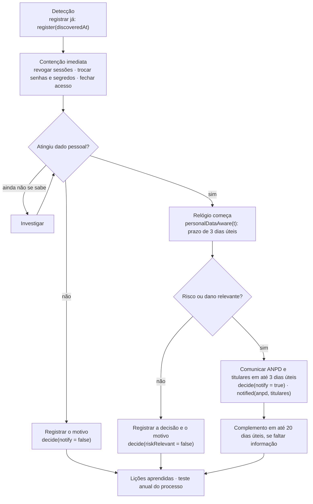

# Runbook · Incidentes de segurança com dados pessoais

> ⚖️ **Rascunho para revisão jurídica.** Base: LGPD, art. 48, e Resolução CD/ANPD 15/2024 (Regulamento de
> Comunicação de Incidente de Segurança), lida por fontes secundárias. Código: `SecurityIncidentService` e
> `ComplianceJob` ([RF18](../RF18/README.md)). Marcadores `{{…}}` como nos [Termos de Uso](TERMOS_DE_USO.md).

## 1. O que é incidente

Qualquer evento, confirmado ou suspeito, que comprometa a confidencialidade, a integridade ou a disponibilidade de
dados pessoais: acesso indevido a banco ou bucket, vazamento de log com e-mail ou IP, segredo exposto
(`FRIENDLY_EATS_APP_SECRET`, chaves do S3), sessão sequestrada em massa, perda de backup, exportação de dados (RF18)
entregue à pessoa errada.

**Todo incidente é registrado**, inclusive os que não precisam ser comunicados. O registro fica **5 anos**
(`security_incident.retain_until`).

## 2. Papéis

| Papel | Quem | O que faz |
|---|---|---|
| Quem detecta | qualquer pessoa da equipe ou de um fornecedor | avisa na hora o canal `{{CANAL_SEGURANCA}}` e o responsável de segurança |
| Responsável de segurança | `{{RESPONSAVEL_SEGURANCA}}` | coordena a contenção e registra o incidente |
| Encarregado (DPO) | `{{ENCARREGADO_NOME}}` (`friendly-eats.legal.dpo-name`) | avalia o risco, decide comunicar e assina a comunicação |
| Jurídico | `{{JURIDICO}}` | revisa a comunicação e acompanha o processo na ANPD |
| Comunicação | `{{COMUNICACAO}}` | aviso no app e por e-mail aos titulares, com texto aprovado antes |

## 3. Linha do tempo

- **Prazo:** 3 dias úteis contados de quando se soube que o incidente atingiu dados pessoais. O sistema calcula o fim
  do 3º dia útil (seg. a sex., horário de Brasília) em `communication_deadline`. ⚖️ Feriados não entram na conta, o
  que deixa o prazo mais curto, nunca mais longo. Para agente de pequeno porte o prazo pode ser em dobro (fonte
  secundária, **não verificado**): na dúvida, use o prazo simples.
- **Alerta:** o `ComplianceJob` registra no log, todo dia, os incidentes sem decisão com o prazo vencido.

## 4. Conteúdo mínimo da comunicação (LGPD, art. 48, §1º)

1. descrição da natureza dos dados pessoais afetados (`data_categories`);
2. informações sobre os titulares envolvidos (`affected_subjects`, incluindo se há crianças ou adolescentes);
3. medidas técnicas e de segurança usadas para proteger os dados;
4. riscos relacionados ao incidente;
5. motivos da demora, se a comunicação não foi imediata;
6. medidas adotadas ou que serão adotadas para reverter ou mitigar os efeitos (`measures`).

Inclua também: identificação do controlador (`{{RAZAO_SOCIAL}}`, `{{CNPJ}}`), contato do encarregado e data e hora em
que se soube do incidente. A comunicação à ANPD usa o formulário do site da Autoridade.

## 5. Aviso aos titulares

- Linguagem clara, sem jargão, em português; diga o que aconteceu, quais dados, o que fizemos e o que a pessoa pode
  fazer (trocar a senha, ativar o 2FA, ficar atenta a golpes por e-mail).
- Por e-mail e no app. Para conta de menor vinculada (RF17), avise também o responsável.
- Use um modelo de texto aprovado antes pelo jurídico.

## 6. Mitigação padrão

| Situação | Ação |
|---|---|
| Sessões possivelmente sequestradas | encerrar todas as sessões dos afetados (`SessionService.revokeAll`) |
| Senhas expostas | forçar troca de senha no próximo login |
| `FRIENDLY_EATS_APP_SECRET` exposto | trocar o segredo: os HMAC de IP e o 2FA precisam ser refeitos, e os registros de acesso cifrados com a chave antiga ficam ilegíveis (guardar a chave antiga num cofre até vencerem os 6 meses) |
| Chaves do S3 expostas | revogar e trocar as chaves; revisar a política dos buckets (`uploads/` e `exports/` nunca públicos) |
| Exportação entregue à pessoa errada | apagar o objeto em `exports/`, marcar o pedido como expirado e investigar a sessão |

## 7. Registro no sistema

Não há tela. Use o serviço interno `SecurityIncidentService` (console administrativo ou script):

| Passo | Método |
|---|---|
| Registrar | `register(IncidentDraft)`: título, descrição, `discoveredAt`, `personalDataAwareAt` (se já se sabe), categorias, número de titulares, medidas e quem registra |
| Soube depois que atingiu dado pessoal | `personalDataAware(id, quando)` |
| Decidir | `decide(id, riskRelevant, notify, motivo)`: a decisão de **não** comunicar também precisa de motivo |
| Comunicou | `notified(id, anpdEm, titularesEm)` |
| Consultar | `list()`, `get(id)`, `overdue()` |

## 8. Teste anual

Uma vez por ano, um exercício simulado com um incidente fictício, do registro à comunicação de mentira, com
registro do que funcionou e do que mudar neste runbook.
