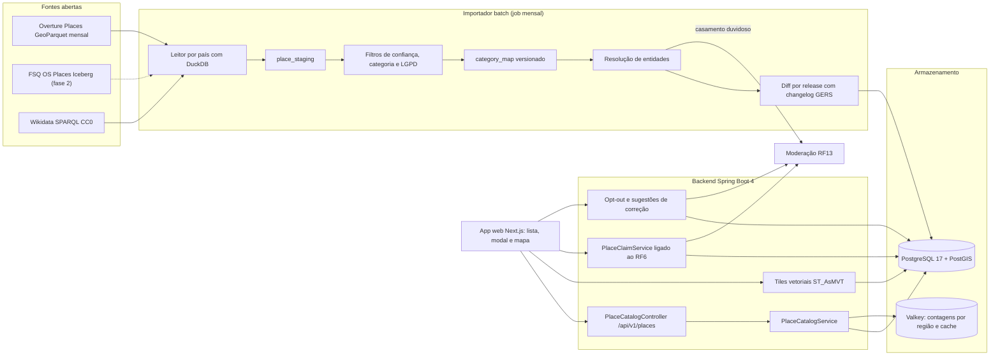
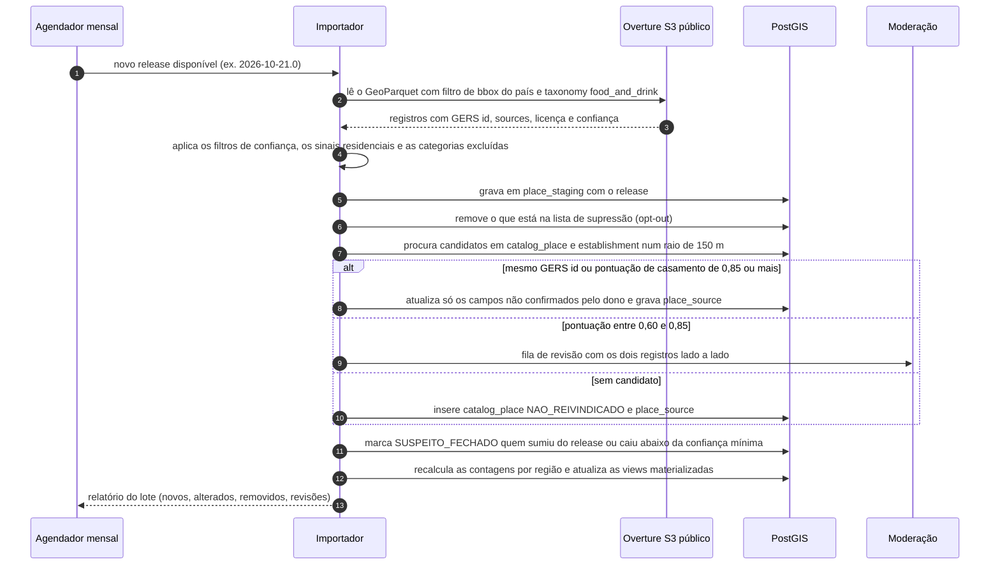
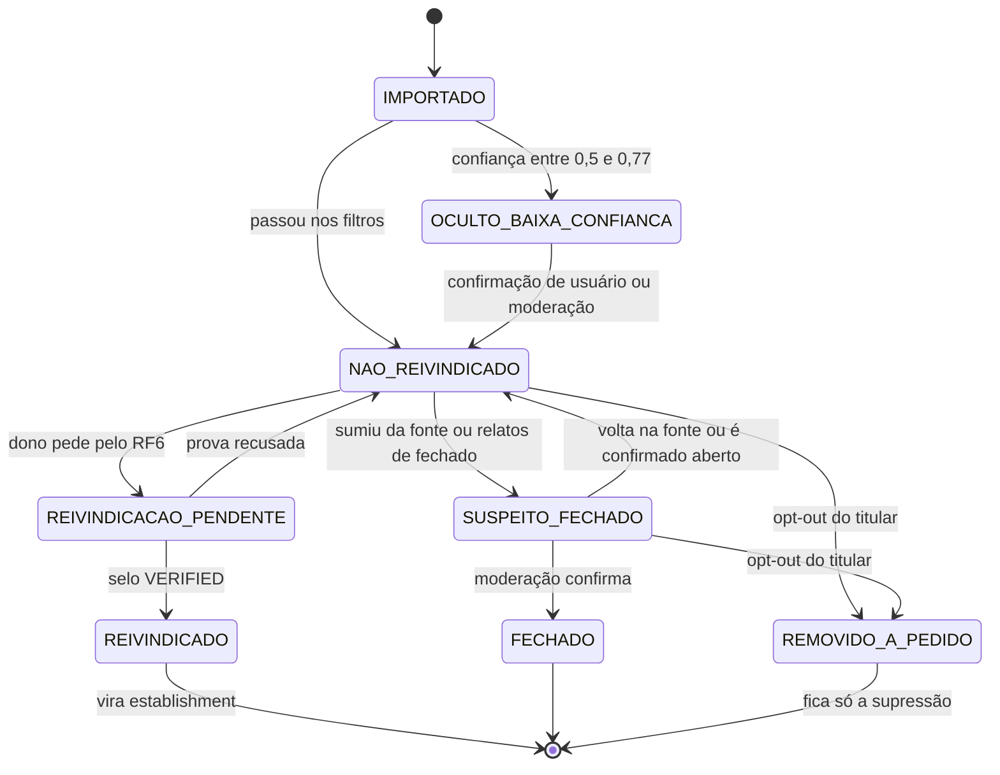

# Friendly Eats · como obter restaurantes do mundo todo para a listagem com modal

> Pesquisa feita em **25/10/2026**, sem alterar o repositório `/home/user/friendly-eats`. Preços em US$ sem impostos.
> O que não consegui confirmar na fonte primária está marcado **(não verificado)**. Nada aqui é parecer jurídico: a
> seção 7 lista o que precisa passar por advogado antes de ir ao ar.

---

## 1. Resumo executivo

1. **Base inicial: Overture Maps Places**, release mensal em GeoParquet (o último é o `2026-10-21.0`). São cerca de 11 milhões de lugares de comida e bebida no mundo, 710 mil deles no Brasil. As licenças são abertas e vêm por registro (CDLA-Permissive-2.0, Apache-2.0 e CC0), não há custo de licença, e o ID estável (GERS) permite fazer o diff entre releases.
2. **Complementos:** Wikidata (CC0) para os lugares notáveis e, na fase 2, o FSQ OS Places (Apache-2.0, exige conta), que ajuda a detectar fechamentos. O **OpenStreetMap fica fora do banco principal** até um parecer sobre o share-alike da ODbL. Google, Yelp, Tripadvisor, HERE, TomTom e Mapbox **não servem de base**, porque os termos proíbem guardar os dados (só IDs ou cache de 24 h a 30 dias).
3. **Importar numa tabela própria `catalog_place` + `place_source`**, separada de `establishment` (RF6). Cada registro guarda a origem, a licença, o release e o ID da fonte. O lugar entra como **"não reivindicado"** e passa a `establishment` quando o dono o reivindica e o selo do RF6 é conferido.
4. **LGPD por padrão:** nada de cozinha caseira, MEI em casa, e-mail ou celular sem outro sinal comercial. Endereço com cara de residência vira só bairro, ou o registro nem entra. Há opt-out sem login, com uma lista de supressão que impede a reimportação. Nota de terceiros nunca é copiada: o modal mostra só as avaliações do próprio Friendly Eats e links de saída.
5. **UX:** a lista agrupa por país → estado → cidade e por culinária. O modal acessível (o `Dialog.tsx` atual já cumpre o padrão APG) traz "De onde vem esta informação", "Não reivindicado", "Este lugar é seu?", "Pode estar desatualizado", "Ver página", "Como chegar" (link de mapas, sem API) e "Sugerir correção". A prova prática com o Overture funcionou: 2.652 lugares em Pinheiros/Vila Madalena e 2.589 na Baixa/Chiado. O Overpass do OSM foi bloqueado pela rede.

---

## 2. Tabela comparativa das fontes

Cenário de custo: **50 mil lugares novos ou atualizados por mês + 1 milhão de visualizações de modal por mês**. Nas
fontes que não deixam guardar dados, cada visualização vira uma chamada à API.

| Fonte | Licença e termos: guardar? quanto tempo? misturar? mapa de terceiro? | Atribuição | Custo no cenário | Cobertura Brasil · mundo | Campos | Atualização | Fechados / desatualizados |
|---|---|---|---|---|---|---|---|
| **Overture Maps Places** | Aberta, **por registro**: Meta, Microsoft, PinMeTo, Uberall, DAC e outros em **CDLA-Permissive-2.0**, Foursquare em **Apache-2.0** e AllThePlaces em **CC0**. Pode guardar sem prazo, misturar e exibir em qualquer mapa. Obrigação: disponibilizar o texto da licença (CDLA) e o NOTICE (Apache) | "Overture Maps Foundation" + fontes; NOTICE da Foursquare | **US$ 0** de licença; download do S3 público; ~1 GB no PostGIS para o Brasil (estimativa) | **BR 709.904** lugares `food_and_drink` (288.975 com confiança ≥ 0,77) · **mundo 10,99 mi** (6,09 mi ≥ 0,77). Medido no release 2026-10-21.0 | nome, ponto, endereço, `taxonomy` (~2.300 categorias), `basic_category`, telefones, sites, redes, e-mails, marca, confiança, `operating_status`. **Sem horário, preço ou nota** | mensal; taxonomia trimestral; GERS com changelog | `operating_status` quase vazio (0 % SP, 0,4 % Lisboa); confiança < 0,5 em 26,9 % (SP) e 14,5 % (Lisboa) da amostra |
| **FSQ OS Places** (dataset aberto, nov/2024) | **Apache-2.0**, com uso comercial. Pode guardar e misturar, com qualquer mapa. Desde 2025 o acesso exige conta (Places Portal / Iceberg ou Hugging Face *gated*) | Apache: LICENSE + NOTICE ("Copyright 2024 Foursquare Labs") | US$ 0 de licença | mundo **100 mi+** (2024); 200+ países (fonte secundária) · BR **não verificado** | 26 colunas: nome, lat/lon, endereço, localidade, região, CEP, país, `fsq_category_ids/labels`, tel, site, e-mail, Facebook, Instagram, X, `date_created`, `date_refreshed`, **`date_closed`**. **Sem horário, nota, preço ou fotos** | mensal (último `dt=2026-10-15`) | tem `date_closed` e `date_refreshed`; taxa **não verificada** |
| **Foursquare Places API** (Pro/Premium) | Só o `fsq_place_id` pode ser guardado sem limite. Os outros campos: **nenhum cache** no plano pay-as-you-go e cache de 24 h no aparelho no Enterprise (Usage Guidelines) | "Powered by Foursquare" em toda tela com dados | Pro: 0–500 a US$ 0, depois US$ 15 / 12 / 9 por mil. 1 mi de views ≈ **US$ 10,7 mil/mês** | mundo amplo · BR não verificado | completos, com horário, nota, preço e fotos (Premium a US$ 18,75/mil) | contínua | não verificado |
| **Google Places API (New)** | Guarda **só o `place_id`** sem prazo; **lat/lng por até 30 dias** (Service Terms §14.3). O resto não pode ser guardado. Pode usar **sem mapa**, mas **nunca com mapa que não seja Google** (§14.2). O **Places UI Kit** pode ficar sobre qualquer mapa (§15.1), sem extrair os dados | logo do Google Maps (16–19 dp), "Google Maps" em texto só sem espaço, autores de fotos e avaliações e link `googleMapsUri` | Busca só com IDs: grátis. Details Pro (nome, status, link): 5 mil grátis, depois US$ 17 / 13,60 por mil. Enterprise (telefone, site, horário, preço, nota): 1 mil grátis, depois US$ 20 / 16. 1 mi de views ≈ **US$ 12–14 mil/mês** (a 3ª faixa é estimada, **não verificado**). Places UI Kit: 10 mil grátis, depois US$ 1,00 / 0,80 / 0,60 por mil ≈ **US$ 0,7 mil/mês** | a melhor do Brasil e do mundo (sem número público, **não verificado**) | todos, inclusive `businessStatus`, `priceRange` e `rating` | contínua | `businessStatus` (`CLOSED_PERMANENTLY`); taxa não verificada |
| **OpenStreetMap** (Overpass, Geofabrik) | **ODbL 1.0**: pode guardar e exibir em qualquer mapa. **Share-alike:** juntar restaurantes do OSM com restaurantes de outra fonte gera banco derivado, que precisa ser oferecido sob ODbL (guideline OSMF de 2014, exemplo literal de restaurantes). O Overpass público não serve para uso comercial ou regular | "© OpenStreetMap contributors" com link para `/copyright` | US$ 0 + hospedar extrato próprio (o Overpass público tem teto de 10 mil consultas/dia e o uso regular deve ser 100× menor) | **BR:** 37.330 `restaurant`, 19.202 `fast_food`, 4.264 `cafe`, 7.478 `bar` (taginfo, 24/10/2026) · mundo 1,63 mi `restaurant` | Nos restaurantes do BR: `cuisine` 40,5 %, telefone 14,8 % (+1,6 % `contact:phone`), `opening_hours` 12,7 %, site 7,1 %; também `diet:*` e `wheelchair` | minuto a minuto; extratos diários | `check_date` em só 4 % dos restaurantes do BR, então a defasagem é desconhecida |
| **Yelp Places API (Fusion)** | Cache máximo de **24 h**, só o ID do negócio pode ser guardado (§5a). **Proibido exibir a nota do Yelp junto com outro conteúdo de usuário** (§5c). Não pode usar geocódigo com OSM (§5g). Produto de consumo exige o plano Enterprise. Termos de 22/09/2026 | logo e link, conforme o *Display Requirements* | US$ 7,99–14,99 por mil (preços de 2024; 2026 **não verificado**) ≈ **US$ 8–15 mil/mês** | aceita `pt_BR` e `pt_PT`, mas o Yelp recuou para fora da América do Norte em 2016. Densidade no BR **não verificada** (provavelmente baixa) | completos, com nota e preço | contínua | não verificado |
| **Tripadvisor Content API** | 5 mil chamadas grátis por mês, depois pay-as-you-go com preço só no checkout. Crédito obrigatório com o logo e as "bolhas". Guardar dados: **não verificado** (o FAQ remete aos Master Terms). A plataforma "Terra" vai substituí-la | logo + bolhas + link | > 5 mil/mês: **não verificado** | forte em turismo · BR não verificado | nome, endereço, culinária, nota, até 5 avaliações e 5 fotos (fonte secundária) | contínua | não verificado |
| **HERE Geocoding & Search** | Cache de **30 dias**. Guardar de vez exige o contrato "Permanent Geocoding", sem redistribuição. Pode usar com outro mapa. Proíbe uso em IA/ML (§6.4, fonte secundária) | "© HERE" | plano grátis de 30 mil a 250 mil por mês (fontes divergem) e ~US$ 0,4–1 por mil (**não verificado**) | global · BR não verificado | nome, ponto, endereço, categorias e `foodTypes`, telefone, site, horário | contínua | não verificado |
| **TomTom Search** | Cache só pelo tempo dos cabeçalhos HTTP. **Proíbe montar banco derivado** (fonte secundária). Pode usar com outro mapa | "© TomTom" | 2.500 grátis por dia, depois US$ 2,50 por mil ≈ **US$ 2,3 mil/mês**. Preços novos desde 01/07/2026 | global · BR não verificado | nome, ponto, endereço, categoria, telefone, site, horário | contínua | não verificado |
| **Mapbox Search Box** | "Temporary use" por padrão. O uso permanente é negociado com vendas | campo `attribution` | por sessão, preço **não verificado** | a documentação lista **EUA, Canadá e Europa**, então é fraca no Brasil | nome, ponto, endereço, categoria | contínua | não verificado |
| **Wikidata** | **CC0**: pode guardar, misturar e exibir em qualquer mapa | não obrigatória (recomendado citar) | US$ 0 (SPARQL com teto de 60 s) | **27 restaurantes** num raio de 12 km do centro de SP e **29** no de Lisboa (consulta de 25/10/2026) | nome, ponto, culinária (P2012), site, fundação e dissolução, prêmios (P166), link da Wikipédia | contínua | `P576` (dissolução); 0 na amostra |
| **Guia Michelin** | **Não tem API.** A seleção, os textos, as fotos e a marca e o logo das estrelas são da Michelin. Os termos de API proíbem raspar para montar base (o termo do site não abriu, **não verificado**). **Permitido:** link para a página do guia e o fato declarado pelo dono ("1 estrela Michelin 2026"), sem logo, com moderação. **Proibido:** raspar, copiar a lista ou os textos, usar o logo | — | — | — | — | — | — |
| **iFood** | **Não há API pública de catálogo.** O portal `developer.ifood.com.br` é para parceiros integrarem a **própria** loja (pedidos, catálogo, merchant), com cadastro e homologação. O portal respondeu 403 e a fonte é secundária, então **não verificado** | — | — | — | — | — | — |
| **Google Business Profile API** | **Não é catálogo.** Dá acesso só a perfis que a conta gerencia, mediante pedido aprovado pelo Google (regra dos 60 dias **não verificada**). Serve no fluxo de **reivindicação**, com OAuth do dono, e não para importar lugares de terceiros | — | grátis com aprovação | — | os do próprio perfil | — | — |

**Conclusão da tabela:** só as fontes abertas (Overture, FSQ OS, OSM e Wikidata) deixam montar um banco próprio. Entre
elas, o Overture é o único que combina cobertura alta no Brasil (cerca de 10× o OSM em comida e bebida), licença que não
contamina os dados dos donos e ID estável entre releases.

---

## 3. Arquitetura proposta

### 3.1 Decisões

| Tema | Decisão |
|---|---|
| Fonte inicial | Overture Places, por país, só os ramos `food_and_drink` e as lojas de comida de `shopping > food_and_beverage_store` (padaria, açougue, empório…) |
| Filtro de existência | `confidence ≥ 0,77` para publicar (essa era a mediana na amostra de SP). O Overture diz que a nota **não é calibrada entre fontes** e sugere `> 0,95` para "existe com certeza". Proposta: ≥ 0,77 publica, de 0,5 a 0,77 entra como `HIDDEN_LOW_CONFIDENCE` e só aparece depois de uma confirmação (avaliação, check-in ou sugestão aceita), e < 0,5 não entra. Calibrar por país depois de medir em campo |
| Onde gravar | Tabela **`catalog_place`**, separada de `establishment`. Motivo: `establishment` exige `owner_id NOT NULL`, `uf`, `municipality_ibge` de 7 dígitos e coordenada no Brasil (RF6), e a busca do RF10 só mostra páginas com selo `VERIFIED`. Afrouxar essas regras quebraria o RF6. A separação também ajuda a provar que os dados de terceiros e os dos donos são bancos independentes (seção 7) |
| Proveniência | **`place_source`**, 1 linha por fonte e registro: fonte, dataset (`meta`, `Foursquare`…), licença, ID externo, release, `update_time` e os campos fornecidos. `catalog_place.field_sources` diz de onde veio cada campo exibido |
| Precedência por campo | dono confirmado (RF6) > moderação > sugestão de usuário aceita > fonte de maior confiança > outras fontes. Campo confirmado pelo dono **nunca é sobrescrito** pela importação |
| Local fora do Brasil | país ISO 3166-1, `admin1` ISO 3166-2, localidade e bairro pelo tema **divisions** do Overture (com nomes em pt). No Brasil, também `municipality_ibge` pela malha do IBGE (ponto no polígono) para reaproveitar o RF10 |
| 18+ | A regra do RF6 vale para o catálogo: um tipo principal `BAR`, `BOTECO`, `GASTROBAR`, `BAR_COQUETELARIA`, `BAR_VINHOS`, `CERVEJARIA`, `VINICOLA_DESTILARIA` ou `ADEGA` marca `adultsOnly` (lista e modal só para adulto logado) |
| Preço | O catálogo nasce com `PRICE_UNKNOWN`. Nenhuma fonte aberta tem preço, e a escala do RF6 é em BRL. Fora do Brasil, o preço só aparece quando houver uma escala por moeda (pendência) |
| Chip | ⚠️ A regra 3 do chip (RF7) faz `REFEICOES`/`CARNES_PESCADOS` → `BRASILEIRA`. Uma marisqueira em Lisboa sairia com o chip "Brasileira". Proposta: no catálogo fora do BR, sem culinária, esses formatos ficam sem chip (exige mudar o RF7) |
| Classificação incompleta | Na amostra, 44–46 % dos lugares só têm o **tipo** (bar ou restaurante genérico), sem culinária nem formato, o que o RF7 recusa. O catálogo aceita `classification_status = PENDENTE` até o dono ou a moderação completar |

### 3.2 Componentes



### 3.3 Sequência da importação



### 3.4 Estados do lugar do catálogo



### 3.5 Deduplicação e resolução de entidades

- **Bloqueio:** candidatos por `ST_DWithin(point, :p, 150)` (até 500 m quando a precisão é de bairro ou município) e
  mesmo grupo de tipo ou grupo compatível (`RESTAURANTE` e `RAPIDO` se cruzam, `VAREJO` e `BAR` não).
- **Nome normalizado:** `lower(f_unaccent(nome))`, sem pontuação, sem termos genéricos (`restaurante`, `bar`,
  `lanchonete`, `cafe`, `ltda`, `me`, `eireli`, `& cia`, artigos) e sem o nome do bairro ou da filial ("– Pinheiros").
  Similaridade `pg_trgm.similarity` (já há índice trigrama no nome, V2) ou Jaro-Winkler no importador.
- **Telefone em E.164**, por igualdade, **só como reforço**. Na amostra, 52 pares em SP e 75 em Lisboa a menos de
  100 m têm o **mesmo telefone e nomes diferentes**: boxes de mercado (Mercado da Ribeira, Mercado de São Bento), o bar
  e a coquetelaria da mesma casa, ou erro da fonte. O telefone sozinho junta coisas que não são a mesma.
- **Pontuação** (calibrar com uns 300 pares rotulados à mão):
  `0,45·sim_nome + 0,25·(1 − d/150 m) + 0,15·telefone_igual + 0,10·domínio_do_site_igual + 0,05·categoria_compatível`.
  Com 0,85 ou mais junta sozinho, entre 0,60 e 0,85 vai para a moderação, abaixo de 0,60 fica separado. **Mesmo GERS
  id** sempre junta.
- **Duplicata dentro do Overture:** 8 pares (SP) e 9 (Lisboa) com o mesmo nome a menos de 100 m. A mesma rotina
  resolve, e a linha de maior confiança fica como principal.
- **Com o RF6:** no cadastro do dono (`POST /api/v1/establishments`), antes de criar, mostrar "Este lugar já está no
  Friendly Eats?" com os candidatos do catálogo. Escolher um deles vira reivindicação, e não um lugar duplicado.

### 3.6 Fluxo de reivindicação (liga ao RF6)

1. No modal ou na página: **"Este lugar é seu?"** → login. Conta `ESTABELECIMENTO` ou `VAREJO` ativa (o RF6 recusa as outras).
2. `POST /api/v1/places/{id}/claims` cria `place_claim` como `PENDENTE` e o lugar vai para `REIVINDICACAO_PENDENTE`. O
   público continua vendo o catálogo.
3. Provas, as mesmas etapas da taxonomia 7.4: CNPJ ativo e nome parecido; endereço do CNPJ batendo com o ponto;
   vínculo (QSA, termo do sócio ou e-mail no domínio do site); posse (código por ligação ou SMS para o **telefone que já
   estava no catálogo**, carta ou documento). Opcional: OAuth do Google Business Profile, para quem já gerencia o
   perfil (**não verificado** se os termos da API permitem esse uso).
4. Aprovado: cria-se o `establishment` com `owner_id` e `catalog_place_id`. O dono **confirma ou corrige cada campo**,
   e o pino vira `GEO_PIN_CONFIRMED`. Campo não confirmado sai, ou fica com a atribuição da fonte. O catálogo passa a
   `REIVINDICADO` e a URL antiga redireciona (301) para `/lugares/{id}`.
5. Fora do Brasil não há CNPJ. Na v1, a reivindicação estrangeira fica **desligada**, e o botão leva a "avise-me".
   O RF1 precisaria de um registro empresarial genérico.

### 3.7 Atualização, fechados, remoção e LGPD

- **Diff por release:** o changelog do GERS (`added`, `removed`, `data_changed`, `unchanged`) é processado só no que
  mudou. Uma divisão ou fusão gera ID novo sem ligação com o antigo, e aí a resolução de entidades refaz o vínculo.
  Mudança de nome pode trocar o ID. Um campo com `update_time` mais antigo que o valor atual não sobrescreve.
- **Fechados:** os sinais são `operating_status = permanently_closed`, confiança que cai para menos de 0,3, sumiço do
  release em 2 meses seguidos, `date_closed` do FSQ OS (fase 2), `P576` do Wikidata e 3 relatos "fechou" de usuários
  diferentes. Qualquer um deles leva a `SUSPEITO_FECHADO`, com a faixa "Pode ter fechado" no modal. Daí vai a `FECHADO`
  por moderação ou depois de 60 dias sem contraprova. O lugar fechado **com avaliações** continua visível, como o
  `CLOSED` do RF6. Sem avaliações, sai da lista.
- **Remoção a pedido (opt-out):** um link "Remover ou corrigir este lugar" em todo modal, **sem exigir login**,
  confirmado por e-mail ou pelo telefone do lugar. Remove em até 15 dias (proposta) e grava em `place_suppression` o
  `(fonte, id_externo)` e o hash de `nome_normalizado + geohash7`, para o lugar **não voltar no próximo release**.
- **LGPD (cozinha caseira e MEI em casa):**
  - **não importar** as categorias ligadas a casa (`caterer`, `personal_chef`, `home_service`, padaria ou confeitaria
    caseira) nem os tipos `COZINHA_ARTESANAL`, `MARMITARIA` e `BUFE_EVENTOS`;
  - **não importar a rua** quando o endereço tem marcador de unidade residencial (`apto`, `apartamento`, `bloco`,
    `casa 2`, `fundos`, `r/c`, `esq.`, `dto`) ou quando o ponto cai num prédio `residential`, `house` ou `apartments`
    do tema buildings do Overture **sem** sinal comercial (site, marca, telefone fixo). O lugar fica como
    `ADDR_PUBLIC_BAIRRO`, com a grade de 0,005° do RF6, ou não entra. Na amostra, 11 endereços em SP e 13 em Lisboa
    (~0,5 %) têm marcador de unidade;
  - **e-mail nunca** (o Overture traz `emails`). Rede social, só quando for página de empresa;
  - **celular:** 33 % dos telefones da amostra de SP e 40 % dos de Lisboa são celulares. Sem outro sinal comercial,
    o celular não é exibido antes da reivindicação. A amostra também tem número de mentira (`+351912345678`), então o
    telefone precisa de validação de formato e de uma lista de números de teste;
  - **base legal:** legítimo interesse (LGPD, Art. 7º, IX e Art. 10), com teste de balanceamento registrado (Guia da
    ANPD de 02/02/2024). Para os dados de acesso público, o Art. 7º, §§ 3º e 4º. Direito de oposição (Art. 18, §2º)
    pelo opt-out. Aviso no `/termos` e na página de privacidade.

### 3.8 Avaliações: o que pode e o que não pode

| Pode | Não pode |
|---|---|
| Mostrar **só as avaliações do Friendly Eats** (RF8), com os estados `RATING_NONE` ("Sem avaliações ainda: seja a primeira pessoa"), `RATING_FEW` e `RATED` | Copiar, guardar ou calcular média com notas do Google, Yelp, Tripadvisor ou Foursquare (os termos só deixam guardar IDs. O Yelp proíbe a nota dele ao lado de outro conteúdo de usuário) |
| Link de saída: "Ver no Google Maps" com a URL pública do Maps (`https://www.google.com/maps/search/?api=1&query=…`), sem chave nem dados guardados | Exibir estrela ou bolha de terceiro dentro do nosso card ou da nossa média |
| Opcional, **sob demanda e sem guardar**: o elemento Place Details do **Places UI Kit**, que o Google renderiza com a própria atribuição e a nota dele, num bloco separado "No Google Maps" (≈ US$ 0,7 mil por 1 milhão de aberturas) | Usar a nota de terceiro no score de relevância (RF10) |
| Distinção (Michelin, prêmio local) **declarada pelo dono** e conferida pela moderação, em texto, com link para a fonte | Logo da Michelin, raspagem do guia |

---

## 4. Mapeamento de categorias (amostra)

**Regra geral** (protótipo em `scripts/mapear_categorias.py`):

1. Sobe-se a hierarquia da fonte do nó mais específico para a raiz. O primeiro nó com **tipo** define o tipo.
2. O primeiro nó com **formato** define o formato. **Se o nó específico é um formato (pizza, sushi, kebab), a culinária
   não é herdada dos ancestrais**, porque "a culinária sugerida nunca é aplicada sozinha" (taxonomia 4.1). No Overture,
   `pizza_restaurant` fica debaixo de `italian_restaurant`, e sem essa regra toda pizzaria viraria `ITALIANA`.
3. A culinária vem do primeiro nó mapeado enquanto não houver formato. Uma culinária sem código no Friendly Eats cai na
   genérica do ancestral (`nepalese` → `himalayan` → `south_asian` → `asian_restaurant` → `ASIATICA`), como manda a
   regra do OSM ("use o valor mais específico").
4. `special_diet_restaurant > vegan…` vira **dica** de estilo (`VEGANO=EXCLUSIVO`), mostrada como "segundo a fonte"
   até o dono confirmar.
5. A tabela `category_map` é versionada (a taxonomia do Overture muda a cada trimestre e o campo `categories` foi
   removido em set/2026).

| # | Fonte | Valor de origem | Tipo | Culinária | Formato | Observação |
|---|---|---|---|---|---|---|
| 1 | OSM | `amenity=restaurant` + `cuisine=brazilian` | `RESTAURANTE_A_LA_CARTE` | `BRASILEIRA` | — | |
| 2 | OSM | `amenity=restaurant` + `cuisine=regional` | `RESTAURANTE_A_LA_CARTE` | — (revisar) | — | `regional` está em 7,5 % dos restaurantes do OSM no Brasil e é ambíguo |
| 3 | OSM | `amenity=restaurant` + `cuisine=pizza` | `RESTAURANTE_A_LA_CARTE` | — | `PIZZA` | não aplica `ITALIANA` |
| 4 | OSM | `amenity=restaurant` + `cuisine=japanese;sushi` | `RESTAURANTE_A_LA_CARTE` | `JAPONESA` | `SUSHI` | o `;` separa valores no OSM. Os dois eixos ficam preenchidos |
| 5 | OSM | `amenity=fast_food` + `cuisine=burger` | `FAST_FOOD` | — | `HAMBURGUER` | |
| 6 | OSM | `amenity=cafe` + `cuisine=coffee_shop` | `CAFETERIA` | — | `CAFE` | |
| 7 | OSM | `amenity=fast_food` + `cuisine=açaí` | `ACAITERIA_SUCOS` | — | `ACAI` | |
| 8 | OSM | `amenity=restaurant` + `cuisine=lebanese` | `RESTAURANTE_A_LA_CARTE` | `ARABE` | — | `ARABE` absorve a libanesa |
| 9 | OSM | `amenity=restaurant` + `diet:vegan=only` | `RESTAURANTE_A_LA_CARTE` | — | — | estilo `VEGANO=EXCLUSIVO` → chip `VEGETAL` |
| 10 | OSM | `amenity=bar` | `BAR` | — | — | 18+, classificação pendente |
| 11 | Foursquare | *Mineiro Restaurant* | `RESTAURANTE_A_LA_CARTE` | `MINEIRA` | — | rótulos FSQ de memória: conferir no CSV de categorias (**não verificado**) |
| 12 | Foursquare | *Baiano Restaurant* | `RESTAURANTE_A_LA_CARTE` | `BAIANA` | — | |
| 13 | Foursquare | *Northeastern Brazilian Restaurant* | `RESTAURANTE_A_LA_CARTE` | `NORDESTINA` | — | |
| 14 | Foursquare | *Churrascaria* | `RESTAURANTE_A_LA_CARTE` (revisar `RODIZIO`) | — | `CHURRASCO` | `GAUCHA` é só sugestão e não é aplicada |
| 15 | Foursquare | *Pastelaria* | `LANCHONETE` | — | `PASTEL` | |
| 16 | Foursquare | *Tapiocaria* | `LANCHONETE` | — | `TAPIOCA` | |
| 17 | Foursquare | *Food Truck* | `FOOD_TRUCK` | — | — | ponto móvel: `GEO_MUNICIPIO_CENTROID` |
| 18 | Overture | `portuguese_restaurant` (…> `iberian_restaurant` >) | `RESTAURANTE_A_LA_CARTE` | `PORTUGUESA` | — | 339 em Lisboa |
| 19 | Overture | `pizza_restaurant` (> `italian_restaurant` >) | `RESTAURANTE_A_LA_CARTE` | — | `PIZZA` | não herda `ITALIANA` |
| 20 | Overture | `sushi_restaurant` (> `japanese_restaurant` >) | `RESTAURANTE_A_LA_CARTE` | — | `SUSHI` | chip `ASIATICA` pela família |
| 21 | Overture | `doner_kebab_restaurant` (> `turkish_restaurant` >) | `RESTAURANTE_A_LA_CARTE` | — | `KEBAB_SHAWARMA` | `TURCA` não é herdada |
| 22 | Overture | `tapas_bar` | `BAR` | — (revisar) | `PETISCOS_BOTECO` | em Lisboa, costuma ser petisco português |
| 23 | Overture | `nepalese_restaurant` | `RESTAURANTE_A_LA_CARTE` | `ASIATICA` (herdada) | — | candidata a `NEPALESA` (taxonomia 3.4) |
| 24 | Overture | `moroccan_restaurant` (> `african` > `north_african` >) | `RESTAURANTE_A_LA_CARTE` | `MARROQUINA` | — | macros diferentes: o Overture põe na África, a taxonomia no Oriente Médio |
| 25 | Overture | `georgian_restaurant` (> `middle_eastern_restaurant` >) | `RESTAURANTE_A_LA_CARTE` | `ORIENTE_MEDIO` (herdada) | — | revisar: Cáucaso |
| 26 | Overture | `asian_fusion_restaurant` | `RESTAURANTE_A_LA_CARTE` | `ASIATICA` | — | abordagem `FUSION` (válida pela genérica da macro, RF7) |
| 27 | Overture | `vegan_restaurant` | `RESTAURANTE_A_LA_CARTE` | — | — | `VEGANO=EXCLUSIVO` como dica |
| 28 | Overture | `bakery` | `PADARIA` | — | `PAES` | |
| 29 | Overture | `wine_bar` / `cocktail_bar` / `pub` | `BAR_VINHOS` / `BAR_COQUETELARIA` / `GASTROBAR` | — | `VINHO` / `COQUETEIS_DESTILADOS` / — | 18+ |
| 30 | Overture | `hookah_bar`, `tobacco_shop`, `internet_cafe`, `vitamin_and_supplement_store` | **excluir** | | | não é lugar de comida |

**Cobertura medida na amostra Overture** (arquivo `data/mapeamento_cobertura.txt`):

| Região | Lugares | Com culinária | Com formato | Só o tipo | Classificação completa (OK) | Excluídos |
|---|---|---|---|---|---|---|
| SP · Pinheiros + Vila Madalena | 2.652 | 17,5 % | 34,5 % | 45,6 % | 62,5 % | 46 |
| Lisboa · Baixa + Chiado | 2.589 | 24,9 % | 30,2 % | 43,5 % | 62,2 % | 19 |

As culinárias regionais brasileiras (`MINEIRA`, `BAIANA`, `NORDESTINA`…) **não aparecem no Overture**. Elas só
existem no Foursquare (14 filhas de *Brazilian Restaurant*) e virão do dono ou do FSQ OS na fase 2.

---

## 5. Modelo de dados proposto (só proposta, sem migração)

```sql
-- PROPOSTA · não é migração. Quando for implementar: nova V{n}__catalogo_lugares.sql (começando com linha em
-- branco) + o mesmo texto anexado a schema.sql (SchemaConsistencyTest), e um RF novo em docs/RFn/ (CLAUDE.md).

-- Lugar do catálogo (importado, sem dono). Separado de establishment para não afrouxar o RF6.
-- CREATE TABLE catalog_place (
--     id                    BIGINT GENERATED ALWAYS AS IDENTITY PRIMARY KEY,
--     public_slug           VARCHAR(80)  NOT NULL UNIQUE,            -- URL estável /lugares/c/{slug}
--     name                  VARCHAR(160) NOT NULL,
--     primary_type          VARCHAR(32)  NOT NULL,                   -- códigos da taxonomia (seção 7)
--     secondary_types       JSONB        NOT NULL DEFAULT '[]',
--     type_group            VARCHAR(16)  NOT NULL,
--     primary_cuisine       VARCHAR(32),
--     primary_format        VARCHAR(32),
--     approach              VARCHAR(16)  NOT NULL DEFAULT 'TRADICIONAL',
--     dietary_hints         JSONB        NOT NULL DEFAULT '{}',      -- {"VEGANO":"EXCLUSIVO"} segundo a fonte
--     classification_status VARCHAR(12)  NOT NULL DEFAULT 'PENDENTE',-- PENDENTE | COMPLETA | REVISAR
--     -- local mundial: ISO + divisões do Overture; IBGE só no Brasil
--     country               VARCHAR(2)   NOT NULL,                   -- ISO 3166-1 alfa-2
--     admin1_code           VARCHAR(6),                              -- ISO 3166-2 (BR-SP, PT-11)
--     admin1_name           VARCHAR(120),
--     locality_name         VARCHAR(120),
--     division_gers_id      VARCHAR(40),                             -- localidade do tema divisions
--     municipality_ibge     VARCHAR(7),                              -- só country = 'BR'
--     neighborhood          VARCHAR(120),
--     street                VARCHAR(160),                            -- NULL quando há sinal residencial
--     street_number         VARCHAR(20),
--     postcode              VARCHAR(12),
--     latitude              DOUBLE PRECISION NOT NULL,
--     longitude             DOUBLE PRECISION NOT NULL,
--     point                 GEOGRAPHY(POINT, 4326) GENERATED ALWAYS AS
--                               (ST_SetSRID(ST_MakePoint(longitude, latitude), 4326)::geography) STORED,
--     geo_precision         VARCHAR(24)  NOT NULL DEFAULT 'GEO_STREET',
--     address_visibility    VARCHAR(20)  NOT NULL DEFAULT 'ADDR_PUBLIC_FULL',
--     phone_e164            VARCHAR(20),
--     phone_public          BOOLEAN      NOT NULL DEFAULT FALSE,     -- celular sem sinal comercial = FALSE
--     website               VARCHAR(300),
--     confidence            NUMERIC(4,3),                            -- da melhor fonte
--     field_sources         JSONB        NOT NULL DEFAULT '{}',      -- {"name":"OVERTURE:meta","phone":"OVERTURE:Foursquare"}
--     status                VARCHAR(24)  NOT NULL DEFAULT 'IMPORTADO',
--         -- IMPORTADO | OCULTO_BAIXA_CONFIANCA | NAO_REIVINDICADO | REIVINDICACAO_PENDENTE | REIVINDICADO
--         -- | SUSPEITO_FECHADO | FECHADO | REMOVIDO_A_PEDIDO
--     establishment_id      BIGINT UNIQUE REFERENCES establishment (id), -- preenchido ao reivindicar
--     first_seen_release    VARCHAR(20)  NOT NULL,
--     last_seen_release     VARCHAR(20)  NOT NULL,
--     suspected_closed_at   TIMESTAMPTZ,
--     created_at            TIMESTAMPTZ  NOT NULL DEFAULT now(),
--     updated_at            TIMESTAMPTZ  NOT NULL DEFAULT now(),
--     version               BIGINT       NOT NULL DEFAULT 0,
--     CONSTRAINT chk_catalog_ibge CHECK (municipality_ibge IS NULL OR (country = 'BR' AND municipality_ibge ~ '^[0-9]{7}$'))
-- );
-- CREATE INDEX idx_catalog_point    ON catalog_place USING GIST (point);
-- CREATE INDEX idx_catalog_region   ON catalog_place (country, admin1_code, locality_name) WHERE status = 'NAO_REIVINDICADO';
-- CREATE INDEX idx_catalog_cuisine  ON catalog_place (primary_cuisine, country);
-- CREATE INDEX idx_catalog_name_trgm ON catalog_place USING GIN (lower(f_unaccent(name)) gin_trgm_ops);

-- Proveniência e licença POR REGISTRO (uma linha por fonte que contribuiu)
-- CREATE TABLE place_source (
--     id                BIGINT GENERATED ALWAYS AS IDENTITY PRIMARY KEY,
--     catalog_place_id  BIGINT       NOT NULL REFERENCES catalog_place (id) ON DELETE CASCADE,
--     source            VARCHAR(16)  NOT NULL,   -- OVERTURE | FSQ_OS | WIKIDATA | OSM | USER | MODERACAO
--     source_record_id  VARCHAR(80)  NOT NULL,   -- GERS id, fsq_place_id, Qid, osm node/way
--     source_dataset    VARCHAR(40),             -- meta, Foursquare, Microsoft, AllThePlaces…
--     license           VARCHAR(24)  NOT NULL,   -- CDLA-Permissive-2.0 | Apache-2.0 | CC0-1.0 | ODbL-1.0
--     attribution       VARCHAR(200) NOT NULL,   -- texto mostrado em "De onde vem esta informação"
--     source_release    VARCHAR(20),             -- 2026-10-21.0
--     source_update_time TIMESTAMPTZ,
--     fields_provided   JSONB        NOT NULL DEFAULT '[]', -- ["name","phone","categories"]
--     raw               JSONB,                   -- só os campos usados, nunca e-mail
--     confidence        NUMERIC(4,3),
--     fetched_at        TIMESTAMPTZ  NOT NULL DEFAULT now(),
--     removed_at        TIMESTAMPTZ,             -- sumiu do release
--     CONSTRAINT uk_place_source UNIQUE (source, source_record_id)
-- );

-- Opt-out que sobrevive à reimportação (só hash, sem dado pessoal em claro)
-- CREATE TABLE place_suppression (
--     id               BIGINT GENERATED ALWAYS AS IDENTITY PRIMARY KEY,
--     source           VARCHAR(16),
--     source_record_id VARCHAR(80),
--     name_geo_hash    CHAR(64)    NOT NULL,     -- sha256(nome_normalizado || geohash7)
--     reason           VARCHAR(24) NOT NULL,     -- RESIDENCIA | NAO_EXISTE | PEDIDO_DO_TITULAR | DUPLICADO
--     requested_at     TIMESTAMPTZ NOT NULL DEFAULT now()
-- );

-- Reivindicação pelo dono (RF6)
-- CREATE TABLE place_claim (
--     id               BIGINT GENERATED ALWAYS AS IDENTITY PRIMARY KEY,
--     catalog_place_id BIGINT      NOT NULL REFERENCES catalog_place (id),
--     account_id       BIGINT      NOT NULL REFERENCES user_account (id),
--     status           VARCHAR(12) NOT NULL DEFAULT 'PENDENTE', -- PENDENTE | APROVADA | RECUSADA
--     method           VARCHAR(24),                             -- CNPJ_TELEFONE | EMAIL_DOMINIO | CARTA | DOCUMENTO
--     evidence_hash    CHAR(64),
--     created_at       TIMESTAMPTZ NOT NULL DEFAULT now(),
--     decided_at       TIMESTAMPTZ
-- );

-- Sugestões de correção de usuários (fechou, mudou de endereço, categoria errada)
-- CREATE TABLE place_correction (id ..., catalog_place_id ..., author_id ..., field VARCHAR(32), proposed JSONB,
--     status VARCHAR(12), created_at TIMESTAMPTZ);

-- Mapeamento de categorias versionado
-- CREATE TABLE category_map (
--     source VARCHAR(16), source_code VARCHAR(80), map_version VARCHAR(16),
--     action VARCHAR(8),                 -- MAP | EXCLUDE | REVIEW
--     primary_type VARCHAR(32), cuisine VARCHAR(32), format VARCHAR(32), dietary JSONB, approach VARCHAR(16),
--     PRIMARY KEY (source, source_code, map_version)
-- );

-- Lote de importação (auditoria e relatório)
-- CREATE TABLE import_run (id ..., source VARCHAR(16), release VARCHAR(20), country VARCHAR(2), started_at TIMESTAMPTZ,
--     finished_at TIMESTAMPTZ, added INT, changed INT, removed INT, to_review INT, status VARCHAR(12));

-- Ligação do lado do RF6
-- ALTER TABLE establishment ADD COLUMN catalog_place_id BIGINT UNIQUE REFERENCES catalog_place (id);

-- Listagem unificada para o RF10 (página com selo + catálogo não reivindicado)
-- CREATE VIEW place_listing AS
--   SELECT 'E' AS kind, id, name, primary_type, primary_cuisine, country, uf AS admin1_code, city AS locality_name, point
--     FROM establishment WHERE status = 'ACTIVE'      -- + regras de selo e conta ativa do RF10
--   UNION ALL
--   SELECT 'C', id, name, primary_type, primary_cuisine, country, admin1_code, locality_name, point
--     FROM catalog_place WHERE status IN ('NAO_REIVINDICADO','SUSPEITO_FECHADO');
```

---

## 6. UX do modal

### 6.1 Wireframe em texto (desktop; no celular, ocupa a tela inteira)

```
┌─────────────────────────────────────────────────────────────────────┐
│ Tasca do Marinheiro                                      [ X Fechar ]│  ← h2 (aria-labelledby)
│ Restaurante · Portuguesa                    [🏷 Não reivindicado (i)]│  ← badge com texto e ícone
│ [chip Europeia]  [18+ se for bar]                                   │
├─────────────────────────────────────────────────────────────────────┤
│ ⚠ Informação pode estar desatualizada. Atualizada pela fonte em     │  ← role="note", não alert
│   out/2026. Se algo mudou, sugira uma correção.                     │
├─────────────────────────────────────────────────────────────────────┤
│ 📍 Rua X, 12 · Madragoa, Lisboa, Portugal   (ou "Bairro aproximado") │
│ ☎ +351 21 000 0000      🌐 tascadomarinheiro.pt                     │  ← só se phone_public
│ 🕘 Horário: não informado                                            │
│ $ Preço: não informado                                              │
│ ★ Sem avaliações no Friendly Eats ainda. [Avaliar]                  │  ← RF8, nunca nota de terceiros
├─────────────────────────────────────────────────────────────────────┤
│ ▸ De onde vem esta informação                                       │  ← <details>
│   Overture Maps Foundation · release 2026-10-21 · dados de Meta     │
│   (CDLA-Permissive-2.0) e Foursquare (Apache-2.0). Ver créditos.    │
│   Este lugar ainda não foi conferido pelo dono nem pelo Friendly Eats.│
├─────────────────────────────────────────────────────────────────────┤
│ Este lugar é seu?  Reivindique para editar e responder avaliações.  │
│ [ Reivindicar ]                                                      │
├─────────────────────────────────────────────────────────────────────┤
│ [ Ver página ]  [ Como chegar ↗ ]  [ Sugerir correção ]              │
│ Remover ou corrigir dados sobre mim                                  │  ← opt-out LGPD, link discreto
└─────────────────────────────────────────────────────────────────────┘
```

### 6.2 Campos do modal

| Bloco | Campo | Origem | Regra |
|---|---|---|---|
| Cabeçalho | nome, tipo principal, culinária ou formato, chip, 18+ | `catalog_place` | o chip segue o RF7, com o ajuste do chip fora do BR (seção 3.1) |
| Selo | "Não reivindicado" ou "Verificado pelo dono" | `status` | texto + ícone: a cor nunca é o único sinal (DESIGN_SYSTEM) |
| Aviso | "Informação pode estar desatualizada" + data da fonte | `place_source.source_update_time` | sempre no catálogo. "Pode ter fechado" em `SUSPEITO_FECHADO` |
| Local | endereço ou bairro aproximado, cidade, estado, país | `catalog_place` | `ADDR_PUBLIC_BAIRRO` mostra "Localização aproximada" |
| Contato | telefone, site | `phone_public`, `website` | telefone como `tel:`, site com `rel="nofollow noopener ugc"` |
| Horário, preço | "não informado" | — | as fontes abertas não têm. Nunca inventar |
| Avaliações | estado do RF8 + "Avaliar" | RF8 | nunca nota de terceiros |
| Proveniência | fonte, dataset, licença, release, link "créditos" | `place_source` | a página `/creditos` traz o texto da CDLA-2.0 e o NOTICE da Apache-2.0 |
| Reivindicação | "Este lugar é seu?" + botão | `place_claim` | escondido em `REIVINDICACAO_PENDENTE` ("Reivindicação em análise") |
| Ações | Ver página · Como chegar · Sugerir correção | — | "Como chegar" abre `https://www.google.com/maps/dir/?api=1&destination=lat,lng` ou `geo:lat,lng` / Apple Maps (só um link, sem dado do Google guardado) |
| LGPD | Remover ou corrigir dados sobre mim | `place_suppression` | sem login |

### 6.3 Listagem e agrupamento

- **Navegação por região:** Mundo → região do mundo (agrupamento UN M49: América do Sul, Europa Meridional…) →
  país → estado (ISO 3166-2, ou UF no Brasil) → cidade → bairro. Cada nível mostra as contagens (view materializada
  `catalog_region_count` recalculada no fim do lote, com cache no Valkey). Breadcrumb com `nav aria-label="Regiões"`.
- **Facetas:** as mesmas do RF10 (culinária com as descendentes, tipo, formato, estilo). Mais "Só verificados pelo
  dono" e "Incluir não reivindicados", ligado por padrão.
- **Paginação:** por cursor (keyset `(score, id)`), 20 por página. O `page/size` do RF10 por offset fica lento com
  milhões de linhas. A URL guarda os filtros e o cursor. "Carregar mais" é um botão, e não rolagem infinita (o rodapé
  continua acessível).
- **Ordem:** com "perto de mim", a distância. Sem localização, os verificados primeiro, depois as avaliações do
  Friendly Eats, depois a confiança da fonte.
- **URL do modal:** `?lugar=c_123`. Abrir empurra uma entrada no histórico, "voltar" fecha, e o link compartilhado
  abre a página `/lugares/c/{slug}` (SSR, indexável) com o mesmo conteúdo.

### 6.4 Acessibilidade (WCAG 2.2 AA + APG Dialog Modal)

O `frontend/apps/web/components/Dialog.tsx` já faz o essencial: `role="dialog"`, `aria-modal="true"`,
`aria-labelledby`, `inert` no resto da página, Tab e Shift+Tab presos no diálogo, **Esc fecha** e o foco volta para
quem abriu. Faltam:

- **Foco inicial:** o conteúdo é longo e começa com texto, então o foco vai para o **título** (`tabIndex=-1`) e não
  para o primeiro botão, como sugere o APG. Usar `initialFocus`.
- `aria-describedby` apontando para o aviso de desatualização.
- **2.4.11 Foco não encoberto:** uma barra de ações fixa no rodapé não pode cobrir o item focado (`scroll-padding-bottom`).
- **2.5.8 Tamanho do alvo:** no mínimo 24×24 px, e 44 px no celular.
- **1.4.10 Reflow:** em 320 px, o modal vira tela cheia sem rolagem horizontal.
- **1.3.1:** a lista é `ul`/`li` de `article`, e cada item abre o modal por um `button` com o nome do lugar (e não por
  um `div` clicável). "Ver página" é `a href`.
- **2.3.3 / prefers-reduced-motion:** sem animação de entrada quando o usuário pediu menos movimento.
- **Badge "Não reivindicado":** um botão "(i)" com a explicação, e não só `title`.
- **Teste:** um e2e com axe (como `lugar.spec.ts` e `explorar.spec.ts`) abrindo o modal, testando Esc, a volta do foco
  e o histórico.

### 6.5 Desempenho

- Lista: só os campos do card (`GET /api/v1/places?…`), < 2 KB por item. O modal busca o detalhe
  (`GET /api/v1/places/{id}`) com `Cache-Control: public, max-age=3600` e **prefetch no hover ou no foco** do item.
- Mapa (quando entrar): **tiles vetoriais** gerados no PostGIS (`ST_AsMVT`, via Martin ou pg_tileserv, ou um endpoint
  Spring), com **cluster por grade em zoom < 13** (`ST_SnapToGrid` ou `ST_ClusterDBSCAN` pré-calculados por zoom) e
  pontos a partir de zoom 13. Cache em CDN por `z/x/y` + release. Mapa de fundo com dados OSM (Protomaps/PMTiles ou
  OpenFreeMap) e "© OpenStreetMap contributors". **Não usar o mapa do Google** com esses pontos (eles não são do
  Google, mas o Places UI Kit, se usado, pode ficar sobre outro mapa, §15.1).
- O índice GiST e os índices por região (seção 5) cobrem `ST_DWithin` e o filtro por país, estado e cidade.

### 6.6 Como outros mostram o lugar sem dono (referência)

| Produto | O que faz | Para o Friendly Eats |
|---|---|---|
| Google Maps | link "Reivindicar esta empresa" ou "Own this business?" no painel, "Sugerir uma edição", faixas "Fechado permanentemente" ou "temporariamente" (texto exato **não verificado**) | badge + ação de reivindicar dentro do modal |
| Apple Maps | "Informar um problema" no cartão; reivindicação pelo Apple Business Connect, fora do app (**não verificado**) | "Sugerir correção" sempre visível |
| Yelp | rótulo **"Unclaimed"** ao lado do nome, que abre a explicação e o fluxo; "Reclaim" depois de 90 dias sem login do dono (fonte secundária) | o mesmo padrão: rótulo clicável com explicação |
| Tripadvisor | "Claim your listing" / "Own or manage this property?" (**não verificado**) | CTA em linguagem do dono |
| Foursquare | "Claim this business" (o app City Guide foi encerrado em dez/2024, **não verificado nesta pesquisa**) | — |

---

## 7. Riscos legais e de licença

| # | Risco | Mitigação | Precisa de validação jurídica? |
|---|---|---|---|
| 1 | **CDLA-Permissive-2.0:** mostrar os registros no app pode contar como "compartilhar dados", o que obriga a disponibilizar o texto da licença | página `/creditos` com o texto da CDLA-2.0, um link em todo modal e `place_source.license` por registro | **sim**: confirmar que exibir no app é "Share" e que basta o link |
| 2 | **Apache-2.0** (registros da Foursquare dentro do Overture e no FSQ OS): redistribuir exige LICENSE + NOTICE | NOTICE da Foursquare na `/creditos` | sim (se a Apache, pensada para software, se aplica a dados) |
| 3 | **ODbL (OSM):** juntar restaurantes do OSM aos do Overture ou dos donos e deduplicar gera **banco derivado**, e o uso público obriga a oferecê-lo sob ODbL. A exceção da guideline vale quando a outra fonte é da própria entidade, o que não cobre a Meta nem a Foursquare | **não usar OSM no banco principal na v1**. Se vier, uma camada separada (`osm_place`) publicada sob ODbL, sem fundir com os dados dos donos | **sim, antes de qualquer uso do OSM** |
| 4 | **Termos do Google, Yelp e Foursquare API:** guardar campos além do ID é violação | não guardar. Só links e o Places UI Kit sob demanda | sim, se for usar o Places UI Kit ou casar `place_id` com registros do Overture (guardar `place_id` é permitido, mas casar com base de terceiros pode ser lido como "criar conteúdo a partir do Google") |
| 5 | **LGPD:** um lugar importado pode ser a casa de uma pessoa (MEI, cozinha caseira) ou ter o celular pessoal dela | filtros da seção 3.7, legítimo interesse com LIA, opt-out sem login, supressão por hash e aviso de privacidade | **sim**: o teste de balanceamento, a base legal para dados de acesso público (Art. 7º, §§ 3º e 4º) e o prazo de atendimento |
| 6 | **Dado errado sobre empresa** (endereço, "fechou"), com risco ao consumidor (CDC art. 6º, III) e à reputação | aviso "pode estar desatualizado", sugestão de correção, nada de "fechado" sem confirmação e nota só do Friendly Eats | sim, para o texto dos Termos de Uso (nova `friendly-eats.legal.terms-version`) |
| 7 | **Marca e conteúdo da Michelin e de guias** | só o fato declarado pelo dono, em texto, com link. Sem logo e sem raspagem | sim, se for exibir distinções |
| 8 | **Direito sui generis de banco de dados (UE)** na exibição para Portugal e na Europa | as fontes são licenciadas, então o risco é baixo | sim, para confirmar que as licenças cobrem esse direito |
| 9 | **Exportar dados para fora do Brasil?** Não se aplica: os dados vêm de fora para o Brasil, e os do usuário ficam no Brasil | — | não |
| 10 | **Fonte que muda de licença ou de acesso** (o FSQ OS virou *gated* em 2025) | `place_source.license` e `source_release` por registro, para saber o que reprocessar | não |

---

## 8. Resultado da prova prática

**Onde está:** os scripts estão em [`scripts/pesquisa/restaurantes-do-mundo/`](../../../scripts/pesquisa/restaurantes-do-mundo/). As amostras baixadas (`data/`) não vão para o repositório: são dados de terceiros, que os scripts regeneram
- `scripts/overture_sample.py`: baixa do Overture por bbox (DuckDB 2.0 + httpfs, por HTTPS, sem chave);
- `scripts/analisar_amostra.py`: filtra comida e bebida e mede o preenchimento;
- `scripts/mapear_categorias.py`: protótipo do mapeamento para a taxonomia, com a cobertura;
- `scripts/overture_contagem_paises.py`: conta lugares de comida por país no release inteiro;
- `scripts/wikidata_sample.py`: restaurantes notáveis no Wikidata num raio de 12 km;
- `data/`: `*_todos.parquet` (todas as categorias da bbox), `*_comida.csv`, `metricas.txt`,
  `mapeamento_resultado.csv`, `mapeamento_cobertura.txt`, `overture_comida_por_pais.csv`, `wikidata_*.csv`.
  Os arquivos baixados ficam em `data/`, separados dos scripts, e foram lidos só como colunas (dado não confiável);
- reproduzir (Python 3.13):
  `python3 -m venv venv && venv/bin/pip install duckdb && venv/bin/python -I scripts/overture_sample.py 2026-10-21.0 data`.

**O que a rede deixou:** o S3 público do Overture funcionou (com o proxy da sessão; usar `https://` e não `s3://`,
porque o ambiente injeta uma chave AWS falsa), assim como o taginfo da Geofabrik e o SPARQL do Wikidata. **Ficaram
bloqueados:** o Overpass (`overpass-api.de` com conexão resetada e os espelhos sem resposta ou com 403) e os downloads
da Geofabrik. **O FSQ OS Places** exige conta (o Hugging Face está *gated* e o bucket S3 antigo só tem LICENSE e
NOTICE), então não foi baixado.

**Amostra Overture, release 2026-10-21.0** (bbox SP: −46,705/−23,575 a −46,675/−23,545; Lisboa: −9,155/38,705 a
−9,130/38,720):

| Métrica | SP · Pinheiros + Vila Madalena | Lisboa · Baixa + Chiado |
|---|---|---|
| Lugares na bbox (todas as categorias) | 16.217 | 7.705 |
| **Comida e bebida** (food_and_drink + lojas de comida) | **2.652** | **2.589** |
| % com telefone | 87,6 % | 91,3 % |
| % com site | 60,5 % | 57,5 % |
| % com rede social | 95,2 % | 93,5 % |
| % com endereço / CEP | 98,4 % / 96,7 % | 98,7 % / 96,8 % |
| % de rede (marca) | 13,0 % | 6,8 % |
| % com culinária mapeável (nosso mapeamento) | 17,5 % | 24,9 % |
| % com **horário** | **0 %** (o Overture não tem o campo) | **0 %** |
| `operating_status` preenchido | 0,0 % | 0,4 % (1 fechado de vez, 4 temporariamente) |
| Confiança ≥ 0,77 / < 0,5 / mediana | 54,6 % / 26,9 % / 0,77 | 70,8 % / 14,5 % / 0,90 |
| Fonte dos registros | Meta 90 %, Foursquare 7 %, Microsoft 2 %, AllThePlaces 1 % | Meta 90 %, Foursquare 7 %, Microsoft 2 % |
| Celulares entre os telefones | 33 % | 40 % |
| Pares com o mesmo nome a < 100 m | 8 | 9 |

Para comparar, **OSM no Brasil inteiro** (taginfo, 24/10/2026): 37.330 restaurantes, com `cuisine` em 40,5 %,
telefone em 14,8 %, horário em 12,7 % e site em 7,1 %. Isso é ~10× menos lugares que o Overture (709.904 de comida e
bebida no Brasil), mas com horário e culinária mais frequentes. **Wikidata:** 27 restaurantes perto do centro de SP
(Maní, Evvai, Tuju, Jun Sakamoto…) e 29 perto do de Lisboa (Tavares, A Praça…), 9 e 3 deles com culinária. Serve para
o selo de "notável" e o link da Wikipédia, e não como base.

**Qualidade da categorização:**
- **Boa** no 1º nível: tipo de lugar (bar, café, padaria, mercearia) e culinárias internacionais (portuguesa,
  italiana, japonesa). A hierarquia é profunda (`…>european_restaurant>iberian_restaurant>portuguese_restaurant`) e
  ajuda no ancestral.
- **Fraca** no que o Friendly Eats tem de próprio: nenhuma culinária regional brasileira, 857 lugares (16 %) só com
  `restaurant` genérico e 647 só com `bar`. `tapas_bar` e `casual_eatery` são ambíguos.
- **Ruído:** `tobacco_shop`, `vitamin_and_supplement_store`, `internet_cafe` e `hookah_bar` entram no ramo de comida e
  precisam de exclusão. Um "Bar" de faculdade aparece como `cafe`. Há telefone de mentira (`+351912345678`) e nomes
  de baixa confiança que parecem fechados ou inexistentes (confiança de 0,18 a 0,45).
- **Na amostra, 62 % dos lugares saem com a classificação completa** (tipo + culinária, formato ou estilo). O resto
  entra como `PENDENTE`.

---

## 9. Plano em etapas

| Etapa | Entrega | Esforço |
|---|---|---|
| 0 | **Parecer jurídico** (seção 7: CDLA/Apache na exibição, LGPD/LIA, Termos de Uso) e **ADR** em `docs/PESQUISA_TECNOLOGIAS.md` escolhendo o Overture | P |
| 1 | **RF novo** (`docs/RFn/` com os 7 arquivos + linha em `docs/README.md`), **taxonomia** (`TAXONOMIA_FRIENDLY_EATS.md`: estados do catálogo, `classification_status`, local mundial, regra do chip fora do BR) e atualização dos diagramas do RF6, RF7 e RF10 no mesmo PR (regra do `CLAUDE.md`) | P |
| 2 | **Modelo de dados**: migração V{n} + `schema.sql` (`catalog_place`, `place_source`, `place_suppression`, `place_claim`, `category_map`, `import_run`, `establishment.catalog_place_id`) | M |
| 3 | **Importador Overture** por país (job batch com DuckDB → staging → filtros de confiança e LGPD → `category_map` → carga), começando por **BR + PT**. Testcontainers com uma amostra fixa (os parquets desta pesquisa) | M |
| 4 | **Mapeamento de categorias** completo do Overture (~300 categorias de comida) e tela de revisão da moderação | M |
| 5 | **API e UX**: `GET /api/v1/places` (cursor, regiões, facetas), `GET /api/v1/places/{id}`, a lista agrupada e o **modal** (sobre o `Dialog.tsx`), `/lugares/c/{slug}`, `/creditos`, e2e com axe | M |
| 6 | **Opt-out e sugestão de correção** (sem login, supressão, fila da moderação) | M |
| 7 | **Deduplicação e reivindicação** ligadas ao RF6 (candidatos no cadastro, `place_claim`, provas, conversão em `establishment`) | G |
| 8 | **Atualização mensal**: changelog GERS, `SUSPEITO_FECHADO`, relatório do lote, alertas | M |
| 9 | **Mapa** com tiles vetoriais e clusters | M |
| 10 | **Fontes extras:** Wikidata (notáveis, P) · FSQ OS Places para fechamentos e culinárias regionais BR (M) · OSM, só se o parecer liberar (G) · resto do mundo por país (P cada) | P–G |

Ordem sugerida: 0 → 1 → 2 → 3 → 4 → 5 → 6. Assim já dá para lançar BR + PT "só leitura", com opt-out. Depois vêm
7, 8, 9 e 10.

---

## 10. Fontes (acessadas em 25/10/2026)

**Google**
- Preços do Google Maps Platform (SKUs do Places API New) — https://developers.google.com/maps/billing-and-pricing/pricing
- Campos × SKU do Place Details — https://developers.google.com/maps/documentation/places/web-service/data-fields
- Políticas e atribuição do Places API (atualizada em 23/10/2026) — https://developers.google.com/maps/documentation/places/web-service/policies
- Service Specific Terms, §14 (Places API) e §15 (Places UI Kit), versão de 15/10/2026 — https://cloud.google.com/maps-platform/terms/maps-service-terms
- Places UI Kit — https://mapsplatform.google.com/maps-products/places-ui-kit/
- Maps URLs (links "como chegar", sem chave; **não reaberto nesta pesquisa**) — https://developers.google.com/maps/documentation/urls/get-started
- Google Business Profile APIs, visão geral e elegibilidade — https://developers.google.com/my-business/content/overview

**Foursquare**
- Preços do Places API — https://foursquare.com/pricing/
- Usage Guidelines (cache) — https://developer.foursquare.com/docs/usage-guidelines
- EULA do Places API (self-service) — https://foursquare.com/legal/terms/apilicenseagreement
- Acesso ao FSQ OS Places (Places Portal, Iceberg, Apache-2.0) — https://docs.foursquare.com/data-products/docs/access-fsq-os-places
- Esquema do FSQ OS Places — https://docs.foursquare.com/data-products/docs/places-os-data-schema
- Dataset no Hugging Face (*gated*, release `dt=2026-10-15`) — https://huggingface.co/datasets/foursquare/fsq-os-places
- Lançamento em nov/2024 (100 mi+, 22 atributos, mensal) — https://simonwillison.net/2024/Nov/20/foursquare-open-source-places
- Discussão da licença no fórum do OSM — https://community.openstreetmap.org/t/foursquare-releases-100m-poi-dataset-under-apache-2-0/121883
- Post "Evolving FSQ OS Places" (respondeu 403) — https://medium.com/@foursquare/evolving-fsq-os-places-fa7a3f5197cd

**Overture Maps**
- Atribuição e licenças por fonte — https://docs.overturemaps.org/attribution/
- Guia do tema Places (contagens de out/2026, confiança, `taxonomy`, cadência) — https://docs.overturemaps.org/guides/places/
- Estabilidade do GERS — https://docs.overturemaps.org/gers/stability
- Bucket público (release 2026-10-21.0) — https://overturemaps-us-west-2.s3.us-west-2.amazonaws.com/?list-type=2&prefix=release/
- CDLA-Permissive-2.0 — https://cdla.dev/permissive-2-0/

**OpenStreetMap**
- ODbL 1.0 — https://opendatacommons.org/licenses/odbl/1-0/
- Guideline "Horizontal Layers" (OSMF, 06/06/2014) — https://wiki.openstreetmap.org/wiki/Open_Data_License/Horizontal_Layers_-_Guideline
- Diretrizes de atribuição (OSMF, 25/06/2021) — https://osmfoundation.org/wiki/Licence/Attribution_Guidelines
- Overpass API, política de uso — https://wiki.openstreetmap.org/wiki/Overpass_API
- taginfo do Brasil (Geofabrik) — https://taginfo.geofabrik.de/south-america:brazil/
- taginfo mundial, `amenity=restaurant` — https://taginfo.openstreetmap.org/tags/amenity=restaurant
- Key:cuisine — https://wiki.openstreetmap.org/wiki/Key:cuisine

**Yelp, Tripadvisor, HERE, TomTom, Mapbox**
- Yelp API Terms (22/09/2026) — https://terms.yelp.com/developers/api_terms/
- Yelp Places API, introdução — https://docs.developer.yelp.com/docs/fusion-intro
- Yelp, locales — https://docs.developer.yelp.com/docs/resources-supported-locales
- Preços do Yelp de 2024 (fonte secundária) — https://appdevelopermagazine.com/yelp-fusion-api-outrageous-new-pricing/
- Yelp recua fora da América do Norte (2016) — https://techcrunch.com/2016/11/03/yelp-lays-off-175-in-sales-and-marketing-as-it-retrenches-internationally/
- Tripadvisor Content API, FAQ — https://tripadvisor-content-api.readme.io/reference/faq
- HERE, Permanent Geocoding — https://docs.here.com/here-kb/docs/permanent-geocoding-overview-licensing-and-usage-rules
- Comparação de termos de armazenamento (Geocodio, 21/10/2026, fonte secundária) — https://www.geocod.io/geocoding-terms-of-use-comparison
- TomTom, preços — https://developer.tomtom.com/pricing · anúncio de 2026 — https://docs.tomtom.com/pricing/price-announcement
- Mapbox Search Box API — https://docs.mapbox.com/api/search/search-box/

**Wikidata, Michelin, iFood**
- Licença do Wikidata (CC0) — https://www.wikidata.org/wiki/Wikidata:Licensing
- SPARQL do Wikidata — https://query.wikidata.org/
- Termos do Guia Michelin (página sem conteúdo legível, **não verificado**) — https://guide.michelin.com/nz/en/terms-of-use
- Termos das APIs da Michelin (proíbem raspagem para montar base) — https://connect-mysystem.michelin.com/terms-and-conditions-use
- Portal de desenvolvedores do iFood (respondeu 403) — https://developer.ifood.com.br/
- iFood sem API pública de catálogo (fonte secundária, não oficial) — https://mcpservers.org/servers/arioliv/ifood-mcp

**LGPD, mercado e acessibilidade**
- LGPD, texto compilado — https://www.planalto.gov.br/ccivil_03/_ato2015-2018/2018/lei/l13709compilado.htm
- ANPD, Guia do Legítimo Interesse (02/02/2024; resumo) — https://www.mattosfilho.com.br/unico/anpd-legitimo-interesse-lgpd/ · cópia do PDF — https://tce.pb.gov.br/wp-content/uploads/2025/03/guia_legitimo_interesse.pdf
- Abrasel, ~1,35 mi de empresas de alimentação fora do lar (nov/2024) — https://mercadoeconsumo.com.br/08/01/2025/foodservice/em-12-meses-brasil-registra-mais-de-148-mil-novas-empresas-no-setor-de-foodservice/
- WAI-ARIA APG, Dialog (Modal) — https://www.w3.org/WAI/ARIA/apg/patterns/dialog-modal/
- WCAG 2.2 — https://www.w3.org/TR/WCAG22/
- Yelp, "Unclaimed" e "Reclaim" (fonte secundária) — https://support.spillover.com/portal/en/kb/articles/yelp

**Repositório (lido, sem alteração):** `docs/RF6/README.md`, `docs/RF7/README.md`, `docs/RF10/README.md`,
`docs/TAXONOMIA_FRIENDLY_EATS.md` (seções 3, 4, 6, 7, 9, 10, 11 e 12),
`src/main/java/com/friendlyeats/domain/model/Establishment.java`,
`src/main/resources/db/migration/V2__estabelecimento_e_avaliacao.sql`, `frontend/apps/web/components/Dialog.tsx` e
`EstablishmentCard.tsx`.
